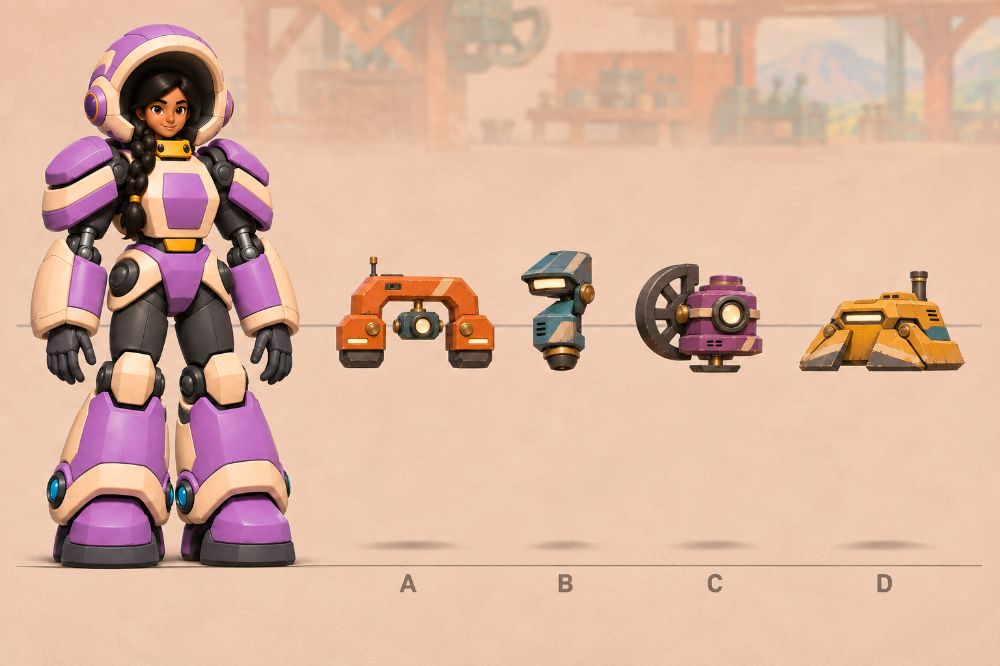
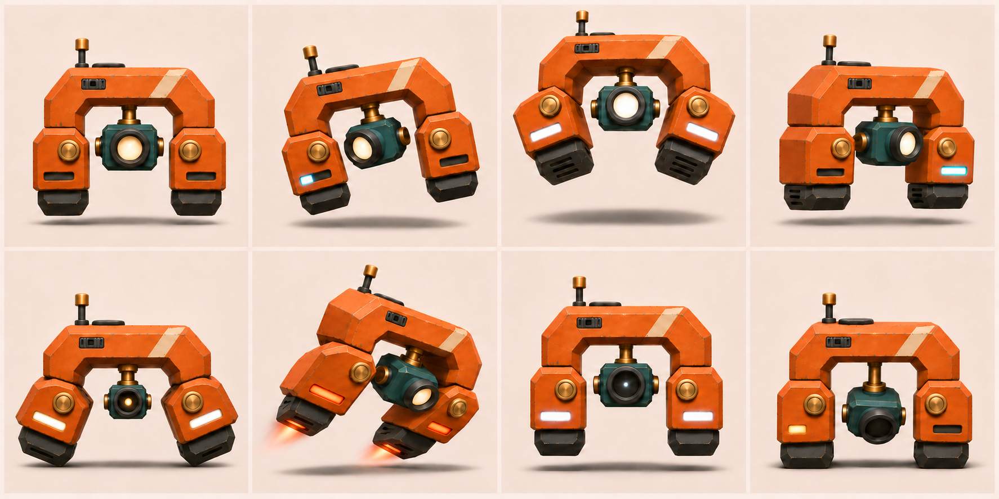
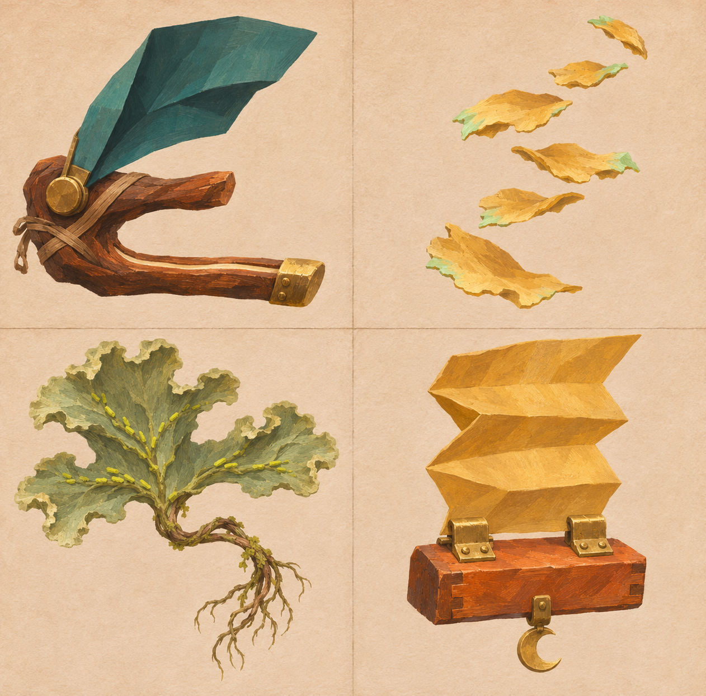

# The Moth’s companion

## Round three

**Rivet** is a hovering inspection gantry from the canyon workshops. A
little camera on a brass gimbal hangs in the open bay between two heavy
lift shoes. The camera looks first, the frame follows, and the two cheek
plates swing wide when Rivet wants the Moth to stop. It has the manner of
a surveyor who wants you to see what it just found.

The owner found Pip too close to EVE and asked for something more
original than a generic happy robot. Knotwhistle went too far toward a
nature object, and the owner rejected its indicators. Rivet takes the
heavy plates, visible joints, and readable poses of the brief’s Firefall,
Mega Man, and MechWarrior touchstones. Canyon orange enamel, scuffed
edges, a cream stripe, and brass pins put it in the same workshop as the
gallery’s pivoting sunshades. The machine is recognizable even when
every lamp is off. [Canyon workshop direction](../valley-and-gallery.md#selected-art-treatment)

### Four robot concepts

The four machines share a roughly 0.48 m height beside the 2.06 m suited
Moth. Read the silhouettes first, then look for the part that tracks a
target and the part that could signal a change of mind.
[Moth concept pack](../moth-concept-pack/README.md)

| Concept | Silhouette and character | Originality and tradeoff |
| --- | --- | --- |
| **A · Rivet** | Wide squared arch, two lift shoes, and one hanging camera in a clear opening. It peers around corners and physically widens to warn. | Its load-bearing arch gives it an outline distinct from EVE’s pod, BB-8’s stacked balls, the Ghost’s radiating shell, Navi’s orb, and a quadcopter’s four rotor arms. The camera and cheeks can convey independent intent. **Selected.** |
| **B · Stile** | Upright offset survey cassette, a hinged horizontal visor, and one gimballed bell. It cranes its head like a meticulous inspector. | The stepped elbow and exposed hinge interrupt EVE’s smooth contour. The flat visor and offset deck give it edges absent from BB-8 and Navi, a clear up and down unlike the Ghost’s radial shell, and a single thrust axis instead of rotor arms. Its narrow view from behind gives the state lamps little room. |
| **C · Spindle** | Short tiered cylinder next to an exposed flywheel, with one lens and a flat skid. It steadies itself before it takes a reading. | The off-centre vertical reel gives it an asymmetric outline unlike EVE or the Ghost. The rigid stepped drum and flat skid separate it from BB-8’s rolling body and Navi’s orb. The enclosed lift system leaves the flywheel as a side mechanism distinct from a quadcopter rotor array. The reel competes with the eye for attention. |
| **D · Wedge** | Low trapezoidal path tender with two folding plow cheeks, a visor slit, and a short exhaust stack. It shoulders into the wind. | Faceted plow armor and a squared exhaust give it a different mass from EVE, BB-8, and Navi. Its forward sweep gives it one clear direction unlike the Ghost’s radial shell. The two cheeks fold around a single hull, giving it a continuous perimeter unlike a four-arm drone. It reads as protective immediately, but has a narrower emotional range at rest. |

Rivet’s open bay gives the eye a readable silhouette against the
background. It also lets a builder give the eye an eager look while the
body stays still. The shoes and flat roof keep the side view identifiable
when the bay foreshortens.

### Character and scale

Start at about 0.48 m tall including the antenna, 0.63 m across with both
cheeks tucked, and 0.19 m deep. The two charcoal shoes give it stable
contact when parked. In flight, leave clear space beside the Moth and
bring the optic to around elbow height for a conversation. The bridge
carries a small front grille and the antenna opposite its cream stripe.
The camera has one circular iris and a rear heatsink. Brass pins show
where the gimbal pitches and where the outer cheek plates swing. Each
plate closes over a fixed bearing housing above the shoe. The shoes
have side vents and downward-facing nozzles.

The optic usually gets to a point before the hull has finished turning.
When curious, Rivet eases into a shallow roll and holds the head cocked
for a beat. When it finds something, it bobs up and swings both cheeks
out. When it really means stop, it brakes low, holds the bridge square,
and spreads those plates across the path. Its expression comes from
these changes in weight, timing, and aperture. [Turnaround](r3-02-turnaround.png) ·
[Scale with the Moth](r3-03-scale.png)

### Integrated light language

Read left to right across the top, then the bottom. The words below name
the implementation states. In play, the glance, hop, lead, brace, bank,
hold, and sag carry their meaning. The inset bars reinforce those moves
with the number of lit sides, lit area, and timing. The iris signals
where Rivet is looking and how hard it is concentrating.

| State | Colour | Light pattern | Motion | Mechanical pose |
| --- | --- | --- | --- | --- |
| Idle | Dim warm ivory | Soft iris only. Both bars dark. | Barely perceptible hover drift. | Level bridge, neutral gimbal, cheeks tucked. |
| Interest | Pale blue-white | One short lit segment on the side it checks, with a soft double swell. | Glance first, then slow roll and hold. | Asymmetric tilt, gimbal cocked a little farther than the bridge. |
| Discovery | Bright warm white | Wide iris and both full bars swell together once, then hold briefly. | One buoyant hop and a soft settle. | Both cheeks flare in a high, open stance. |
| Objective | Turquoise | One full-length strip on the destination side, held steadily on approach. | Turn, lead a little way, then check back. | Tucked travel stance, with the camera pointed down the route. |
| Danger | Gold-white | Both bars fill once on entry and hold. Iris contracts. | Quick brake and a low lateral block on the safe side. | Bridge square, both cheeks spread into a wide brace, shoes low. |
| Combat | Ember red-orange | Both bars lit with one short accent on the change of direction. Lift vents brighten under load. | Fast lateral bank with thrust directed back and down. | Cheeks swept with the lift, lens pitched into the turn. |
| Locked target | Cold white | Small, hard iris point and two full steady bars. | Tracks the target without bob or scanning. | Square and level at a clear flank, cheeks vertical and camera aligned. |
| Low energy | Dim amber | One short ember, separated by long pauses. Iris darkens. | Gutter once, descend, then stay down. | Both shoes planted and the camera hanging nose-down. |

The authored cue picks one state from live conditions. Immediate danger
takes precedence, followed by a forced landing, lock, combat, objective,
discovery, ordinary low energy, interest, and idle. Hold a danger cue
through consecutive ticks. For reduced motion, shorten the hop and bank
while retaining the stance, light placement, and held warning. Interest
uses a crooked inquisitive hold. The objective cue keeps a full light on
the direction of travel. That distinction survives even when the two
colors look alike.

### Speech and marking

The small dark grille on the bridge is the speaker. An amber segment
wakes on onset, the full grille lights on a stressed syllable, and the
cavity goes dark at a rest. A tiny nod at the gimbal can underline the
stress. The iris keeps its aim and the cheeks can keep a warning through
the line. Feed the grille from the scheduled speech intervals so it still
reads with muted audio. Clear it on interruption or crossing. The mixer
already exposes the schedule as `TextSpeechSource.Schedule`. The hookup
from a companion utterance to this grille belongs in the prototype.
[Speech sequence](r3-05-speech.png) · [Speech source](../../../../src/Puck.Audio/Mixing/TextSpeechSource.cs)

For a gallery exhibit, Rivet stops short on the reachable side, holds
the near strip steady, and puts a narrow beam from the iris onto the
control. It traces a small pool on the surface so the hit reads from the
player’s angle. In the open valley it can hover over a ground point and
dip its head toward it. For a moving lock it holds a visible flank away
from the Moth’s aim. Danger cancels the beam and brings Rivet back onto
safe ground to block the approach. [Gallery marking](r3-06-gallery-mark.png) ·
[Valley danger](r3-07-valley-danger.png)

The destination’s authored cue must resolve a single live, visible local
target for the requesting player. The approach, aim, and surface hit use
that result together. Clear the hit on occlusion, invalidation, or a
crossing. Let the world’s existing companion custody carry identity and
durable permissions. Each host decides what its instance can mark. Keep
each companion’s lights on its own body lanes and keep the projected
guidance visible to its requesting player. A second player’s beam and a
mark cached on another server would both give the Moth a false direction.
[Companion custody](../../../decisions/companions.md) ·
[Companion guidance](../../../../worlds/standard/companion.puck) ·
[Diegetic marking](../../../decisions/play.md#in-world-consoles)

### SDF build plan

1. **Block out the bay and landing shoes.** Use a chamfered `Prism` with
   a through-cut for the fixed bridge. Preserve enough thickness over
   the opening for real depth in side view. Put a rounded prism on each
   cheek and a dark chamfered box beneath each. Blend around fixed seams
   within a group. Build the gimbal stem, bearings, and lens rim from
   cylinders. Use a recessed circular inset for the optic. Paint the
   stripe and small seams on the frame, with broad enamel wear
   concentrated along corners. Check the CPU mesh preview from each side
   against the turnaround and both shoes against a common rest plane.
2. **Rig the hinges and aim.** Keep the bridge, camera gimbal, cheek
   plates and any counter-tilting shoes in their own bake groups wherever
   their motion separates. Use parented swings for the gimbal and armor.
   Start with about 25° of gimbal pitch, 30° of yaw, and 35° of cheek
   travel outward. Judge clearance at both extremes and resize the
   existing companion flight collider for the flared pose. Check that
   banking and braking agree with the actual direction of thrust.
   [Rig authoring](../../../../.claude/skills/sdf-authoring/references/rig.md)
3. **Put the cues in the materials.** Use a per-look emission lane for
   the iris, one for each recessed cheek strip, and one for the grille.
   Give each light a recessed emissive material slot. Use bounded paint
   masks to shape the emitting areas. Check per-body tint and mask
   control on two independent companions before relying on them. Use
   short mechanical shutters for discrete iris and strip widths if
   needed. Author the cues on the simulation tick and verify that cue
   changes reuse the mesh and affect only the matching companion.
   [Paint and emission](../../../../.claude/skills/sdf-authoring/references/surface.md#render-lanes)
4. **Reuse the standard companion.** Extend the authored look and the
   existing `companion{owner}-guide` path for the approach. Check
   `point-designation-tests.puck` for target registration and
   `flashlight.puck` for directed light. Give the mark a lens origin and
   a surface hit from one visibility check. Confirm in the lab that the
   beam disappears behind a wall and stays absent until the new instance
   resolves a local hit. Compare two viewers before enabling marks in a
   shared gallery. If the mark renderer lacks a per-view or clipped
   projection path, resolve that in its owning system before wiring it
   into multiplayer. [Point designation](../../../../worlds/debug/point-designation-tests.puck) ·
   [Directed light](../../../../worlds/standard/flashlight.puck)
5. **Prove it from the player’s camera.** Give the companion a focused
   debug lab reached from the gallery and reuse the Moth and the
   standard companion there. Compile the authored document with
   `puck compile --validate`. In the settled lab, cycle all eight cues
   once bakes have finished, `world.residency` reads `all-landed`, and
   the lighting has settled. Play a moving chase in daylight and at
   dusk. Repeat with hue removed, speech muted, and reduced motion. A
   first-time viewer should be able to describe the action without
   labels. Walk the gallery mark
   and valley warning in the debug world and cross with a mark active.
   Check that a second local or remote viewer gets their own guidance and
   that the companion takes up its destination’s cue after landing.
   [SDF authoring checks](../../../../.claude/skills/sdf-authoring/SKILL.md#verifying)

### Round-three panel audit

The table records the artist’s pass. The checking partner’s independent
pass is pending. [Review criteria](../README.md#concept-art-review) ·
[Built-in ImageGen prompts](r3-prompts.md)

| Panel | Artist’s verdict |
| --- | --- |
| [Exploration](r3-01-exploration.png) | Pass. Four outlines read at matched scale. Their exposed mounts look seated and the neutral hover poses agree with the common plane. Moth keeps her open hood, side braid, and heavy boots. The pale guide runs behind the figures. |
| [Turnaround](r3-02-turnaround.png) | Pass. The pin supports the teal box in each view and the cheek pivots line up with both lift shoes. The back shows the grille and the reversed antenna and stripe. The side and three-quarter views preserve the shallow depth and solid bay walls. |
| [Scale](r3-03-scale.png) | Pass. The two placements show a supported rest and clear hover space. The Moth’s boots share the baseline and there is daylight between her plates and Rivet’s. Its hanging gimbal, antenna and shoe pair read in both poses. |
| [States](r3-04-states.png) | Pass. The open bay and attached eye persist through the eight poses. Shadow separation shows the hop and grounded rest. The wide brace and banking thrust distinguish danger from combat. A small point in a rigid hold reads differently from the open bright iris at the top of a hop. |
| [Speech](r3-05-speech.png) | Pass. The matched framing fixes the bridge and shoe contacts while the gimbal nods on its stem. Amber appears inside the same grille in each voiced frame. The light stays quiet elsewhere, and the rest leaves the grille dark. |
| [Gallery marking](r3-06-gallery-mark.png) | Pass. The ray joins the hanging iris to the real control and terminates on its surface. Rivet’s stance and scale leave space beside the Moth, whose open hood and grounded boots agree with the perspective. The light and shadows sit in the same room. |
| [Valley danger](r3-07-valley-danger.png) | Pass. The cheeks flare on their pins with the soles below them. Rivet holds on the safe side of the rockfall and its shadow is separated from the shoes. The Moth braces on both boots. The falling dirt and rocks give the warning an immediate cause. |

### Round-three open questions

- The lead’s checking partner should audit the seven images before they
  become modeller references. The artist’s pass covers stills. The lab
  pass settles recognition in motion, especially interest versus
  objective and discovery versus lock in glare and from behind.
- The prototype builder should check the four body lanes, per-body tint,
  grille timing from a world cue, and the lens-to-hit presentation with
  two viewers. These determine the smallest reusable change to the
  authored look or the renderer.
- The lead should try the warning and camera clearance in play before
  settling the width of the flare and the escort height. Keep the first
  low-energy behavior a short rest. An interactive recharge can wait for
  that play decision.

## Round two

The owner's verdict on Pip was “a decent start, but I'd like it to be more
inspired! It looks too similar to EVE from WALL-E in my opinion, generic happy
bot vs original new idea; I want the latter.”

**Knotwhistle** is a living fork of Gallery wood fitted with a brass hinge
and a sail of waxed paper. The Moth carries a little piece of the Gallery
with her. When Knotwhistle has something to show her, it flies there on a
short arc and turns its sail towards her. When it speaks, light opens and
closes along a reed in the cleft of the wood.

The Gallery tree gives it its branching shape and warm timber. Its opening
sail borrows the broad fold and visible pivot of the Gallery's sunshades.
The valley's pollinators supply the dart, hover and settle. Bioluminescence
gives the reed and paper distinct ways to light up. Firefall, Mega Man and
MechWarrior inform the large parts, visible hardware and pose that make an
object readable at a distance. The fork and folded paper make this one
specific to Puck.
[Valley and gallery](../valley-and-gallery.md#selected-art-treatment) ·
[Gallery tree](../gallery-tree-pack/README.md) ·
[Gallery inspiration](../gallery-inspiration-pack/README.md)

### Four directions

Read the sheet at thumbnail size with the lights mentally removed. The
test is whether the outline and its first motion could be mistaken for EVE
or a stock drone.

| Concept | What it is and how it reads at a glance | What decided it |
| --- | --- | --- |
| **Knotwhistle**, upper left | A living instrument with a wooden fork for a resonator. The long lower prong, open gap and single paper sail read as a branch carrying a flag. Even edge-on, the cap and heel carry a handmade wood-and-brass profile. In broadside the EVE or stock-drone read falls away immediately. | The cleft gives speech a clear source and the sail works as a signal flag. A few solid parts and one hinge carry both functions. **Selected.** |
| **Spore Choir**, upper right | Six independent spores make a flying chorus. The staggered stack reads as windborne flakes at thumbnail size. A tight formation could merge into one luminous blob at chase range, which is where the stock-orb reading returns. | Formation can draw a superb marker, but a line of speech has no natural mouth and a crowd of companions would multiply moving points. |
| **Lichen Kite**, lower left | A grown lichen frond that sails root-first, then unfurls its fan of light-bearing veins. The flattened scallops, trailing roots and crooked stem give it the immediate read of a leaf or ray, well away from EVE. | Strong organic shape in broadside. Edge-on it loses both silhouette and cues, and its many glowing veins leave the mouth and selected point hard to locate. |
| **Foldbell**, lower right | A clockwork trail stamp that hoists an accordion pennant. Open, it reads as a mechanical flag and hanging clapper. Folded, it looks like a small hovering parcel and could briefly read as a utility drone. | Excellent for marking a place. In transit its folded state loses the shape that makes it recognizable, and the clapper competes with the speech light. |

Knotwhistle keeps its identity with the light off and can show a warning
while it speaks. The sail's thin edge is the weak angle. Address it with
the way the companion banks and presents itself, and judge the result at
the player's camera before thickening the sail.

### Character, silhouette and scale

The silhouette has three large masses. The low chestnut fork splits from
one thick heel into a long, brass-shod tine and a shorter bare tine. The
upper tine sits a little farther back in depth so a three-quarter view
still catches the gap and the reed. A single dark teal paper sail rises
from the heel, its two facets meeting at one deep fold. One transverse
brass pin and a broad saddle make the attachment visible. Paint the tan
cross-wrap over the heel and keep a small raised knot for the close view.
Use satin brass, varied chestnut planes and matte paper with a stronger
value break at the fold. [Turnaround](r2-02-turnaround.png)

Start at 31 cm from heel to toe and about 25 cm high with the sail raised,
roughly a gauntlet in length beside the 2.06 m suited Moth. Float outside
her shoulder and leave a gap between the sail and her silhouette. Give it
the manner of an attentive pollinator. It darts in a shallow arc, feints
once when curious and then settles, holding the sail broadside when it has
something to show. The fork holds its shape as the body pitches. The sail
lags a little on takeoff and opens against the motion as the body brakes.
When worried, it draws closer and holds still.
[Scale sheet](r2-03-scale.png) · [Moth reference](../moth-concept-pack/README.md)

### Light language

Ink the cue into the same broad face on either side of the teal sail. One
shape stays recognizable throughout its pulse. Give each cue a visible
brightness floor and a broad stroke, and keep the interior of open symbols
dark. The reduced-motion option holds the pose and shapes steady. Test the
symbols from a moving chase camera in daylight and at night, then repeat in
grayscale and under common colour-vision simulations. A player should be
able to tell a ring from a diamond and a triangle from two chevrons in a
single still, before rhythm can help. The sheet shows the peak shapes in
this order, left to right across each row. Rhythms are starting values.
[Light-language sheet](r2-04-light-language.png)

| State | Colour and shape | Rhythm and body cue |
| --- | --- | --- |
| Idle | Warm ivory short horizontal dash | Gentle three-second breath at the Moth's shoulder. |
| Interest | Cyan pair of upright strokes | Two soft swells, then hold. Tip toward what drew its attention. |
| Discovery | Mint open circle | One smooth rise, then hold. Stop over the exhibit's approach. |
| Selected objective | Gold open diamond | Slow two-second swell. Lead to a reachable approach and wait. |
| Locked target | Ice-blue four square corners | Steady while valid. Track the target's visible flank. |
| Combat | Violet double chevron | Two rounded accents on entry, then hold. Take a watch position off the Moth's shoulder. |
| Immediate danger | Coral upright outline triangle | One quick rise and a steady hold. Brake on the safe side and turn broadside. |
| Low energy | Amber solid square | Slow three-second swell at lower intensity. Shorten excursions and settle closer to the Moth. |

The authored cue rule picks one sail cue per companion. Immediate danger
wins, then a forced rest, then player lock, combat, objective, discovery,
ordinary low energy, interest and idle. A higher-priority cue can suspend a
mark. Validate the target again before resuming it. Keep the shape readable
through each transition and avoid repeated brightness spikes if danger or
combat is asserted on consecutive ticks.

### The speaking reed

Set a shallow, dark groove into the inner ledge of the lower tine. Speech
opens an ivory oval in the groove. Onset has a short narrow oval, vowels
widen it, release draws it into a thin line, and spaces and punctuation let
the groove rest. Its placement inside the open fork lets the light read as a
mouth even though the wood is still. Turn slightly to show the inner ledge
while speaking. The sail can hold a warning throughout a line.

Drive the reed from the voice's scheduled boundaries so it follows the
same line when audio is muted, and clear it immediately on cancellation or
world crossing. Give reduced-motion mode a compact steady oval for each
voiced interval. Reuse the timing from `TextSpeechSource`. The existing
HUD speech feed supplies scheduled speech. A per-companion hookup has
to deliver that schedule to the presenting body and its emitter.
[Speech sequence](r2-05-speech.png) · [Text speech](../../../reference/audio.md#text-speech)

### Marking a place or body

For an exhibit, take a short arc to the reachable side of the plinth. Hold
the brass toe over its lip and put a mint ring on the surface. One short
mint thread joins toe and ring on arrival. The Moth sees the route, the
object and the mark together. For an objective, use the same approach with
a diamond on the sail and a diamond on the landing surface. A moving lock
uses the four corners on the sail and the companion's position at the
target's visible flank. Keep that hover clear of the target and the
player's aim. Danger interrupts the excursion, clears its surface mark,
and brings Knotwhistle back across the player's path on the safe side of
the hazard with its triangle held upright.
[Gallery mark](r2-06-gallery-mark.png) · [Valley danger](r2-07-valley-danger.png)

Every displayed mark must resolve to the current owner's live, local
target. The destination's authored cue rule owns target validity and the
placement check owns the clear path to the hit. Position, glyph and thread
use that same validated result. Clear the mark when a target despawns,
becomes occluded or changes generation. An unreachable approach can show
interest near the Moth. With many players in a hall, drive the sail from
its own body and show the projected mark only to the requesting player.
This keeps another player's objective from reading as yours.
[Point designation example](../../../../worlds/debug/point-designation-tests.puck)

The Moth's companion travels under the existing custody rules. A world
can accept its pinned driver or author its own. An authored world can
award an enduring behaviour, such as reading a moon's survey cairns.
Persist the declared unlock with Knotwhistle's identity and let each host
decide how to use it. A surface hit, target generation and line in progress
belong to the current instance. After crossing, the destination can resolve
a new local mark. At MMO scale this gives each host one clear decision and
keeps a stale target or an arriving driver from claiming another world or
player's points of interest.
[Companion custody](../../../decisions/companions.md) ·
[Standard companion role](../../../../worlds/standard/companions.puck)

### Build and prove the design

1. **Block out the fork and sail.** Shape the heel with a `Superellipsoid`
   and blend two tapered, rounded `Prism` tines into it. Soften the inside
   of the fork with a rounded cutter where the tines meet. Cut a shallow
   rounded groove into the lower tine and seat a contrasting reed within
   it. Fit the brass toe over the long tine. Make the pin with a
   `Cylinder` and the saddle with a rounded box. Join two thin extruded
   `Prism` profiles along the sail fold and attach the sail to the pin as
   one rig part. Start with about 15 degrees of travel either side of the
   rest pose. Check both limits against the upper tine and the Moth's
   shoulder. Validate the prototype offline, then compare its broadside,
   top, heel and three-quarter views to the turnaround after it settles.
   [SDF authoring](../../../../.claude/skills/sdf-authoring/SKILL.md) ·
   [Rigging](../../../../.claude/skills/sdf-authoring/references/rig.md)
2. **Paint state and speech on fixed geometry.** Give the sail and reed
   separate palette slots. Author local-coordinate distance masks for
   the sail strokes and an expanding oval for the reed. Bind the cue
   index, cue envelope, reed width and speech envelope per body. Select
   the index discretely and ease the other lanes. Replace the existing
   `companion-glow` fixed-body sample with each companion's own cue
   binding. In the lab, place two guides beside each other, change their
   cues independently, and look for any intervening glyph or fresh bake.
   Hold a danger triangle through a short spoken line, then mute, cancel
   and cross mid-line. The reed should follow the schedule and clear
   without disturbing the triangle.
   [Render lanes](../../../../.claude/skills/sdf-authoring/references/surface.md#render-lanes) ·
   [Current glow rule](../../../../worlds/standard/companion.puck)
3. **Extend the existing free-flight driver and point designation.** Keep
   bank and sail poses visual. Reuse the driver for arrival, avoidance
   and follow, and prove an actual plinth target, a reachable objective
   and a moving lock. Put an emissive ring or diamond on the resolved
   surface and try a short volume from the toe during arrival. Hide it
   when the hit fails. In the lab, change or despawn a lock, occlude a
   plinth and trigger `companion.threat` during an excursion. Check that
   the mark clears and the triangle appears on the safe side. Then pass
   through the lab's Gallery portal and through a federated crossing
   with an authored unlock. The unlock should survive. Each mark should
   follow its own host's target and clear on departure.
   [Current driver](../../../../worlds/standard/addons/companion.wat) ·
   [Shape-mounted volumes](../../../../.claude/skills/sdf-authoring/references/surface.md#volumes)

### Panel audit

Seven panels passed the artist's written audit below. The checking
partner's independent verdict is pending. Use the turnaround and scale
sheet for proportions and the scene panels for placement and light.
[Review criteria](../README.md#concept-art-review) ·
[Built-in ImageGen prompts](r2-prompts.md)

| Panel | Artist's verdict |
| --- | --- |
| [Exploration](r2-01-exploration.png) | Pass. Four silhouettes stay legible at the same viewing size. Knotwhistle and Foldbell show seated hinges and continuous contact between the parts. The grown frond leads into one connected root and the six independent spores hold coherent stagger and depth. There is no Moth or moving joint at an extreme to check. |
| [Turnaround](r2-02-turnaround.png) | Pass. The wood, cross-wrap, long shod tine and short bare tine stay recognizable. The heel view shows the two ends of the single axle mounted to the saddle. The thin top view follows the sail fold and passes over the laterally offset tines. The neutral pose clears the wood and the air gap stays open. |
| [Scale](r2-03-scale.png) | Pass. The boot soles agree with the ground plane and her relaxed arms leave the joints in range. Her right-cheek braid, brown skin, ivory hood rim and lavender plates match the Moth reference. The small fork, pin and fold remain continuous off her shoulder, with clear air between the two silhouettes. |
| [Light language](r2-04-light-language.png) | Pass. All eight views share the same neutral pose, wood, pin and sail. Each mark stays on the same facet. The filled area, gaps and stroke count distinguish the shapes with hue removed. |
| [Speech sequence](r2-05-speech.png) | Pass. Four matched poses keep the joint, shoe and fork gap fixed. The oval and line stay on the inner ledge and change width without spilling into the gap. The rest shows the naturally pale inset with its light off. |
| [Gallery marking](r2-06-gallery-mark.png) | Pass. The fork and pin read at the little guide's intended scale. The toe connects to a foreshortened ring on the plinth and the soft shadow leaves an air gap. The Moth's planted stance, braid, open hood and layered plates carry through under the same warm tree light. |
| [Valley danger](r2-07-valley-danger.png) | Pass. The small fork hovers on the Moth's side of the rockfall with visible air below it. Its attached sail holds a hollow triangle broadside. Her bent knees track over planted boots and her near cheek carries the braid out of the open hood. Rock, path, shadows and figures agree with the same view and sun. |

### Open questions

- The checking partner should inspect all seven sheets against the art
  audit before the builder takes them as references.
- The lead's settled companion lab pass should establish how large the
  sail and reed need to appear at chase range. Use moving daylight and
  dusk passes, especially edge-on at a turn and during speech and danger
  together. Repeat with reduced motion and colour removed.
- The design can use a short rest in the first build. The owner can decide
  after play whether helping Knotwhistle recharge should become an action.

## Earlier round

### The Moth’s seed lantern

Pip is the working name for a palm-sized guide that looks as if the Gallery’s
sunshades and seedpods shared a workshop. An ivory ceramic hood peaks over a
smoked teal lens and a tapered teal keel. Two ochre fins sit on round pivots,
like seeds split from the same pod. The lip around the lens is thick enough to
read even with the light off. Use broad satin surfaces, colored shadows and
slight edge wear. Keep the dark joints clean and the light inside the lens.

Start at 24 cm from hood to nozzle, about 12% of the suited Moth’s 2.06 m
height. Pip travels beside her outer shoulder, clear of her face, hands and
view of the path. The fins fold a little with acceleration and open when
braking. The body leans into a dart, eases into a stop and hangs almost still
when listening. Pip has the manner of a curious workshop assistant. It cocks
its hood at a sound, makes a buoyant hop on discovery, and goes still and
square to the Moth when worried. The Moth decides where they go.
[Moth concept pack](../moth-concept-pack/README.md) ·
[Canyon workshop direction](../valley-and-gallery.md#selected-art-treatment) ·
[Gallery tree pack](../gallery-tree-pack/README.md)

### Panels and review

The retained panels passed the artist’s written audit for attachment, joint
range, pose, turnaround agreement, perspective, seams and character facts.
A checking partner’s review is pending. The two first scene drafts made Pip
read as a larger machine, so both were regenerated. [Generation prompts](prompts.md) ·
[Concept art review](../README.md#concept-art-review)

| Panel | Artist’s verdict |
| --- | --- |
| [Turnaround](01-turnaround.png) | Pass. Four views hold the hood, matching hinge heights, attached fins and keel on one body. The vents stay in back and the lens stays in front. The aligned views show the neutral hinge pose with room for a small swing. |
| [With the Moth](02-with-the-moth.png) | Pass. Pip is about one eighth of the suited figure and clears the open glove. Both boot soles share a plane and her hips support the pose. The hood, single braid, gauntlets and suit colours carry her identity. The companion matches the turnaround at hand range. |
| [Light language](03-light-language.png) | Pass. All eight front views keep both fins and their pivots fixed. The marks stay within the recessed lens and have distinct outlines at the same angle and scale. |
| [Speech aperture](04-speech-aperture.png) | Pass. The hinge pose, contours and front camera stay fixed. The light opens and closes inside the lower lens with no added jaw or moving seam. |
| [Gallery discovery](05-gallery-discovery.png) | Pass. Both fins read as attached in three-quarter. The vertical beam joins the nozzle to a ring that lies on the plinth plane. The gap, scale against the plinth and shared daylight make the hover believable. |
| [Valley danger](06-valley-danger.png) | Pass. The small seed silhouette and triangle stand clear of the path. The fins stay on their hinges, the body is near upright at the stop, and its shadow places it on the near side of the rockfall. |

### Options

| Direction | What it offered and what decided it |
| --- | --- |
| Seed lantern | The hood, keel and two fins make a readable outline in silhouette. A shaded lens keeps cues legible and gives it a face that can speak through light. It fits the planted Gallery and echoes the Moth’s thick shell over dark joints. |
| Wind-up survey crab | Twin feelers and a pair of folding landing claws give it a comic gait and a convincing perch. The legs and tool heads crowd a 24 cm outline and start to read as a small utility vehicle. |
| Floating spore | A luminous bud with a trailing leaf could tilt and unfurl expressively. Backlight and bloom erase too much of the form, and a bright body offers poor separation between an expression and a warning. |

### Light language

Every cue has a stable shape. Brightness shifts gently above a visible floor,
so one frame can convey the state and a second glance can confirm the rhythm.
The art shows peak shapes. The timings below are starting values for play.

| State | Colour | Pattern and rhythm | What Pip does |
| --- | --- | --- | --- |
| Idle | Warm ivory | Low smile, soft three-second breath | Hovers beside the Moth, fins relaxed |
| Interest | Cyan | Horizontal dash, one gentle swell then hold | Turns toward something it has noticed |
| Curiosity | Lilac | Vertical dash, two soft swells then hold | Cocks the hood and leans closer |
| Point of interest found | Mint | Open-centred circle, one outward swell then hold | Short arc to the active exhibit and a surface ping |
| Selected quest objective | Gold | Open-centred diamond, slow two-second rise and fall | Leads to a reachable approach, then hovers or perches |
| Combat or danger | Orange | Upright outline triangle, quick rise then hold | Brakes on the safe side and turns back to the player |
| Locked target | Ice blue | Four square corners, steady until lock changes | Takes a position off the visible target’s shoulder |
| Low energy | Amber | Small low dot, slow three-second fade with a visible floor | Shortens excursions and heads for a rest socket |

Resolve one main cue per body in this order. Danger, energy low enough to
force a return, player lock, selected objective or active player mark,
discovery, curiosity, interest, idle. An existing target stays selected while
an urgent cue takes the lens. Resume it only after validating it again. A
player mark keeps whatever lifetime the world assigned it.
[Play decisions](../../../decisions/play.md#in-world-consoles)

**Speech.** Open a small ivory aperture low on the lens in time with the
utterance. Take the same scheduled events as the voice. The aperture narrows
at onset, opens at the vowel, contracts on release and rests through spaces
and punctuation. Reserve the lower lens for the mouth while speaking and move
the low-energy dot above it. Idle yields to the mouth. Replace or cancel the
utterance and its light together, including on handoff. A muted mix still
follows the schedule. The guide already speaks
authored text, and its synthesizer schedules text units. An emitter that
shares those event boundaries with a body’s mouth is a required connection.
Longer recorded lines can supply authored syllable events on the same
presentation timeline. [Text speech](../../../reference/audio.md#text-speech)

Use aperture size and the fins for expression. An excited line gets a fuller
opening and a lift, a confidential line a small opening and a slight lean, and
a worried line a still body with shorter openings. Keep the mouth local and
low contrast, especially during fast speech. Offer a reduced-motion setting
that holds cue shapes steady and retains a compact speaking aperture. Shape,
placement and pose carry meaning when hue is unavailable. Test actual frames
for contrast, bloom and repeated flashes. No accessibility claim has been
verified in play. [W3C guidance on use of color](https://www.w3.org/WAI/WCAG22/Understanding/use-of-color.html) ·
[W3C guidance on flashes](https://www.w3.org/WAI/WCAG22/Understanding/three-flashes-or-below-threshold.html)

### Marking the world

At the Gallery, Pip makes a short arc toward the near edge of an exhibit and
waits there. A brief, close-range beam from the keel connects it to a ring on
the plinth. A quest objective can use the same approach and settle into a
tapered pedestal socket with its fins tucked. A player ping briefly marks the
surface the player chose. For a moving lock, Pip traverses a shallow arc at
the target’s flank so the Moth keeps a clear view of what she’s following.
Danger breaks the excursion and puts Pip on the player’s side of the hazard.

The marker’s invariant is that Pip points to a live, locally resolved target
or clears the mark. The world’s cue rule validates the target and reachability
before it names the destination. The marker placement stops emitting when
that resolution or the beam’s clear path fails. Pip can turn toward a last
known direction with the interest dash. The body’s cue belongs to its owner’s
intent and binds per companion, so a crowd can have different cues in the same
hall. Private journal details stay with the player. On a crossing, the
destination resolves the cue from its own data. Keep lasting facts such as
name and affinity in the declared identity. Targets, beam hits and speech
phase belong to the current instance.
[Companion custody decision](../../../decisions/companions.md#state-that-persists-is-declared)

At hand range, the rim, fin pivots, mouth and cue geometry should all read.
At chase-camera range, favor the dark lens and thick strokes. Farther out,
use the body’s position and the surface mark first. Return closer to signal an
urgent warning if the small lens no longer reads. By day, keep the inset
shaded so the glyph survives bright ochre and sky behind it. At night, lower
emitted light and spill enough to keep the dark centre of a ring visible and
the ivory body legible. Judge those transitions in motion.

### Build and check in the debug world

Prototype the cues and movement in a focused companion lab linked from the
Gallery. Use the full debug world for the lead’s composition pass through the
Gallery and valley. Judge motion and light once the scene has settled.

1. Sculpt the hood as one flared `Superellipsoid` and relieve it with a round
   opening. Set a shallow, dark lens inside the lip. Shape the keel with a
   tapered `Prism`, cut the rear vent slots and put a short cylinder under
   it for the nozzle. Reuse the same rounded fin profile under two mirrored
   cylinder hinges. Give the fins a small rig range so they clear the shell
   at both extremes. Validate the prototype and inspect each view in the
   turnaround and the open and closed fins in motion. [SDF authoring](../../../../.claude/skills/sdf-authoring/SKILL.md)
2. Give the lens its own palette slot. Use a curved `Sweep` footprint for
   the idle smile, rounded profiles for the bars and mouth, and bold strokes
   for the ring, diamond, triangle and lock brackets. Paint those masks on
   the lens in an authored `shade` using its object coordinates. Let body
   lanes carry the world’s selected cue, cue envelope and speech aperture.
   Use a discrete body-state read for the cue and ease the envelope. Check
   each glyph against the sheet and switch twice between distinct states
   while watching for an intervening glyph or a new bake. The current
   prototype reads one glow lane. Its `companion-glow` rule samples body 42,
   while the companion’s grants name `companionBody`, which resolves to 52
   in the debug world. Replace that fixed sample with the cue’s own body.
   [Current prototype](../../../../worlds/debug/companion.puck) ·
   [Senses and glow](../../../../worlds/standard/companion.puck) ·
   [Body render lanes](../../../../.claude/skills/sdf-authoring/references/surface.md#render-lanes) ·
   [Authored shading](../../../../.claude/skills/rendering/references/authored-shading.md)
3. Extend the existing driver’s nearby exhibit and threat cues. Keep the
   visual pose separate from the colliding body. Resolve player choices
   through the existing target registers. Start with a real Gallery plinth
   and the authored `companion.threat` input in the valley. At the plinth,
   hover at a defined height above a surface ring. Try a small spotlight
   and a nozzle-mounted `flow` volume gated by the ping’s envelope. Check
   that the ring lands on the selected surface, clears on occlusion, follows
   a changed lock, and survives day and night.
   A portal crossing during an excursion should drop the source mark and
   resolve a valid cue on arrival. [Existing driver](../../../../worlds/standard/addons/companion.wat) ·
   [Point designation](../../../../worlds/debug/point-designation-tests.puck) ·
   [Shape-mounted volumes](../../../../.claude/skills/sdf-authoring/references/surface.md#volumes) ·
   [Gallery lighting](../../../../worlds/debug/gallery/gallery.puck)
4. Connect a short authored line to speech and its light aperture. Capture
   onset, vowel, release and a punctuation rest in a presented pass. Repeat
   while muted, on cancellation and during danger, with the triangle still
   readable. At close and chase range, identify each steady cue in grayscale
   and with colour-vision simulation. The lead owns the lab and composition
   checks. Per-body voice sync, quest and lock wiring, and camera-range
   readability remain unverified.

### Open product question

The first implementation can treat low energy as a reason for shorter trips
and a brief rest. Should recharge later become something the Moth actively
helps with, or stay part of Pip’s routine?

### References

- Ocarina of Time makes the target marker a companion with a place in the
  scene. Pip uses that relationship when it moves alongside a selected body.
  [Nintendo’s interview with the developers](https://iwataasks.nintendo.com/interviews/3ds/zelda-ocarina-of-time/1/3/)
- Firefall uses Battleframes to make mobility part of the suit’s identity.
  Pip’s fins likewise suggest how it moves. [Red 5 Studios](https://red5studios.com/our-games/)
- Mega Man 11’s Robot Masters make character readable through a few large
  forms. Use Block Man as a study in proportions. [Capcom](https://news.capcomusa.com/mega_man/blog/2018/05/29/gear-up-for-mega-man-11-available-october-2nd)
- MechWarrior’s MechLab presents machines as serviceable assemblies. Here
  the single exposed hinge per fin makes that idea visible at toy scale.
  [Piranha Games’ MechWarrior 5 manual](https://cdn.akamai.steamstatic.com/steam/apps/784080/manuals/MW5Mercs_Game_Manual.pdf)
- Puck’s Gallery studies place small discoveries where circulation, planting
  and exhibits meet. The plinth scene borrows that relationship and the
  restrained glow of occupied places. [Gallery inspiration pack](../gallery-inspiration-pack/README.md) ·
  [Gallery tree pack](../gallery-tree-pack/README.md)
