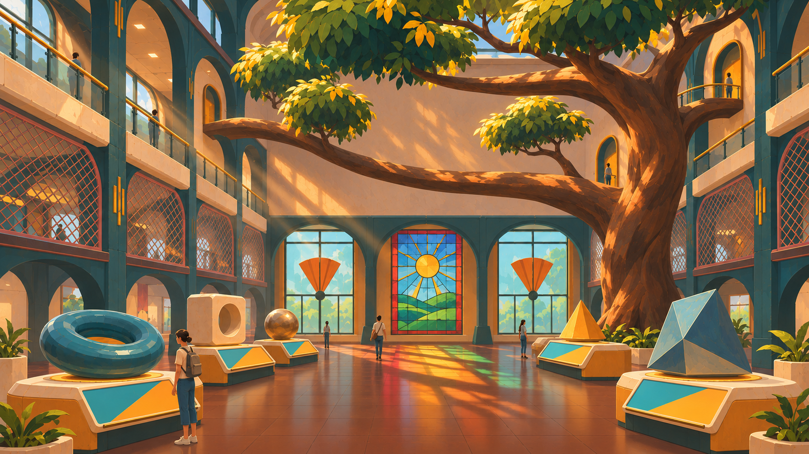
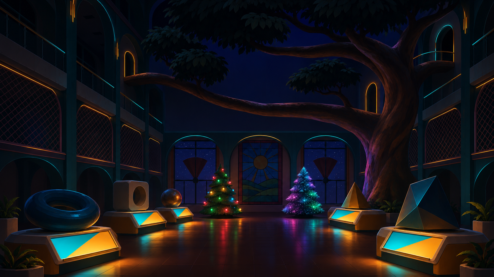
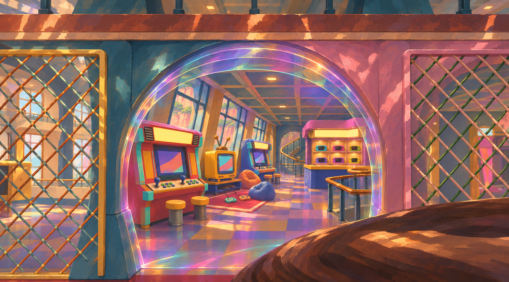
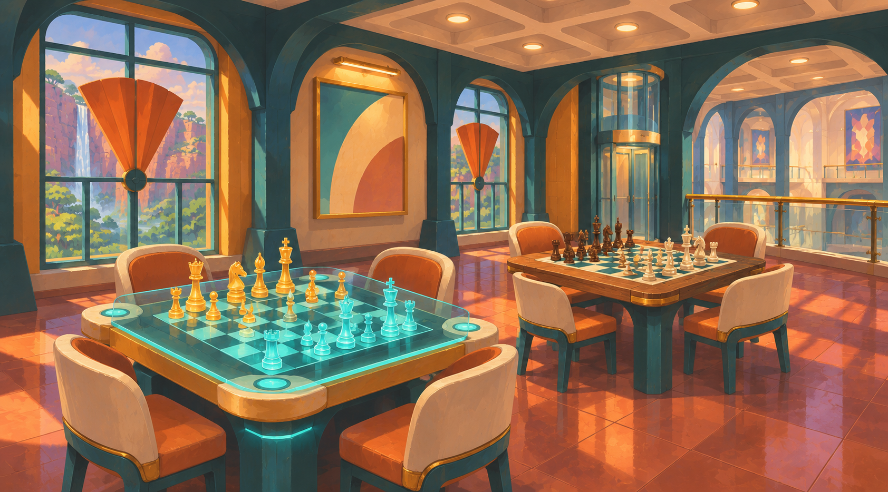
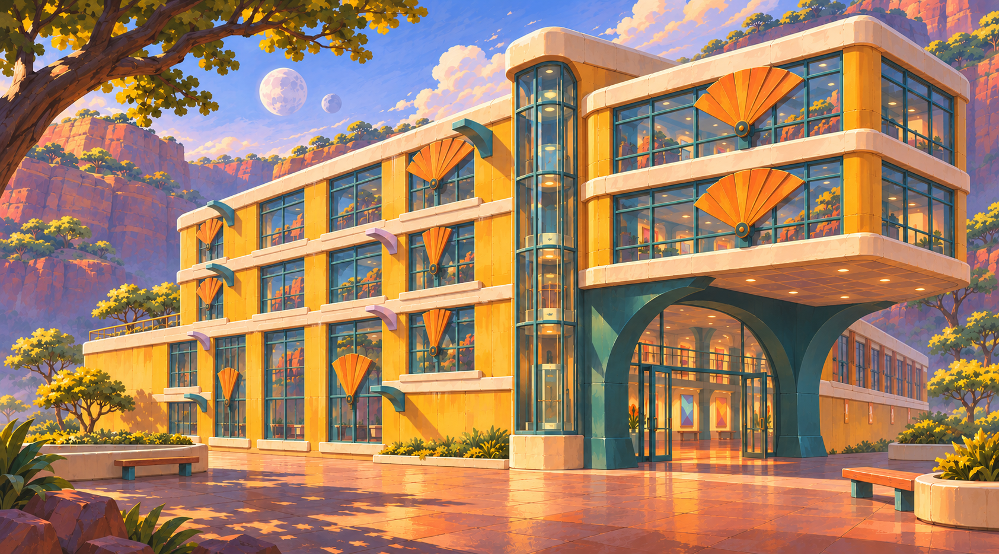
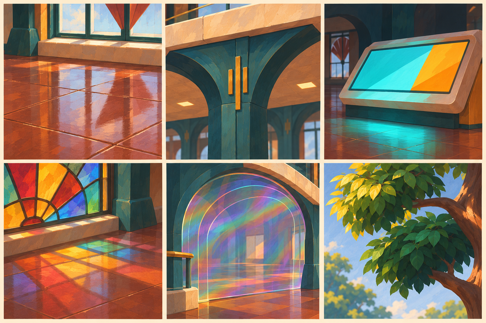

# Gallery fidelity paintings

Six landscape paintings develop the [selected valley-and-gallery direction](../valley-and-gallery.md) from the supplied live captures and [Canyon workshop baseline B](../valley-and-gallery-concepts/canyon-workshop.png). They propose the gallery's next visual target before implementation. The [gallery guide](../../../../worlds/debug/gallery.md) owns its layout; these paintings establish light and material intent, rather than measured construction. [Complete prompts and references](prompts.md) · [Artist review](review.md).

**[The nave by day](nave-day.png).** The four-storey hall keeps its tree, branching routes, netted toybox, upper balconies and display stations. Carry over grouped green-and-gold foliage, warm shafts against teal shade, the single-screen consoles, and calm terracotta reflections. It needs coloured light transmitted through stained glass with lead shadows, soft reflections that preserve grout, foliage shading with lit edges and dark cores, and atmospheric scattering confined to sunlit air.

**[The nave at night](nave-night.png).** The same view goes dark with the hall lights off: screens pool light before their stations, classic bulbs sparkle on one fir, and fine fibre-optic tips colour the other. Carry over the dark intervals, restrained neon and protected emitter colours; the stained glass stays dark against the night sky. Emissive surfaces must light nearby surfaces with falloff, occlusion and bounce, reflect softly in the floor, and support authored colour cycling at the fibre tips.

**[The toybox, level 1](toybox.png).** A tree-branch approach looks through the magical arch into the netted playroom, with two-player cabinets, a TV and beanbags, and a cubby-lit rental kiosk beside the guarded stair. Carry over the cheerful tiles, blank glowing marquees, tactile rounded housings and clear routes. The rainbow barrier needs layered transparent films, interference colour and refraction with the room visible behind; screens and cubby lights need local illumination that agrees with their visible brightness.

**[The board game room](board-game-room.png).** A glowing digital chess table sits beside a physical chess table within the gallery's windowed upper wing. Carry over the transparent bevelled tabletop, light within the board, warm tactile chessmen on the neighbouring table, inviting seats and distinct material responses. It needs readable game imagery through layered glass, controlled reflections, luminous edges that light their supports, and contact shadows grounding the tables and chairs.

**[The exterior](exterior-golden-hour.png).** Golden-hour light gives the four-storey facade depth, with two glazed floors projecting over the tall teal arcade and the lift beside the entrance. Carry over deep window pockets, overlapping fan leaves on attached pivots, cream bevels, ochre panel joints and restrained weathering beneath sills. It needs authored surface variation and roughness, glazing that combines canyon reflection with interior depth, and warm indirect light under the arcade while preserving its cool shadows.

**[Material and light studies](material-and-light-studies.png).** Read the six close studies left to right, top row then bottom: polished floor, pier spring, screen on cream, stained-glass transmission, magic film and leaf clumps. Match the scale of variation, broad highlights and soft reflections rather than adding uniform noise. Together they ask for material-specific roughness, continuous shaded junctions, emissive bounce, coloured glass transmission, layered refractive films, and foliage volumes with readable whole-leaf silhouettes.

