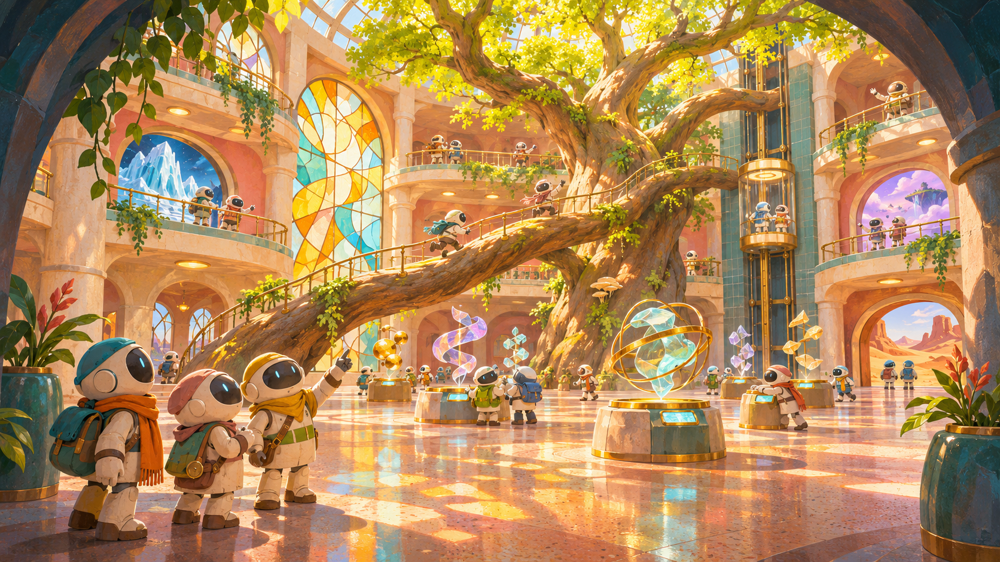
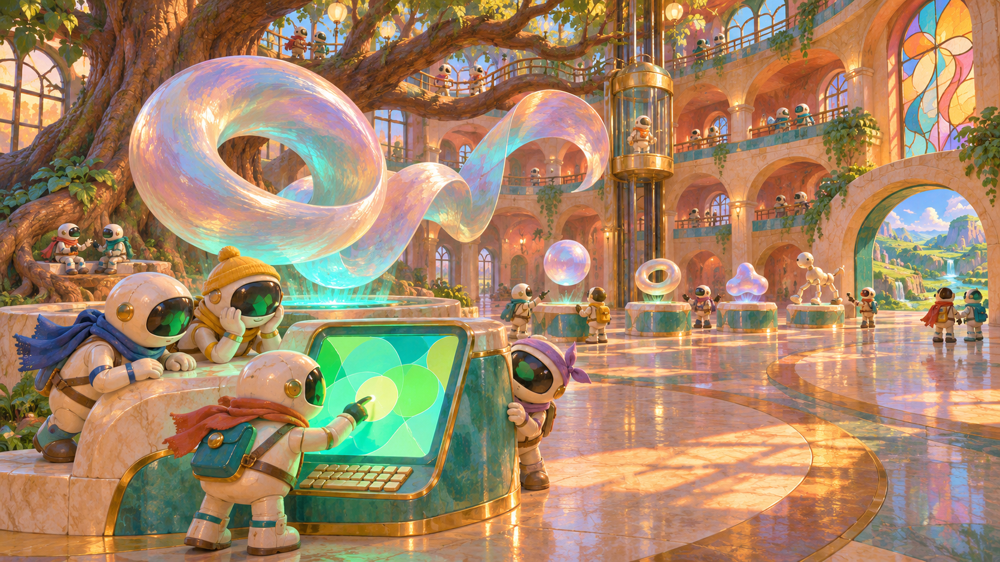
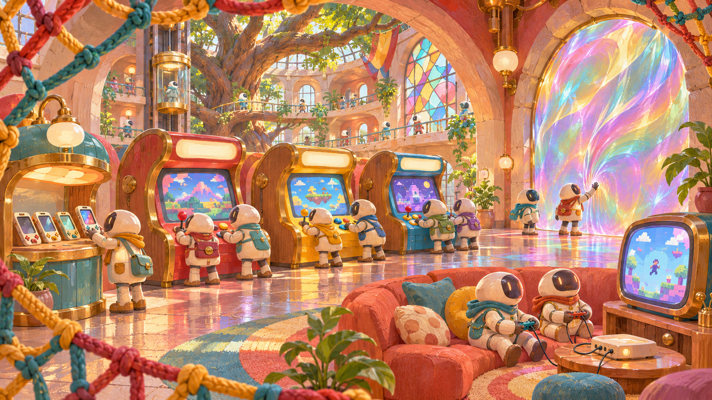
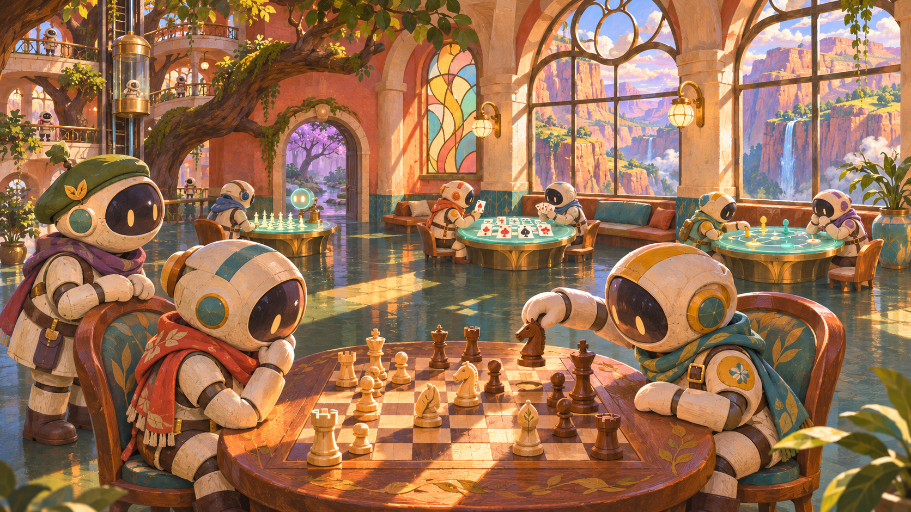
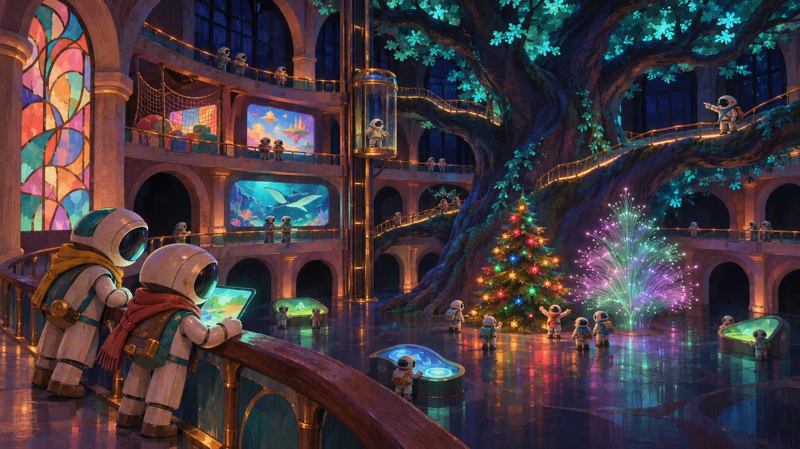
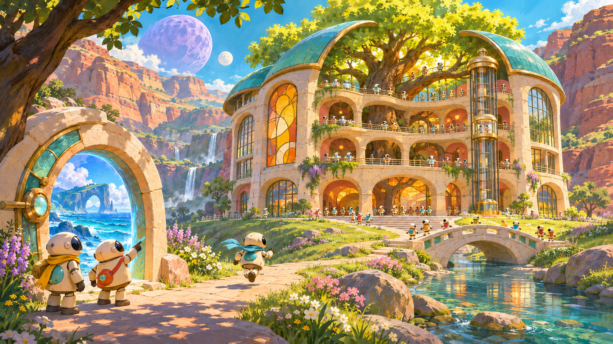
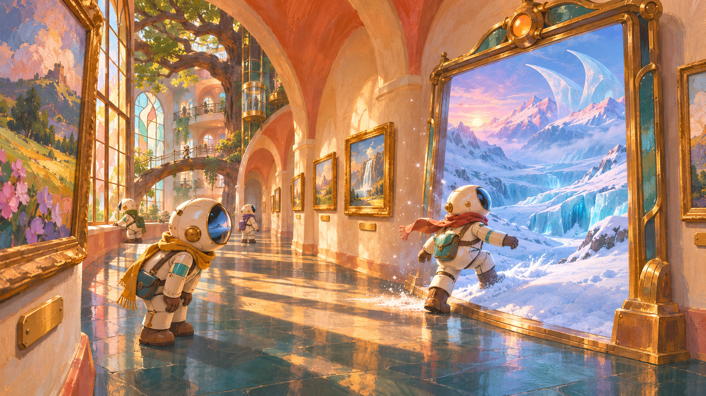
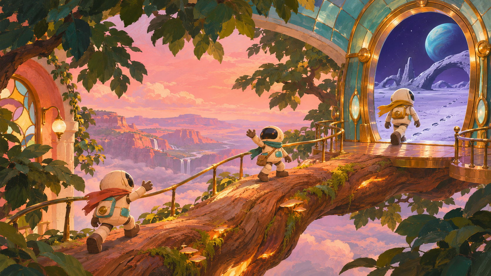

# Gallery inspiration pack

Eight original landscape paintings propose a warm, handmade future where a museum, arcade, and treehouse become one place to explore. They were painted from the written brief without viewing repository images. These are art proposals for the game to follow. The complete generation prompts are in [prompts.md](prompts.md).

## The tree is the staircase

Make circulation the hall's great attraction: broad living boughs carry explorers between sunlit arcades, while a glazed lift offers another way up. Players can see friends, exhibits, and other worlds above them, so the next destination is something they notice and choose.

## Someone found the secret

A morphing pearlescent sculpture makes one player's experiment a spectacle for the whole group. The console sits low enough to gather around, with a tucked-in keyboard inviting a closer look; discovery spreads through watching someone else try something.

## Just one more game

Treat the toybox as a shared living room behind bright knotted netting, with paired arcade controls, borrowed handhelds, and a sofa for longer games. The rainbow membrane gives the room an unanswered question that can draw even a busy group away from its screens.

## A game by the canyon window

Give tabletop play a room worth lingering in: carved wooden chess pieces in a shaft of sunlight, softly glowing digital tables, and enormous canyon windows. The physical and digital games share the same hospitable furniture scale, making competition feel like spending time with friends.

## The building teaches itself to glow

Let screens, luminous foliage, fine guide rails, and seasonal trees turn the hall into a constellation of occupied places. Classic colored bulbs and airy fiber-optic tips have different characters; reflections and lit visors reveal where people are gathering without washing the whole room in light.

## The canyon keeps a treehouse

A split turquoise roof opens around the living crown, giving the Gallery a silhouette players could recognize from across the valley. The stream, footbridge, tiny balcony crowds, nearby ocean portal, and visible moons make arriving feel like choosing the first of many possible adventures.

## The picture that has weather

Let one apparently framed landscape become a walkable glacier world among ordinary paintings and quiet plaques. A boot in snow and a few crystals drifting onto the warm floor teach the difference through a small, surprising action, rewarding the player who looks closely.

## The last branch goes to the moon

Reward the climb with a canopy path whose final doorway meets a moon's dusty ground. Warm canyon dusk, friends waving on the branch, and a cold planetary horizon make the journey feel both impossibly large and as immediate as taking the next step.
