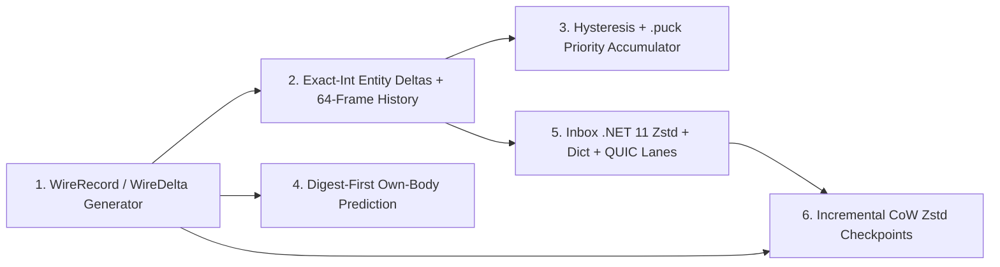

# Wire and replication research (Gemini)

Puck's simulation model combines four properties that rarely appear together in shipped multiplayer engines: one deterministic fixed-point (`FixedQ4816`) world per authority, content-addressed caches, disclosure-filtered streams per observer, and worlds federated through portals. This report audits Puck's current wire and checkpoint formats, surveys shipped engines and compression practice against those four properties at MMO scale, and ranks six Puck-native designs to guide the wire-records generator ([code size](../code-size.md#1-wire-and-checkpoint-records)) and the replication protocol that follows it.

## Executive summary

Puck's current wire is ahead of common game prototypes in safety—every decoder uses a bounded, non-throwing reader (`WireReader`) with explicit refusal names and strict trailing-byte checks—but behind shipped engines in bandwidth, CPU sharing, prediction, and code generation. Moving bodies are serialized whole as lossy `float` render snapshots whenever any field changes; submission unions fall back to reflection-based UTF-8 JSON; checkpoints encode full synchronous images on the tick thread; interest management is a plain distance filter with no hysteresis or byte budget; and the QUIC transport multiplexes all traffic onto one reliable stream.

The strongest finding of this round is that Puck's existing architecture already holds most of the primitives needed to surpass conventional engines rather than merely copy them:

1. **Exact fixed-point deltas replace lossy quantization for simulation state.** Because `FixedQ4816` is an integer lattice, integer deltas against an acknowledged baseline shrink moving poses by 3× to 5× with zero precision loss, so reconstructed continuation records hash bit-identically. Presentation-only observers use exact power-of-two bit shifts on `FixedQ4816`—quantized once globally per tick, as Unreal Iris does—so presentation baselines also stay deterministic across CPUs.
2. **A single Roslyn incremental generator closes three bug classes and removes thousands of lines.** Generating `WireWriter`/`WireReader` codecs, delta masks, array-cap guards, and `IContinuationSection` folds from attributed C# records closes read/write-order drift, forgotten fields, and missing caps at compile time while eliminating delegate indirections and reflection JSON.
3. **Deterministic client prediction needs only an 8-byte digest on the happy path.** `WorldBodySections` already partitions a body's complete deterministic continuation, and `WorldPopulation.AppendContinuationHash` already folds per-slot digests. Sending that 8-byte digest in `WorldInputAnswer` proves bit-exact prediction with negligible overhead, paired with compact exact deltas of `WorldBodySections` for 1-RTT reconciliation on real divergence.
4. **Zstandard is already inbox in Puck's .NET 11 runtime.** Inspecting the local `.NET 11.0.0` reference assembly (`System.IO.Compression.dll`) confirms `ZstandardEncoder`, `ZstandardDecoder`, `ZstandardStream`, and `ZstandardDictionary` ship in the base class library—removing the third-party native-dependency concern raised in earlier plans for desktop and silo hosts (while `Puck.World.Browser` negotiates a fallback because .NET 11 marks Zstandard unsupported on `browser-wasm`).

**Build first:** the Roslyn incremental `[WireRecord]` / `[WireDelta]` generator in `Puck.Analyzers`. Every other design—compact body deltas, own-body prediction continuations, fixed-point neighbour contact packets, and incremental checkpoints—becomes a declarative record rather than hundreds of hand-written lines once that generator lands.

---

## Audit of Puck's current wire and checkpoints

Every citation below was opened directly in the current tree (`file:line` leads verified against HEAD).

### Transport and framing (`Puck.Networking`)

- **Bounded reader and writer.** `WireReader` (`src/Puck.Networking/WireCodec.cs:81-557`) is a `ref struct` over `ReadOnlySpan<byte>` that latches the first `WireFailure` instead of throwing, makes subsequent reads inert, and enforces exact consumption via `TryFinish` (`:542-556`). `WireWriter` (`:575-789`) mirrors it over `LittleEndianWriter`. Both `ReadArray` (`:149-169`) and `ReadOptional`/`ReadOptionalClass` (`:384-405`) take a `WireReadItem<T>` delegate per call—an indirect call per optional or repeated field, with byte-aligned booleans (1 byte each, `:204-215`) and fixed-width 32-bit counts and 64-bit fixed-point values (no bitpacking, no varints, no compression).
- **Single reliable QUIC stream, no datagrams.** `QuicPeerTransport` (`src/Puck.Networking/Peers/QuicPeerTransport.cs:14-17, 38, 212, 228-229`) accepts `MaxInboundStreams = 1` per connection and reports `MaxDatagramBytes => 0` because `System.Net.Quic` exposes no RFC 9221 datagram API. Large document frames, state deltas, and frequent snapshots share one ordered stream, creating head-of-line blocking under packet loss.

### Federation and entity replication (`WorldFederationCodec`, `WorldBodyHistory`, `WorldInterestFrame`, sinks)

- **Whole-entity float rewrites.** `WorldFederationCodec.WriteEntity` (`src/Puck.World.Server/WorldFederationCodec.cs:948-973`) and `ReadEntity` (`:192-287`) write every field of `EntitySnapshot` (`src/Puck.World.Protocol/Protocol/WorldSnapshot.cs:98-113`) as raw uncompressed scalars: `Vector3 Position` (12 B float), `Quaternion Orientation` (16 B float), `float Heading` (4 B), `Vector3 BodyColor` (12 B float), `Active`/`Kit`/`Look`/`CatalogRig`/`Continuity.Kind` (5 B), `Continuity.Seconds` (4 B), optional `WorldPoseCarry` (32 B), `Generation` (4 B), nullable `PlacementId` string, `Facts` (4 B), and `State` registers (4 B count + 8 B per slot). That is **70 bytes minimum** per entity before `PlacementId`, `Carried`, or `State` registers (typically 100–140 B for a populated avatar).
- **All-or-nothing entity skipping.** `WorldBodyImage.Encode` (`src/Puck.World.Server/WorldBodyHistory.cs:19-37`) compares `(held with { State = entry.State }) == entry && held.State.Span.SequenceEqual(entry.State.Span)` (`:28`). If a body moves by one millimeter, the codec rewrites its color, kit, look, rig, generation, placement ID string, facts, and entire register array.
- **Short baseline history ring.** `WorldBodyHistory` (`src/Puck.World.Server/WorldBodyHistory.cs:44-85`) stores `PendingDeliveryLimit = 8` snapshots (`src/Puck.World.Server/WorldFederationProjectionSink.cs:28`). At the default 30 Hz remote update cadence (`UpdateSeconds = 0.03f` in `src/Puck.World.Schema/WorldObserverDisclosure.cs:33`), 8 snapshots cover only ~267 ms of in-flight ack latency; any round-trip or jitter spike beyond that expires `m_ack` and forces a full body table resend.
- **Inline JSON and repeated strings in snapshot tails.** `WorldFederationCodec.WriteSnapshotTail` (`src/Puck.World.Server/WorldFederationCodec.cs:975-1024`) writes `delta.Region`, `delta.FieldName`, and `delta.Image.Key.Value` as full UTF-8 strings on every `FieldCellDelta`, and serializes `delta.Observation` as inline JSON (`JsonSerializer.SerializeToUtf8Bytes`, `:986-987`).
- **Whole-document delivery on structural edits.** `EncodeDocument` (`src/Puck.World.Server/WorldFederationCodec.cs:438-478`) serializes the whole `Replica` definition or `Presentation` projection as compact JSON with no compression, capped at `WireLimits.MaxDocumentBytes = 64 MiB` (`src/Puck.Networking/WireCodec.cs:563`).
- **Distance-only interest filter.** `WorldInterestFrame.Project` (`src/Puck.World.Server/WorldInterestFrame.cs:83-120`) queries a `FixedSweepGrid` and evaluates `WorldObserverDisclosureEvaluation.Discloses` (`src/Puck.World.Protocol/Protocol/WorldSnapshot.cs:215-236`): `All`, `SelfOnly`, or a single `Radius` sphere around the observer's own body. There is no hysteresis band, no unembodied camera anchor (`observerIndex < 0` returns nothing under `Radius`, `:220-222`), no priority accumulator, no per-packet byte budget, and only one global `UpdateSeconds` cadence per world (`WorldObserverDisclosure.cs:33`).
- **Two parallel delivery sinks.** `WorldSessionSink` (`src/Puck.World.Server/WorldSessionSink.cs:16-590`) and `WorldFederationProjectionSink` (`src/Puck.World.Server/WorldFederationProjectionSink.cs:24-378`) duplicate disclosure-cursor stepping, cut handling, and snapshot redaction (`docs/plans/code-size.md:418-426`).

### Submissions and peer completions (`WorldSubmissionCodec`, `WorldPeerWireFormat`, `WorldWireCodec`)

- **Mixed hand-written binary and reflection JSON.** `WorldSubmissionCodec` (`src/Puck.World.Protocol/Protocol/WorldSubmissionCodec.cs:81-1600`) hand-codes binary writers and readers for `WorldCommand` (16 discriminants, `:184-309` and `:970-1111`), `WorldGrant` (`:345-373` and `:1124-1170`), `WorldSessionLever` (`:397-433`), `WorldRebuildRequest` (`:495-573` and `:1253-1311`), `WorldScreenOp` (`:574-608` and `:1331-1367`), and `WorldDesignation` (`:1573-1591`). Meanwhile, `WorldMutation` (81 kinds), `WorldComposition`, `SessionRequest`, and `WorldQuery` fall back to `TryEncodeJsonUnion`/`TryDecodeJsonUnion` (`:644-795`) over a reflection-enabled `DefaultJsonTypeInfoResolver` (`:98-109`).
- **No own-body continuation in input acks.** `WorldWireCodec.TryWriteInputAnswers` / `ReadInputAnswers` (`src/Puck.World.Protocol/Protocol/WorldWireCodec.Input.cs:79-106`) sends only `WorldInputAnswer(Principal Owner, ulong Epoch, uint Sequence, ulong Tick)` (`src/Puck.World.Protocol/Protocol/WorldInputPublication.cs:42`). `WorldSeatInput` (`src/Puck.World.Client/WorldSeatInput.cs:22-26`) tracks edge sequences for input-lead guesses, not deterministic physics prediction.
- **Hand-written completions.** `WorldPeerWireFormat` (`src/Puck.World.Protocol/Codecs/WorldPeerWireFormat.cs:21-777`) encodes `MutationOutcome` by converting `OperationId` (`Guid`) and `Actor` (`Principal`) to UTF-8 strings (`:738-739`) and parsing them back (`:556-577`), repeating field layouts across writer and reader.

### Checkpoints, replays, and machine state transfer

- **Full, uncompressed, tick-thread checkpoints.** `WorldAuthorityCheckpointCodec.Encode` (`src/Puck.World.Server/WorldAuthorityCheckpointCodec.cs:54-92`) writes all 13 sections unconditionally into one uncompressed buffer (up to `MaxCheckpointBodyBytes = 128 MiB`, `:37`), computes a `sha256-64` hash over the whole body, and runs synchronously under `row.Server.AuthorityGate` inside `WorldSiloHost.TryCaptureRow` (`src/Puck.World.Silo/WorldSiloHost.Checkpoints.cs:219-252`), triggered simultaneously for every row by `CaptureRowsArmedByCadence` (`:85-152`).
- **Segment digests exist but are not yet used for incremental storage.** `WorldPopulation.HashSegmentSlots = 32` (`src/Puck.World.Server/WorldPopulation.Checkpoint.cs:12`) and `WorldAuthorityCheckpointCodec.FoldContinuationSegments` (`src/Puck.World.Server/WorldAuthorityCheckpointCodec.Population.cs:84-96`) already fold active slots into 32-slot segment digests, and `WorldBody.HeldDigests` (`src/Puck.World.Server/WorldBody.Sections.cs:160-198`) caches section digests behind versioned holders—yet `EncodePopulation` (`WorldAuthorityCheckpointCodec.Population.cs:227-280`) still writes every entry whole.
- **Concrete bugs found in hand-written checkpoint codecs during this read.**
  - `EntryAdmissionSection.Read` (`src/Puck.World.Server/WorldEntrySections.cs:130`) casts `reader.ReadByte()` directly to `WorldDisclosureTier` without validating `Enum.IsDefined`, bypassing `WorldWireLeaves.ReadDisclosureTier` (`src/Puck.World.Server/WorldWireLeaves.cs:19-26`).
  - `WorldAuthorityCheckpointCodec.ReadArena` (`src/Puck.World.Server/WorldAuthorityCheckpointCodec.Arena.cs:51`) casts `r.ReadByte()` to `ArenaColumn` without an `Enum.IsDefined` check.
  - `WorldAuthorityCheckpointCodec.WriteArenaKey` (`src/Puck.World.Server/WorldAuthorityCheckpointCodec.Server.cs:10-22`) allocates a temporary `new byte[value.Length * 2]` per key and encodes raw UTF-16LE instead of UTF-8.
  - Multiple checkpoint collections (`WorldAuthorityCheckpointCodec.Population.cs:346`, `WorldBodySections.cs:571, 628, 726`, `WorldEntrySections.cs:114, 119`) use the catch-all `MaxCollectionCount` (`1_000_000`) rather than tight domain caps like `WorldBodiesLimits.CapacityCeiling` (4096), and none check `count * minBytes <= reader.Remaining` before allocating (unlike `WorldReplaySnapshot.Codec.cs:76-183` and `WorldWireCodec.Input.cs:48, 94`).
- **Existing single-list prior art.** `IStateTransfer` (`src/Puck.Machines/IStateTransfer.cs:14-41`) and its struct implementations `StateSaveTransfer` (`src/Puck.Machines/StateSaveTransfer.cs:5-33`) and `StateLoadTransfer` (`src/Puck.Machines/StateLoadTransfer.cs:5-33`) prove the single-field-list pattern for mutable emulator components, including unmanaged `Block<T>` bulk copies. `WorldPopulationEntryCheckpoint.VisitSections` (`src/Puck.World.Server/WorldPopulationEntryCheckpoint.cs:52-75`) applies the same visitor pattern at the section level for checkpoints and continuation digests, while each individual section (`WorldBodySections.cs`, `WorldEntrySections.cs`) still hand-writes `Write` and `Read` separately.
- **Mesh store codec (`SdfMeshStoreCodec`).** `SdfMeshStoreCodec.EncodePayload` (`src/Puck.SdfVm/SdfMeshStoreCodec.cs:151-168`) uses `ZLibStream(CompressionLevel.Fastest)` over byte-plane-delta positions, 16-bit octahedral normals, and index deltas—corresponding directly to finding 11 in [the state-of-the-art audit](../state-of-the-art/audit.md#11-the-mesh-store-codec).

### Disclosure invariants the wire must uphold

From [the disclosure plan](../disclosure.md#what-is-guaranteed-and-to-whom) and [decision 5](../disclosure.md#5-a-delta-is-a-difference-of-views-owned-by-the-stream), any wire optimization must preserve tick-granularity noninterference:

- A recipient's delivery count, byte sizes, stream ordinals, document versions, and change masks must be functions of that recipient's `WorldRecipientView` alone.
- Baselines and change masks belong to the recipient's own stream (`WorldDeliveryCursor` and `WorldBodyHistory`), never to authority-global dirty flags that could leak whether a withheld field or entity changed.
- Content-addressed fetches (`WorldProjectionPrototypeFetch.FetchAsync`, `src/Puck.World.Server/WorldFederationCodec.Observation.cs:74-122`) must remain gated by whether the recipient's current disclosed view references that `ContentPin`.

---

## 1. Change masks, bounded quantization, and exact Q48.16 deltas

### What shipped engines do

| Engine / System | Field change tracking | Quantization & packing | Baseline & sharing |
|---|---|---|---|
| **Quake 3 / ioquake3** (`msg.c`) | Flat `netField_t` table; 1-byte `lc` (last changed index) truncates trailing unchanged fields; 1 bit per field up to `lc`. | Per-field bit widths (`bits`); 0 means full 32-bit word; static Huffman table on top (`MSG_WriteBits`). | Delta against client's last acked snapshot ring (32 snapshots). |
| **Tribes** (Frohnmayer & Gift) | 32-bit per-ghost dirty `StateMask` grouping logically coupled fields (e.g., position + velocity share one bit). | Manual bitpacking in `packUpdate`/`unpackUpdate` per dirty mask bit. | GhostManager tracks per-client bitmask of unacked dirty bits; lost packets OR bits back into the pending mask. |
| **Halo: Reach** (Aldridge) | Per-object dirty/state masks decoupled from one-shot events. | Aggressive bounded bitpacking per field type; compressed orientations; ~80% bandwidth cut vs Halo 3. | Eventual-convergence priority snapshots rather than monolithic all-entity snapshots. |
| **Overwatch** (Ford) | ECS component-granularity diffs isolated to three networking systems. | Component-specific quantization and bitpacking. | Per-client acked baseline snapshots for delta compression. |
| **Unity Netcode for Entities** | `[GhostField]` source-generated component change bitmasks. | `[GhostField(Quantization = N)]` scales floats to integers before delta + Huffman coding over small delta buckets. | Per-connection acked snapshot baselines; prediction and interpolation share the quantized grid. |
| **Unreal Iris** | Inlined `ChangeMask` bit arrays per `ReplicationFragment` + protocol-level combined masks. | `NetSerializer.Quantize` converts gameplay state to an internal quantized buffer **once globally**; `IsEqual` compares quantized buffers before dirtying; `SerializeDelta` packs diffs. | Quantized state is shared across all connections; delta baselines are per-connection. |
| **Gaffer on Games** (Fiedler) | Per-field presence/changed bits in a `BitWriter`. | Bounded-range integer quantization (`BitsRequired(min, max)`); **Smallest Three** quaternion (2-bit largest index + three 9–10 bit components = 29–32 bits). | Delta against client-acked baseline for positions; notes that raw quaternion deltas often span too wide a range over short windows compared to direct Smallest Three. |

### Where sources disagree

1. **Bit-level packing vs byte-aligned varints.** Halo: Reach, Quake 3, Fiedler, and Iris pack to exact bit boundaries, trimming 15–35% on dense small records. Byte-aligned formats (MemoryPack, Cap'n Proto, Puck's `WireWriter`) avoid bit-shifting overhead, support `MemoryMarshal` block copies, and preserve byte boundaries for downstream LZ77/zstd compressors. When downstream dictionary compression or entropy coding runs on byte-aligned deltas, much of the bit-packing advantage disappears—except for 1-bit booleans and change masks, which should always be packed into bitsets (`ulong`/`uint` mask words) rather than 1-byte-per-bool lanes.
2. **Per-field bitmasks (Quake 3, Iris) vs grouped state masks (Tribes).** Per-field masks minimize bytes when one field changes, but pay 1 bit per field on every touched entity. Grouped masks (one bit for `Pose`, one for `Appearance`, one for `Continuity`) cost only 4–8 bits per entity and match physical coupling (when `Position` changes, `Orientation` and `Heading` usually change too; `BodyColor`, `Kit`, `Look`, `CatalogRig`, and `PlacementId` almost never change after spawn).
3. **Quantize once globally (Iris) vs per connection (legacy UE / naive encoders).** At MMO scale (hundreds of observers seeing the same crowd), Iris's split—quantize each dirty entity once per tick into a shared quantized record, then diff/pack per connection—turns $O(N_{\text{obs}} \times N_{\text{vis}})$ quantization work into $O(N_{\text{entities}})$. Puck's `WorldInterestFrame.Capture` and `WorldInterestFrame.Changes` (`src/Puck.World.Server/WorldInterestFrame.cs:147-163`) already share encoded bytes across identical `(image, baseline)` pairs, so global quantization fits naturally.

### The Puck-native option: exact Q48.16 quantization and lossless integer deltas

`FixedQ4816` (`src/Puck.Maths/FixedPoint/FixedQ4816.cs:14-25`) stores a signed 64-bit integer scaled by $2^{16}$ ($1\text{ ULP} = 2^{-16}\text{ m} \approx 15.26\text{ }\mu\text{m}$). This gives Puck a clean two-domain design that eliminates `float` from the wire entirely while keeping hashes verifiable:

1. **Lossless exact integer deltas (for simulation state: own-body prediction, `Replica` tier, neighbour contact records, and checkpoints).**
   - Compute $\Delta r = r_{\text{cur}} - r_{\text{base}}$ in exact wrapping 64-bit integer arithmetic (`unchecked`), ZigZag-encode to unsigned (`(d << 1) ^ (d >> 63)`), and write with a compact width prefix (either LEB128/varint or a 2-bit width selector per vector: `00` = 0/unchanged, `01` = 8-bit, `10` = 16-bit, `11` = 32-bit or 64-bit escape).
   - **Worked arithmetic:** A character running at 6 m/s moves 0.20 m between 30 Hz snapshots = $13,107$ raw Q48.16 units. ZigZag-encoded, that is $26,214$—fitting in **16 bits (2 bytes)** per axis instead of 8 bytes (a **4× reduction with zero precision loss**). At 240 Hz, the delta is $1,638$ raw units (12 bits signed). Because reconstruction is exact integer addition (`base + delta`), the receiver's `FixedQ4816` bits are **bit-identical** to the authority's and hash identically under `Fnv1aHash`.
   - **Important quaternion subtlety (norm drift):** `FixedQuaternion` (`src/Puck.Maths/FixedPoint/FixedQuaternion.cs:8-9`) explicitly warns that rounded component multiplies allow the unit norm to drift by a few ULPs between renormalizations. Consequently, naive Smallest Three (dropping the largest component and reconstructing $w = \sqrt{1 - x^2 - y^2 - z^2}$) is **not** bit-exact for simulation continuation! For lossless continuation, encode the 4 raw Q48.16 component deltas ($\Delta x, \Delta y, \Delta z, \Delta w$): unit quaternion components lie in $[-65536, +65536]$, so a per-tick delta is typically within $\pm 4096$ (2 bytes × 4 = **8 bytes lossless** vs 32 bytes raw `FixedQuaternion` = **4× smaller, 100% bit-exact**).
2. **Exact power-of-two coarse quantization (for `Presentation`-tier remote bodies).**
   - Remote bodies in `Presentation` tier are interpolated for rendering, never fed into the observer's deterministic simulation. Shifting `FixedQ4816.Value` right by a fixed power-of-two $k$ (for example, $k = 6 \Rightarrow 2^{-10}\text{ m} \approx 0.98\text{ mm}$, or $k = 8 \Rightarrow 2^{-8}\text{ m} \approx 3.9\text{ mm}$) produces an exact integer coordinate $q = r \gg k$ with **zero floating-point arithmetic**.
   - **Exact integer Smallest Three for presentation orientation:** Map the three smallest components from $[-46341, +46341]$ ($\approx \pm 2^{16}/\sqrt{2}$) to signed 11-bit integers using pure integer scaling, pack `2 bits (largest index) + 1 bit (sign flip) + 3 × 11 bits` into a **36-bit** (or 10-bit × 3 = **32-bit**, $\approx 0.08^\circ$ error) word.
   - **Resulting entity delta size:** Group `EntitySnapshot` fields into an **8-bit grouped change mask**:
     - Bit 0: `Position` (3 quantized deltas; typically 3–6 B)
     - Bit 1: `Orientation` + `Heading` (32-bit Smallest Three + 12-bit quantized heading = 5.5–6 B)
     - Bit 2: `Facts` (16-bit `BodyFacts` mask = 2 B)
     - Bit 3: `State` registers (per-slot bitmask + ZigZag varint deltas; 0 B when unchanged)
     - Bit 4: `Continuity` (only set when `Kind != Continuous`; 0 B on 99% of ticks)
     - Bit 5: `Appearance` (`BodyColor` quantized 3×10-bit RGB = 4 B, `Kit`, `Look`, `CatalogRig`, `Active`; 0 B after spawn)
     - Bit 6: `Identity` (`Generation`, `PlacementId` interned table index rather than repeated string; 0 B after spawn)
     - Bit 7: `FullOrSpawn` (baseline creation)
   - For a steady moving body, the wire payload drops from **~100–140 B today** (`WorldFederationCodec.WriteEntity`) to **~12–16 B** (index varint + 1 B mask + ~5 B position delta + 6 B orientation/heading), a **6× to 9× reduction before any stream/dictionary compression**, while remaining 100% integer-deterministic and hash-verifiable on the quantized image!
   - **Baseline ring sizing:** Raise `WorldBodyHistory` from 8 slots (`WorldFederationProjectionSink.cs:28`) to a configurable ring of **32–64 snapshots** (1–2 seconds at 30 Hz, matching Quake 3's 32-snapshot history), so transient 300–500 ms jitter spikes stay on deltas instead of triggering full-table resyncs.

---

## 2. Interest management and priority under a per-packet byte budget

### What shipped engines do

- **Tribes (GhostManager + Priority Accumulator):** Separates scoping (which ghosts exist for a client) from update scheduling. Every scoped ghost accumulates priority each tick from distance, velocity, line-of-sight, and state change; the highest-priority ghosts fill the outgoing packet's byte budget and reset their accumulators, while unsent ghosts keep accumulating so none starve.
- **Halo: Reach (Dynamic Per-Client Priority):** Scores every object relative to each client (aiming/combat targets highest, distant or out-of-frustum ragdolls lowest) and scales update frequency continuously while guaranteeing eventual convergence.
- **Unreal Iris (`Filtering` + `UNetObjectPrioritizer`):** Strictly separates binary **Filtering** (who is allowed to receive an object—spatial grids, cull distances, owner/team security filters) from **Prioritization** (how often allowed objects update). Priorities **accumulate additively across ticks** per `(connection, object)` pair until reaching threshold `1.0f`; once replicated, the accumulator resets to zero. Multiple prioritizers can stack per object.
- **Unity Netcode for Entities (`GhostRelevancy` + `GhostImportance` / `PrioChunks`):** Separates binary relevancy from chunk-level importance scaling. `GhostSendSystem` multiplies each chunk's spatial/custom importance by **age** (ticks since last send) and respects `MinSendImportance` and `FirstSendImportanceMultiplier` so newly entering or distant ghosts do not starve.
- **World of Warcraft (Spatial AOR Grids):** Partitions zones into spatial grid cells and tracks an Area of Relevance per player, emitting creation/update/destruction blocks on cell crossings and throttling updates in dense hubs.

### Where sources disagree

1. **Per-entity accumulation (Tribes, Halo, Iris) vs per-chunk accumulation (Unity `PrioChunks`).** Evaluating priority per `(observer, entity)` pair costs $O(N_{\text{obs}} \times N_{\text{vis}})$ CPU work—affordable for 16–64 player shooters, expensive in a 1,000-player WoW city where 300 players stand in one square. Unity's chunked prioritization cuts CPU cost by an order of magnitude by scoring whole spatial/archetype groups together, at the cost of coarser per-entity control.
2. **Discrete cadence tiers vs continuous byte-budgeted accumulators.** Discrete distance rings (e.g., 30 Hz within 25 m, 10 Hz within 80 m, 2 Hz beyond) maximize cross-observer encoded-byte sharing (all observers in the same ring receive the same delta image) and are trivial to reason about, but they **fail under local crowding** (200 players inside the 25 m ring blow past the byte budget) and cause visible cadence pops at ring edges. Continuous accumulators handle arbitrary crowd density smoothly within a fixed byte budget, but desynchronize each observer's send ticks, reducing byte-sharing unless quantized to epoch buckets.

### Designing interest and priority for Puck (and whether priority can be `.puck`)

Puck's architecture imposes two hard requirements beyond typical shooters: **disclosure noninterference** ([disclosure](../disclosure.md)) and **authored gameplay over engine policy** (`AGENTS.md`, "Puck code over engine code"). Those two rules lead to a clean three-stage pipeline inside `WorldRecipientView`:

1. **Stage 1: Hard disclosure and relevancy filter (engine-enforced security boundary).**
   - Extends `WorldRecipientView.Bodies` and `WorldInterestFrame.Project` (`src/Puck.World.Server/WorldInterestFrame.cs:83-120`) with:
     - **Anchor resolution:** observer's embodied body, or an authority-granted camera/window anchor for unembodied spectators (closing disclosure open item I1, where `observerIndex < 0` gets zero bodies under `Radius`).
     - **Hysteresis radii:** separate `enterRadius` and `exitRadius` ($R_{\text{enter}} < R_{\text{exit}}$, e.g., 10% margin or authored `hysteresis`), evaluated against the stream's currently known body set (`WorldBodyHistory`), eliminating spawn/despawn flapping at the boundary.
     - **Hard visibility policy:** any body excluded by visibility rules never enters Stage 2.
2. **Stage 2: Authored `.puck` priority program (`ExpressionProgram`).**
   - **Can priority be an authored `.puck` program? Yes—and Puck already has the exact bounded VM for it.** `ExpressionProgram` (`src/Puck.State/Expressions/ExpressionProgram.cs:6-50`) compiles infix `.puck` expressions into a statically typed, cycle-free postfix IR priced against `RuleCapacity.MaxWorkUnitsPerTick` and evaluated purely in `FixedQ4816`.
   - **What the priority program may read (disclosure-safe contract):** Only pure, read-only, already-disclosed `FixedQ4816` / integer inputs for the `(observer, candidate)` pair:
     - `distSq` (squared distance from observer anchor), `viewDot` (cosine against observer heading/view cone), `speedSq` (candidate speed), `deltaPosSq` (displacement since observer's last acked image), `isSelf`, `isTargeted` (observer's designation registers), `sameGroup` / `carrying` / `tethered`, `hasEvent` (continuity kind or recent cue), `kit` ordinal, and `ageTicks` (ticks since last sent to this observer).
     - **Forbidden:** Arbitrary `StateArena` reads, undisclosed rows, wall clocks, or other observers' state. Because the program takes a fixed read-only input struct derived from `WorldRecipientView`, it **cannot leak hidden state** by construction.
   - **Engine guardrails:** The engine evaluates the program to a fixed-point priority increment $p$, clamps it to $[p_{\min}, p_{\max}]$ where $p_{\min} > 0$ (guaranteeing bounded starvation age $\le \lceil 1 / p_{\min} \rceil$ network ticks even if an author writes a broken formula), pins `isSelf` and `Continuity != Continuous` events to mandatory immediate send, and ships a sensible neutral default in `worlds/standard/`.
3. **Stage 3: Starvation-weighted accumulator, byte budget, and cadence bucketing (engine C#).**
   - Each stream maintains a compact per-known-body accumulator `FixedQ4816[]` (or `uint[]` fixed-scale). On each **network send tick** (not every 240 Hz sim tick!), add clamped $p_i$ to $A_i$.
   - **Hybrid WoW-scale CPU optimization:** Run the `.puck` priority expression per-entity only for candidates inside the near spatial cells (or changed bodies); for distant spatial cells beyond a threshold, score the **cell once** (Unity `PrioChunks` insight) and advance all bodies in that cell on a shared coarse cadence epoch (allowing `WorldInterestFrame` to cache one encoded delta blob per coarse cell across hundreds of distant observers!).
   - Partition candidates with $A_i \ge 1.0$ (using linear-time top-$K$ selection or a small bucket queue rather than full $O(N \log N)$ sort when $N$ is large), pack deltas in descending $A_i$ order until the connection's per-tick byte budget $B$ (derived from congestion window / configured cap) is reached, reset $A_i \leftarrow 0$ for packed bodies, and leave unpacked bodies' $A_i$ intact so they win the next packet.

---

## 3. Client prediction with a deterministic simulation

### What shipped engines do and where they disagree

- **Overwatch (Tim Ford, GDC 2017):** Runs fixed command frames over an ECS architecture so predicting movement, abilities, and projectiles—and rewinding/replaying component state on mismatch—is isolated to three systems.
- **Rocket League (Jared Cone, GDC 2018):** Runs deterministic 120 Hz fixed-step physics (custom Bullet) and predicts **everything** (own car, other cars, and the ball) because high-speed shared-ball impacts fail if remote objects are only interpolated. On server mismatch, the client snaps back to the authoritative past tick and replays up to ~24 buffered local input frames in under a millisecond.
- **Quake 3 / Source Engine / WoW:** Predicts **only the local player's movement** (and optionally basic abilities) against static world geometry while rendering other players via **snapshot interpolation** (100 ms / 2–3 snapshot buffer behind the server).
- **The core disagreement (Full-world rollback vs Own-body prediction):** Full-world deterministic prediction (Rocket League, GGPO fighting games) requires every client to possess the full simulation state and rules of every interacting entity. At MMO scale under Puck's disclosure model (`docs/plans/disclosure.md`), a `Presentation`-tier client **does not have** hidden rules, undisclosed arena cells, or non-disclosed entities; attempting full-world prediction on a `Presentation` client would either break disclosure or produce constant mispredictions. Conversely, for `Replica`-tier peers (or small deterministic arenas / LAN duels), full-island prediction is viable because the replica already holds the disclosed state.

Therefore, Puck should target **exact own-body deterministic prediction first** (works at both `Presentation` and `Replica` tiers), with full-island prediction as an opt-in `Replica`-tier extension later.

### What the seat's own continuation record must carry in Puck

Today, a remote client cannot predict bit-identically because `EntitySnapshot` (`src/Puck.World.Protocol/Protocol/WorldSnapshot.cs:98-113`) transmits lossy `float` poses and `WorldInputAnswer` (`src/Puck.World.Protocol/Protocol/WorldInputPublication.cs:42`) carries only `(Owner, Epoch, Sequence, Tick)`.

Reading `WorldBody.Advance` (`src/Puck.World.Server/WorldBody.Step.cs:39-200`) and `WorldBody.CaptureSections` / `RestoreSections` (`src/Puck.World.Server/WorldBody.Sections.cs:33-376`) reveals the **exact** minimal state required to reproduce the authority's `WorldBody.Advance` bit for bit:

| Continuation component | Source in Puck today | Why prediction drifts without it | Hotness / typical delta size |
|---|---|---|---|
| **1. Input cursor & time anchor** | `WorldInputAnswer` (`Epoch`, `Sequence`, `Tick`) + `WorldSnapshot.EngineTick`, `StepTicks` + `BodyInputImagesSection` (`Engaged`, `Source`, `Mapping`, `HasTransferHeld`/`TransferHeld`) + `BodyInputReadbacksSection.RelativeRemainders` | Identifies which buffered client inputs were already applied by the authority; `RelativeRemainders` (Q32.32, `WorldBodySections.cs:416`) preserves sub-scalar mouse/relative-look fractions. | Every ack; ~12–20 B delta (0 B for zero remainders). |
| **2. Exact pose** | `BodyPoseSection` (`WorldBodySections.cs:19-26`): `Position`, `Yaw`, `Orientation`, `Up`, `PreviousPosition`, `Scale` | `FixedQ4816` exact coordinates; `PreviousPosition` is the swept portal/contact segment start (`WorldBody.Step.cs:45`). | Every moving tick; ~18–26 B lossless delta (position + yaw/orientation). |
| **3. Velocities, followers & integration remainders** | `BodyMotionSection` (`WorldBodySections.cs:95-140`): `PlanarVelocity`, `VerticalVelocity`, `DrivePitch`, `OverlayVelocity`, `TimedMove`, `RigidVelocity`, `RigidAngularVelocity`, flags (`Grounded`, `InMedium`, `AtMediumBand`, `RigidResting`, `AttitudeLeaned`, attach/detach edge bits), **all 11 `FixedRateAccumulator` remainders**, `PlanarFollower*`/`VerticalFollower*` Q32 raws, `Hold*`, `Tether*`, `Carrying`/`CarriedBy`, `AffectingSubject` | `FixedRateAccumulator` remainders (`WorldBody.Sections.cs:276-301`) carry fractional sub-tick integration; dropping them causes a 1-ULP error on tick 1 that compounds through shaping ramps and contact sweeps. | Active fields only via change mask; ~24–60 B lossless delta when moving (most of the 44 fields are zero/unchanged on a given kit). |
| **4. Clocks & sleep state** | `BodyClocksSection` (`WorldBodySections.cs:272-285`): `Frame`, `UpNeedsReseat`, `FieldUpTurnRemainder`, `ContactUpTurnRemainder`, `IdleSleepGravity`, `AsleepSinceTick`, `SleepIdleTicks`, `RigidSleepRootPlusOne`, `OrdinaryAdvanceAdmitted`, `ContinuumConsumedThroughEngineTick`, `OverlayRemainingTicks`, `RigidRestingHoldTicks` | Sleep eligibility (`WorldBody.Step.cs:177`), up-turn smoothing remainders, and timed impulse overlays change the next step's branch. | Mostly idle; ~2–16 B delta. |
| **5. Action track & recency clocks** | `BodyActionSection` (`WorldBodySections.cs:475-490`: `TimerTicks`, `TimerValues`, `PreviousBit`, `PendingPress`, `PendingValue`, `LaneLatch`, `LaneFactHeld`), `BodyMotionRecencySection`, `BodyLaneRecencySection` | Rising-edge detection (`!Action.PreviousBit[ordinal]`, `WorldBody.Step.cs:106, 162`) and timed-press drain (`:165-170`) decide jumps, dashes, and engages. Must be sparse-masked by active channel ordinal (not all `ChannelLimits.MaxChannels` slots!). | Sparse mask over changed channels; ~0–16 B per tick. |
| **6. Program, tape & rigid contacts** | `BodyProgramSection` (`BodyMotionProgramName` / kit ordinal, `PendingContinuum`), `BodyTapeSection` (scripted segments minus authority-only `Actor`), `BodyContactsSection` (`WorldBodySections.cs:762-803`, warm-start impulses for rigid kits) | Switching motion program resets latches (`WorldBody.Sections.cs:245-247`); rigid contacts supply warm-start impulses. | 0 B unless program changed, tape active, or rigid kit in contact. |
| **7. Body register file & profile tuning** | `WorldPopulationEntryTail.Registers` (`WorldPopulationEntryCheckpoint.cs:17`), `BodyDurableInputSection`, plus `ResolveMoveSpeed`/`ResolveTurnRate` inputs (already delivered via profile/kit) and `WorldSnapshot.SolidScales` (`WorldSnapshot.cs:153`) | Action gates read body registers; `WorldBody.Step.cs:137-138` reads speed/turn envelopes; contact reads `SolidScales`. | Register change mask + ZigZag deltas; ~0–8 B when unchanged. |
| **8. Per-slot continuation digest** | `WorldAuthorityCheckpointCodec.ContinuationSlotDigest` (`WorldAuthorityCheckpointCodec.Population.cs:68-73`) over the seat's predictable sections | Lets client verify bit-exact agreement in **8 bytes** without comparing fields or guessing float tolerances! | Always 8 B. |

**What MUST be excluded (disclosure and authority boundary):**
- `BodyScriptActorsSection` (`WorldBodySections.cs:643-646`) and `WorldTapeSegmentImage.Actor` carry internal principals/actors and are omitted from the seat's continuation (replaced by a boolean "scripted" flag if a tape is active).
- `BodyRegisterWritesSection` (pending server-side profile write-back) and undisclosed arena rows never cross.
- `EntryAdmissionSection`, `EntryProducerSection`, `EntryNavigationSection`, `EntryRouteSection`, and `EntrySteeringSection` are server-side admission/AI state not read by a human-driven seat's `WorldBody.Advance`.

### Puck-native optimization: digest-first verification with authority-dirty delta push

Because both client and authority run the exact same `FixedQ4816` `WorldBody.Advance`, prediction errors are **binary** (either bit-identical or genuinely diverged—never float epsilon noise!):

- **Happy path (zero external interference):** The authority computes the seat's 8-byte predictable continuation digest (reusing `WorldBody.HeldDigests` and `ContinuationSlotDigest`) and embeds `(Epoch, Sequence, Tick, Digest64)` in `WorldInputAnswer`. The client looks up its local history ring at `Tick` and compares the 8-byte digest. **Match = 0 bytes of continuation payload needed, 0 ms of rollback/replay!**
- **Authority-dirty push (1-RTT correction, no extra round trip):** Whenever an event the client could not predict locally touches the seat—a late/dropped input, a rule effect/knockback, a body-to-body collision, a moving solid change, a tether/carry change, or a portal arrival—the server sets an `ExternalPerturbation` flag on the seat and immediately appends a **per-field exact delta `OwnBodyContinuation`** (against the client's last acked continuation) to that tick's `WorldInputAnswer` (~40–90 B).
- **Fallback resync:** If the client's 8-byte digest mismatches even when `ExternalPerturbation` was false (e.g., missed moving-solid update or subtle divergence), the client sets a `RequestContinuation` bit in its next `IntentSubmission`, and the server attaches the exact continuation delta on the next tick.
- **Reconciliation & presentation smoothing:** On mismatch, the client restores `WorldBody.RestoreSections` at `WorldInputAnswer.Tick`, replays all unacknowledged local `WorldInputBatch` entries up to the local predicted tick using the same deterministic `WorldBody.Advance`, and hands the visual position delta (if any) to `EntityContinuity.Correction(seconds)` (`src/Puck.World.Protocol/Protocol/WorldSnapshot.cs:43-46`) so rendering eases smoothly while simulation stays exact.
- **Portal crossings:** When a seat crosses a portal to a new authority, `WorldAuthorityRouteDescription` (`WorldFederationCodec.cs:881-912`) already carries `FixedVector3 Position`, `FixedQuaternion Orientation`, and `TravelTurn`. Extending the arrival ack with the seat's `OwnBodyContinuation` lets prediction stay continuous across world boundaries instead of pausing for a round trip.

---

## 4. Generated codecs: shipped architectures and a Puck-native design

### How shipped engines generate serializers

1. **Unreal Iris (`ReplicationFragment` + `FReplicationStateDescriptor` + `NetSerializer`):**
   - Reflection (UHT) or explicit macros build an immutable `FReplicationStateDescriptor` storing external offsets, internal quantized offsets, member `NetSerializer` vtable entries, and an inlined `ChangeMask`.
   - Crucially, Iris **splits serialization into four distinct operations**: `Quantize`, `IsEqual`, `Serialize`/`Deserialize`, and `SerializeDelta`/`DeserializeDelta`. Quantizing into an internal representation happens once per dirty object, and delta comparison operates on the quantized state.
   - *Trade-off:* Descriptor-table iteration is highly flexible for C++ dynamic object graphs and reflection, but incurs indirect function-pointer calls per member compared to fully inlined generated code.
2. **Unity Netcode for Entities (`[GhostField]` Roslyn source generator):**
   - Inspects `[GhostField(Quantization = ...)]` on unmanaged ECS component structs at compile time and emits direct, reflection-free C# serialization, delta compression, prediction backup/restore, and interpolation code.
   - *Trade-off:* Zero runtime reflection, Native AOT/IL2CPP friendly, and tightly coupled to blittable component structs—cannot directly serialize arbitrary reference-heavy graphs without custom serializers.
3. **MemoryPack & MessagePack-CSharp (C# Roslyn incremental generators):**
   - Generate straight-line C# readers/writers from annotated C# types with zero reflection and Native AOT compatibility. MemoryPack achieves peak throughput by copying unmanaged struct layouts directly (`Unsafe`/span blitting) without per-field tags or varints, while MessagePack-CSharp emits spec-compliant tagged varints for cross-language interop.
   - *Trade-off:* MemoryPack's raw blitting is blazingly fast for trusted C#-to-C# IPC, but without explicit schema bounds and enum validation it is unsafe for untrusted internet peers, and raw memory layouts waste bandwidth on sparse deltas and 64-bit fixed-point numbers.
4. **FlatBuffers vs Cap'n Proto (Zero-copy schema compilers):**
   - **FlatBuffers** compiles `.fbs` schemas into back-to-front builders and vtable + relative-offset readers. Unset optional fields take 0 bytes; untrusted buffers require an explicit linear-time `Verifier` pass before reading.
   - **Cap'n Proto** aligns fields to 64-bit word boundaries so wire layout matches native C++ struct layout; unset fields still occupy their reserved word slots (larger sparse payloads unless a separate byte-level packing pass runs); untrusted reads rely on traversal-limit checks during access.
   - **Why neither fits Puck's hot replication wire:** Both formats operate on byte/word boundaries and **cannot bitpack, compute per-field deltas, or quantize `FixedQ4816`**. They also introduce an external schema language (`.fbs`/`.capnp`) separate from Puck's C# records and `.puck` types, reintroducing the exact two-definition drift family 1 exists to eliminate. Where zero-copy excels is large read-only assets or memory-mapped local caches—not 30 Hz networked entity deltas or untrusted peer frames.

### What Puck's Roslyn incremental generator must do

Puck already runs an incremental Roslyn generator (`SdfFieldCatalogueGenerator` in `src/Puck.Analyzers/SdfFieldCatalogueGenerator.cs:11-215`) using `ForAttributeWithMetadataName` (`:16`) and compile-time `DiagnosticDescriptor` errors (`PUCKFIELD001`–`003`, `:97-120`). The wire-records generator belongs in `Puck.Analyzers` beside it, adopting the single-definition discipline of `IStateTransfer` (`src/Puck.Machines/IStateTransfer.cs:14-41`) and Iris's separation of quantization, equality, and delta encoding—while emitting straight-line, zero-delegate C# over `WireWriter` and `WireReader`.

#### One definition: attributes on C# records and unions

- `[WireRecord]` on a `partial record` or `partial record struct`: generates `Write(WireWriter, in T)`, `Read(ref WireReader)`, and `WriteText(TextWriter, in T)` (for replay inspection). If the type implements `IContinuationSection<T>`, the generator implements `IContinuationSection<T>.Write` and `Read` directly.
- `[WireDelta]` on a `[WireRecord]`: additionally generates a **per-field (or grouped) change-mask delta pair** `WriteDelta(WireWriter, in T current, in T baseline)` and `ReadDelta(ref WireReader, in T baseline)` plus `Quantize` when `[WireQuantized]` attributes are present.
- `[WireUnion]` on an abstract record hierarchy with `[WireCase(ordinal, typeof(SubRecord))]`: generates exhaustive switch dispatch for both encode and decode, **replacing `WorldSubmissionCodec`'s reflection JSON (`WorldSubmissionCodec.cs:98-109, 644-795`) and hand-written switches (`:184-309, 970-1111`)** with zero-reflection binary codecs that are automatically Native AOT and `PublishTrimmed` safe.
- Field-level wire contracts:
  - `[WireCap(MaxBytes = ...)]` / `[WireCap(MaxCount = ...)]` / `[WireCap(MinCount = ..., MaxCount = ...)]`: required on every string, byte block, and collection.
  - `[WireDeltaMode(WireDeltaKind.ExactFixedDelta | WireDeltaKind.QuantizedShift | WireDeltaKind.SmallestThree | WireDeltaKind.GroupMask)]`: selects lossless Q48.16 integer delta, exact power-of-two shift quantization, or integer Smallest Three.
  - `[WireGroup(bitIndex)]`: groups related fields (e.g., `BodyColor`, `Kit`, `Look`, `CatalogRig`) under one change-mask bit, combining Tribes' compact masks with Quake 3's field-table automation.
  - `[WireRequired]` (non-blank string), `[WireRange(min, max)]`, `[WireIgnored(Reason = "...")]` (explicit opt-out for non-wire derived properties).

#### How the generator closes all three bug classes by construction

| Bug class (`docs/plans/code-size.md:232`) | Compile-time enforcement | Where the guarantee stops |
|---|---|---|
| **1. Read/write-order mismatch** | One ordered field list (primary constructor parameters or explicit `[WireOrder]` ordinals) emits `Write`, `Read`, `WriteDelta`, `ReadDelta`, and `WriteText` in lockstep. Hand-written `Write*`/`Read*` methods are deleted. | Declared external-format escapes (CBOR attestation, Matroska muxer, JSON world documents). |
| **2. Forgotten field** | Generator inspects every constructor parameter and settable property on `[WireRecord]`. Any member without a supported wire mapping or explicit `[WireIgnored(Reason = ...)]` fails the build (`PUCKWIRE001`). Same for a `[WireUnion]` derived subtype missing a `[WireCase]` attribute (`PUCKWIRE002`). | A field marked `[WireIgnored]` by mistake (visible in code review at the declaration itself). |
| **3. Missing cap, unchecked enum, or allocation bomb** | Compile errors (`PUCKWIRE003`–`005`) if: (a) any `string`, `byte[]`, array, or list lacks `[WireCap]` naming a compile-time constant; (b) any `enum` lacks either a `[WireTagTable]` or exhaustive `Enum.IsDefined` generation (closing `WorldEntrySections.cs:130` and `WorldAuthorityCheckpointCodec.Arena.cs:51` automatically!); (c) any `float`/`Vector3`/`Quaternion` lacks either `[WireQuantized]` or automatic `IsFinite` validation. For every collection, generated `Read` computes `MinEncodedBytes` statically from the element type and checks `(long)count * MinEncodedBytes <= reader.Remaining` **before** allocating the array. | Cross-field semantic invariants (e.g., `acceptedMembers.Length == count`, `WorldFederationCodec.cs:1538`), which run in an optional `partial void ValidateWire(ref WireReader reader)` hook emitted right before returning. |

#### Mechanical sympathy for .NET 11 and incremental builds

- **Zero delegate calls:** Generated `Read` loops inline element reads directly—removing every `WireReadItem<T>` delegate in `WireReader.ReadArray` and `ReadOptional` (`src/Puck.Networking/WireCodec.cs:149, 384, 398`).
- **Bit-packed booleans & masks:** Consecutive `bool` and nullable presence flags in a `[WireRecord]` automatically pack into one `byte`/`uint`/`ulong` bitmask instead of 1 byte per boolean (`BodyMotionSection` alone has 9 booleans + 1 optional flag = 10 B today → 2 B packed).
- **Blittable block fast path:** When a `[WireRecord]` contains only fixed-width little-endian unmanaged fields with no validation (e.g., fixed-point vectors/arrays inside trusted checkpoints), emit a single `MemoryMarshal.AsBytes` span copy, matching `IStateTransfer.Block<T>` and MemoryPack's hot path.
- **Incremental build hygiene:** Use `ForAttributeWithMetadataName` with immutable, value-equal `EquatableArray<FieldSpec>` pipeline records (no `ISymbol` or `SyntaxNode` retained across steps) so editing unrelated code reuses cached generator outputs and protects the edit-to-running iteration loop ([code size](../code-size.md#where-the-generators-live)).

---

## 5. Compression for small, frequent packets (and checkpoints/meshes)

### What EVE-scale, WoW-scale, and modern engines do

- **World of Warcraft (stateful zlib over TCP):** Batches entity updates into `SMSG_UPDATE_OBJECT` and wraps payloads above a size threshold in `SMSG_COMPRESSED_UPDATE_OBJECT` / `SMSG_COMPRESSED_PACKET` compressed with zlib (`deflate`). Emulator implementations (TrinityCore, MaNGOS) document using `Z_SYNC_FLUSH` on a persistent per-connection `z_stream` so each packet flushes immediately over TCP without resetting the 32 KB sliding window.
- **EVE Online (MachoNet / StacklessIO + zlib over TCP + Time Dilation):** Uses custom Carbon/MachoNet marshaling with zlib compression over TCP connections, paired with StacklessIO packet batching and Time Dilation (TiDi, slowing simulation clock down to 0.1×) when a single solar system's CPU saturates under thousands of players.
- **Quake 3 / ioquake3 (stateless static Huffman over UDP):** Avoids zlib entirely because UDP packets drop and 200–800 B packets lack sliding-window history; instead applies a hardcoded static Huffman table (`MSG_WriteBits`) with zero header overhead and zero per-connection state.
- **RAD Game Tools Oodle Network (stateless trained dictionary over UDP):** Captures representative game packet corpora (`.ucap`) and trains a static shared dictionary offline (typically a few hundred KB). Every packet compresses independently using the read-only dictionary: **near-zero per-connection RAM**, 100% tolerant of UDP packet drop/reordering, and 2× to 6× compression even on 50–200 byte packets.
- **Zstandard (`zstd`) with `ZSTD_trainFromBuffer`:** Uses LZ77 + Finite State Entropy (FSE/Huff0), decoding at ~1,500+ MB/s on a single core vs ~390 MB/s for zlib (`docs/plans/state-of-the-art/audit.md:146`, supported by Meta Zstandard benchmarks). With a pre-trained static dictionary compiled into shared read-only `ZSTD_CDict` and `ZSTD_DDict` contexts, `zstd` achieves 2× to 5× compression on 200–1,000 B structured payloads while keeping per-connection memory near zero.

### Where sources disagree

1. **Stateful stream compression (WoW, EVE) vs stateless per-packet dictionary compression (Oodle Network, zstd+dict).**
   - Stateful streams (zlib `Z_SYNC_FLUSH` or streaming zstd) get strong ratios on repetitive text/JSON over reliable ordered TCP/QUIC streams without needing an offline training corpus.
   - **Why stateful streams hurt at MMO scale and future-proof poorly:** Each connection holds its own mutable compression window (32 KB–256 KB per direction = 0.6–5 GB of hot server RAM for 10,000 connections, hurting L3 cache locality), requires serial compression per connection, and **breaks immediately** if Puck adopts QUIC datagrams (RFC 9221) or unreliable UDP channels for snapshots later.
   - Stateless per-frame compression with a shared read-only `ZstandardDictionary` uses **one dictionary in memory for the entire silo** (hundreds of KB total, shared across all connections), parallelizes trivially across worker threads, and works identically on QUIC streams today and QUIC datagrams tomorrow.
2. **Compressing bit-packed deltas vs byte-aligned deltas.**
   - Oodle Network and zstd documentation both warn that LZ77 matchers operate on **byte boundaries**: arbitrary bit-shifted payloads destroy byte alignment and reduce LZ77 match rates, and zstd frame headers add overhead (~6–15 B) that can **inflate** payloads under ~100–150 B.
   - Therefore, compression should never be applied blindly to tiny packets: keep hot entity deltas byte-aligned (or compactly word-packed with bitmasks), skip compression below an explicit threshold (e.g., 192–256 B) or whenever compressed output is not strictly smaller than raw input (1 flag bit in the frame header), and apply trained-dictionary zstd primarily to **multi-entity snapshot frames, state-cell batches, projection deltas, and documents**.

### Major codebase discovery: `.NET 11` has inbox Zstandard

Earlier Puck documents ([audit finding 11](../state-of-the-art/audit.md#11-the-mesh-store-codec), [audit finding 12](../state-of-the-art/audit.md#12-checkpoints-are-full-and-uncompressed), and [open items](../open-items.md#transfers-federation-and-server)) noted that adopting zstd would add a third-party native dependency subject to the [vendor binaries register](../../decisions/runtime-and-delivery.md#vendor-binaries).

Inspecting this checkout's installed `.NET 11.0.100` SDK reference assembly (`System.IO.Compression.dll`) shows that **Zstandard is already inbox in `.NET 11`**:
- Exposed types verified in `System.IO.Compression.dll`: `ZstandardEncoder`, `ZstandardDecoder`, `ZstandardStream`, `ZstandardDictionary`, `ZstandardCompressionOptions`, and `ZstandardDecompressionOptions`.
- Zero files under `src/` or `docs/` reference `Zstandard` today.
- **Licensing and vendor impact:** Zstandard itself is dual-licensed BSD-3-Clause / GPLv2, and shipping through the .NET 11 runtime introduces **no third-party NuGet package and no vendor binary obligation** on Windows, Linux, or macOS desktop/silo hosts.
- **One platform boundary:** .NET 11 marks `Zstandard*` unsupported on `browser` and `wasi` targets. `Puck.World.Browser` (`src/Puck.World.Browser/Puck.World.Browser.csproj:85-93`) currently references only `Puck.State`, `Puck.State.Rules`, `Puck.World.Schema`, and `Puck.World.Transpiler`—not `Puck.Networking`, `Puck.SdfVm`, or `Puck.World.Server`. If a browser client later connects to a remote authority, the peer handshake negotiates a compression capability enum (`None`, `Zstd`, `ZstdDict`, `Deflate`), so desktop/silo peers use inbox zstd while a browser peer falls back to `None` or `Deflate` cleanly.

### Security and anti-DoS rules for compressed frames

1. **Pre-decompression cap (zip-bomb defense):** Every compressed frame carries its declared `uncompressedLength` (checked against the frame kind's existing `MaxRequestBytes`/`MaxResponseBytes` cap **before** allocating or decoding), and `ZstandardDecoder` decodes into a bounded buffer of exactly that length, refusing any mismatch as `WireRefusal.PayloadMalformed` or `PayloadTooLarge`.
2. **Content-addressed dictionaries:** A trained `ZstandardDictionary` (e.g., 16–64 KB trained via `ZstandardDictionary.Train` over a world's representative snapshot/projection corpus) is identified by its `ContentPin` (`sha256-64`), never by a mutable version number, and cached in `ContentAddressedStore` like any other derived product. A receiver without that pin either fetches it (when public/disclosed) or negotiates dict-less zstd—never refusing a connection on a cache miss ([a derived product is a cache](../../decisions/engine-design.md#a-derived-product-is-a-cache-never-the-truth)).
3. **Disclosure safety (CRIME/BREACH awareness):** Never compress a frame that mixes **secret per-recipient state** with **attacker-controlled plaintext** inside a shared compression context. Because Puck's stateless per-frame compression uses a static public dictionary (no cross-frame secret state) and every frame is already filtered to a single recipient's `WorldRecipientView`, an observer can only ever compress bytes it is already entitled to read!

---

## Ranked Puck-native designs and build order

Every design below is weighed at MMO scale under Puck's one-deterministic-world-per-authority, fixed-point, disclosure-filtered, and portal-federated model. Each names what it replaces, what it closes, its invariant and enforcement boundary, its cost, and a mechanical verification check.

### Rank 1 (Build first): Incremental `[WireRecord]` / `[WireDelta]` Roslyn generator

- **Replaces:** Hand-written `Write*`/`Read*` methods across `WorldAuthorityCheckpointCodec*.cs`, `WorldBodySections.cs`, `WorldEntrySections.cs`, `WorldFederationCodec*.cs`, `WorldSubmissionCodec*.cs` (including the reflection-JSON union path `CreateJsonOptions`/`TryEncodeJsonUnion`/`TryDecodeJsonUnion` at `WorldSubmissionCodec.cs:98-109, 644-795`), `WorldPeerWireFormat.cs`, `WorldReplaySnapshot.Codec.cs`, and `WorldWireLeaves.cs` (~135 `Write` and ~147 `Read` methods, 19,300 lines of reach in [code size](../code-size.md#1-wire-and-checkpoint-records)).
- **What it closes:**
  - Read/write-order drift, forgotten fields, missing collection caps, unchecked enum casts (including the concrete gaps found in `WorldEntrySections.cs:130` and `WorldAuthorityCheckpointCodec.Arena.cs:51`), and allocation-bomb counts without remaining-byte pre-checks.
  - Per-field delegate indirection (`WireReadItem<T>`) and 1-byte-per-bool bloat.
  - Reflection serialization debt in `Puck.World.Protocol`, making protocol codecs Native AOT and trim-clean.
- **Invariant and enforcement:** Every binary record and closed union has one C# type definition from which encode, decode, delta, cap checks, and replay text are generated; the compiler enforces completeness (`PUCKWIRE001`–`005`) and deleting hand-written codecs ensures no unguarded path exists. *Guarantee stops at:* declared external-format escapes (CBOR, Matroska, JSON documents) and cross-field semantic hooks (`ValidateWire`).
- **Cost:** Medium (1–2 lanes: generator + checkpoint conversion first, then submission/federation/replay conversion, matching steps 3 and 4 of [code size](../code-size.md#the-build-order)). Net **−7,000 to −9,000 lines**. Must keep incremental pipeline value-equal so build times do not regress.
- **Mechanical check:** Build-negative analyzer tests prove missing `[WireCap]`, omitted field, or undeclared union case fails compilation; converted files lose ≥3,500 lines in checkpoint phase and ≥7,000 overall; zero hand-written `Write*`/`Read*` methods remain outside declared escapes; checkpoint round-trip and `puck test --reproduce` produce identical state hashes; `AllocationWindow` shows zero delegate allocations per decoded array/optional.

### Rank 2: Exact-integer delta & quantized body wire (plus widened baseline history)

- **Replaces:** `WorldFederationCodec.WriteEntity` / `ReadEntity` (`src/Puck.World.Server/WorldFederationCodec.cs:192-287, 948-973`), all-or-nothing entity skipping in `WorldBodyImage.Encode` (`src/Puck.World.Server/WorldBodyHistory.cs:19-37`), 8-slot `WorldBodyHistory` ring (`:45-46`), repeated string names (`Region`, `FieldName`, `PlacementId`) and inline JSON `Observation` in `WriteSnapshotTail` (`WorldFederationCodec.cs:975-1004`), and float `EntitySnapshot` on the wire.
- **What it closes:** Finding 7 in [the state-of-the-art audit](../state-of-the-art/audit.md#7-the-wire-is-wasteful) (~6×–9× entity bandwidth reduction before compression), cross-CPU float nondeterminism on the wire, and full-table resync storms during 300+ ms latency spikes.
- **Design:** Built directly on Rank 1's `[WireDelta]` generator. `WorldInterestFrame` quantizes each active body **once globally per tick** (Iris pattern) into a deterministic integer presentation record (exact power-of-two shifted `FixedQ4816` position, exact integer 32-bit Smallest Three orientation, quantized heading/color, interned placement/region ordinals), and encodes grouped change-mask deltas against `WorldBodyHistory` (widened to 32–64 frames). `Replica`-tier streams use lossless ZigZag `FixedQ4816` integer deltas so reconstructed state hashes match bit-for-bit.
- **Invariant and enforcement:** Quantization is pure integer arithmetic over `FixedQ4816`; baselines and change masks are owned per stream inside `WorldDeliveryCursor` / `WorldBodyHistory` over `WorldRecipientView`. *Guarantee stops at:* presentation-tier bodies intentionally discard sub-millimeter bits below the shift threshold, so only the quantized presentation image hashes equal—exact simulation hashing stays on lossless deltas (`Replica` and Rank 4's `OwnBodyContinuation`).
- **Cost:** Small once Rank 1 lands (1 lane). Slight memory increase per connection for 32–64 snapshot baselines, amortized because `WorldInterestFrame` shares immutable `WorldBodyImage` instances across streams.
- **Mechanical check:** Crowd scene (`worlds/debug/garden-crowd.puck`) measures bytes per moving entity per tick falling by ≥5×; `WorldSnapshotReceiver` reconstructed quantized images hash equal to sender's across injected packet delays up to 1 s; `puck disclosure` noninterference harness stays green across all paired fixtures.

### Rank 3: Split disclosure + authored `.puck` priority accumulator under a byte budget

- **Replaces:** Plain radius-only `WorldInterestFrame.Project` (`src/Puck.World.Server/WorldInterestFrame.cs:83-120`), unembodied-observer blind spot in `WorldObserverDisclosureEvaluation.Discloses` (`src/Puck.World.Protocol/Protocol/WorldSnapshot.cs:220-222`), and single global `UpdateSeconds` cadence (`src/Puck.World.Schema/WorldObserverDisclosure.cs:33`). Also pairs cleanly with unifying `WorldSessionSink` and `WorldFederationProjectionSink` ([code size family 7](../code-size.md#7-recipient-streams-and-mirrors)).
- **What it closes:** Finding 6 in [the state-of-the-art audit](../state-of-the-art/audit.md#6-interest-has-no-priority), disclosure open item I1 (hysteresis, spectator anchor, cadence tiers), boundary flapping, and $O(N^2)$ bandwidth blowups in crowded MMO zones.
- **Design:** Hard security/relevancy filter (`WorldRecipientView.Bodies` + hysteresis `enterRadius`/`exitRadius` + camera anchor) feeds a pure, bounded `.puck` `ExpressionProgram` priority function over disclosed fixed-point features, clamped to $[p_{\min}, p_{\max}]$ ($p_{\min} > 0$). Engine accumulates priority per connection at network send cadence, uses coarse cell-level scoring/bucketing for distant rings (preserving shared pre-encoded deltas), and packs top-priority bodies up to the connection's per-tick byte budget. Neutral default program lives in `worlds/standard/`.
- **Invariant and enforcement:** The priority program receives a read-only struct derived solely from `WorldRecipientView` and cannot read `StateArena` or widen the disclosed body set; the engine enforces $p_{\min} > 0$ (starvation bound) and mandatory immediate send for `isSelf` and continuity events. *Guarantee stops at:* wall-clock evaluation cost if an author sets a massive near radius, bounded by `RuleCapacity.MaxWorkUnitsPerTick` pricing.
- **Cost:** Medium (1–2 lanes: hysteresis + anchor + accumulator first, `.puck` program surface second).
- **Mechanical check:** Under a fixed per-packet byte budget on a crowded world: (a) a body oscillating across the radius does not flap in/out; (b) an unembodied spectator with an anchor receives bodies; (c) every disclosed far body's maximum update age stays within $\lceil 1 / p_{\min} \rceil$ network ticks; (d) `puck disclosure` proves hidden bodies and hidden state rows never alter an excluded observer's priority order or packet bytes.

### Rank 4: Digest-first deterministic client prediction (`OwnBodyContinuation`)

- **Replaces:** Prediction-less remote play where `WorldInputAnswer` (`src/Puck.World.Protocol/Protocol/WorldInputPublication.cs:42`) carries only `(Owner, Epoch, Sequence, Tick)` and remote clients wait a full RTT for float `EntitySnapshot` motion.
- **What it closes:** Finding 5 in [the state-of-the-art audit](../state-of-the-art/audit.md#5-there-is-no-client-prediction) and the prediction item in [transfers, federation and server](../open-items.md#transfers-federation-and-server).
- **Design:** Define `OwnBodyContinuation` as a `[WireRecord, WireDelta]` over the exact predictable subset of `WorldBodySections` (Pose, Motion with all 11 `FixedRateAccumulator` remainders and follower raws, Clocks, sparse Action/Recency, InputImages/RelativeRemainders, Program, Contacts, and body Registers—excluding authority-only `ScriptActors`). Every `WorldInputAnswer` carries the 8-byte predictable slot digest (`ContinuationSlotDigest`); on external perturbation or client resync request, it also carries the lossless exact Q48.16 delta `OwnBodyContinuation`. The client predicts locally with the same `WorldBody.Advance`, skips rollback whenever the 8-byte digest matches, and restores + replays unacked `WorldInputBatch`es on real divergence with `EntityContinuity.Correction` visual smoothing.
- **Invariant and enforcement:** `OwnBodyContinuation` is generated from the same section types `WorldBody.CaptureSections`/`RestoreSections` use, and delivered strictly through `WorldOwnedRecords.ForOwner` (`WorldFederationProjectionSink.cs:322`). *Guarantee stops at:* unpredicted external interactions (other players, hidden server rules), which trigger a 1-RTT exact reconciliation rather than silent drift.
- **Cost:** Medium-high (2 lanes: wire continuation + digest check first; client prediction/replay harness + portal-crossing continuation handoff second).
- **Mechanical check:** Under simulated 100 ms fixed latency on `worlds/debug`, a locally predicted seat reproduces the authority's `WorldBody` continuation hash **bit for bit** on 100% of undisturbed ticks (zero rollbacks); injecting a server knockback or late input triggers exactly one rollback that converges to the authority's exact hash on the acknowledged tick; `puck disclosure` confirms no other recipient ever receives a seat's `OwnBodyContinuation`.

### Rank 5: Inbox `.NET 11` Zstandard compression (trained dictionaries) & multi-stream QUIC lanes

- **Replaces:** Uncompressed federation documents, projection deltas, and snapshots (`WorldFederationCodec.cs`), `ZLibStream(CompressionLevel.Fastest)` in `SdfMeshStoreCodec` (`src/Puck.SdfVm/SdfMeshStoreCodec.cs:161`), and single-stream multiplexing in `QuicPeerTransport` (`src/Puck.Networking/Peers/QuicPeerTransport.cs:38`).
- **What it closes:** Finding 11 in [the state-of-the-art audit](../state-of-the-art/audit.md#11-the-mesh-store-codec), large-document/projection wire bloat, and head-of-line blocking between document updates, snapshots, and inputs on lossy links.
- **Design:**
  - Replace `ZLibStream` in `SdfMeshStoreCodec` with inbox `.NET 11` `ZstandardEncoder`/`ZstandardDecoder` (fast negative/low levels for bake speed and ~1,500 MB/s decode).
  - Add a 1-byte compression header + bounded `uncompressedLength` cap to `WireFrame` for payloads above a configurable threshold (~192–256 B), using stateless per-frame `ZstandardEncoder` with a shared, read-only, content-addressed `ZstandardDictionary` (`ZstandardDictionary.Train` + `ZstandardDictionary.Create`, zero per-connection window RAM) negotiated at handshake (`None`, `Zstd`, `ZstdDict`, `Deflate` fallback for `browser-wasm`).
  - Open separate QUIC streams per logical lane (`Control/Documents`, `Snapshots`, `Intents/Input`) on `QuicPeerTransport` (raising `MaxInboundStreams` from 1 to a small fixed cap such as 4, with independent bounded receive windows) so a large document or prototype fetch never stalls real-time inputs or snapshots.
- **Invariant and enforcement:** Declared `uncompressedLength` is checked against the frame kind's hard cap before allocation; compression is stateless per frame over single-recipient views, so neither packet loss nor cross-recipient secrets can corrupt or leak across frames. *Guarantee stops at:* `browser-wasm` clients lack inbox Zstandard in .NET 11 and fall back to negotiated `Deflate` or uncompressed frames.
- **Cost:** Small-medium (1 lane for `SdfMeshStoreCodec` + `WireFrame` zstd framing; 1 lane for multi-stream QUIC lanes + dictionary training verb/cache). Zero new NuGet packages or vendor binaries.
- **Mechanical check:** `SdfMeshStoreCodec` byte count per triangle and decode byte throughput improve with lossless/in-budget round-trip parity; compressed wire frames refuse tampered `uncompressedLength` above cap without allocating; crowd-scene snapshot wire bytes drop further with trained dictionary while per-connection memory stays flat across 1,000 simulated sessions; an artificial stall on the document stream does not delay input acks on the intent stream.

### Rank 6: Incremental content-addressed, zstd-compressed checkpoints off the step thread

- **Replaces:** Full synchronous `WorldAuthorityCheckpointCodec.Encode` (`src/Puck.World.Server/WorldAuthorityCheckpointCodec.cs:54-92`) called simultaneously for all rows under `AuthorityGate` in `WorldSiloHost.CaptureRowsArmedByCadence` / `TryCaptureRow` (`src/Puck.World.Silo/WorldSiloHost.Checkpoints.cs:85-252`).
- **What it closes:** Finding 12 in [the state-of-the-art audit](../state-of-the-art/audit.md#12-checkpoints-are-full-and-uncompressed) and silo-wide checkpoint stalls in [transfers, federation and server](../open-items.md#transfers-federation-and-server).
- **Design:** Promote each 32-slot population segment (`WorldPopulation.HashSegmentSlots = 32`), each unchanged checkpoint section, and the canonical `DefinitionJson` to immutable, zstd-compressed blobs keyed by their existing `ContentPin` (`sha256-64`) in the authority store. A cadence checkpoint writes only dirty segments/sections plus a small manifest of pins. Stagger row cadences across the silo and run encoding/compression off the step thread from copy-on-write section references (leveraging `WorldBody.HeldDigests`'s versioned holders).
- **Invariant and enforcement:** Every segment blob is content-addressed and verified by hash on restore; the manifest pins every segment and section so a missing or corrupt blob fails closed with a named refusal. *Guarantee stops at:* blob garbage collection/retention must reference-count or sweep manifests safely under the existing retention fence (`WorldSiloHost.Checkpoints.cs`).
- **Cost:** Medium (1–2 lanes, depending on Rank 1's generated section codecs and Rank 5's inbox zstd helper).
- **Mechanical check:** On a silo with 200 mostly-idle bodies and 5 moving bodies, a cadence checkpoint writes <15% of the full checkpoint bytes, never runs `Encode` on the tick thread, and restores to the exact same authoritative state hash (`puck test --reproduce`).

### Recommended build sequence

1. **Build Rank 1 first** (`Puck.Analyzers` generator + checkpoint & submission conversion) because every subsequent step defines new wire records and benefits from compile-time cap/order/completeness enforcement.
2. **Build Rank 2 and Rank 5 (mesh store + wire zstd framing) in parallel** right after Rank 1—Rank 2 eliminates the 6×–9× entity wire bloat and float round-trips, while Rank 5 validates inbox `.NET 11` Zstandard on both meshes and framed payloads.
3. **Build Rank 3 (interest + `.puck` priority accumulator) and Rank 4 (digest-first own-body prediction)** on top of Rank 2's integer delta pipeline and widened `WorldBodyHistory`.
4. **Build Rank 6 (incremental checkpoints)** once Rank 1's section codecs and Rank 5's zstd framing are in place.

---

## Sources and evidence

To keep evidence distinct from inference, every source is marked **opened** (read directly in this checkout or local SDK) or **summary** (obtained from web search summaries rather than opening the raw web page verbatim).

### Puck codebase and local runtime (opened)

- `src/Puck.Networking/WireCodec.cs:81-789` — `WireReader`, `WireWriter`, `WireLimits`, `WireRefusal`.
- `src/Puck.Networking/Peers/QuicPeerTransport.cs:10-231` — single bidirectional stream (`MaxInboundStreams = 1`), `MaxDatagramBytes = 0`.
- `src/Puck.World.Server/WorldFederationCodec.cs:14-1976`, `WorldFederationCodec.Observation.cs:1-155`, `WorldFederationCodec.Authority.cs:1-63`, `WorldFederationCodec.Custody.cs:1-263`.
- `src/Puck.World.Server/WorldBodyHistory.cs:8-143`, `WorldInterestFrame.cs:19-164`, `WorldFederationProjectionSink.cs:24-409`, `WorldSessionSink.cs:16-590`.
- `src/Puck.World.Protocol/Protocol/WorldSubmissionCodec.cs:13-1600`, `WorldSubmissionCodec.Mutation.cs:1-86`, `WorldSnapshot.cs:9-237`, `WorldWireCodec.cs:19-250`, `WorldWireCodec.Input.cs:6-202`, `WorldInputPublication.cs:42`.
- `src/Puck.World.Protocol/Codecs/WorldPeerWireFormat.cs:21-777`.
- `src/Puck.World.Server/WorldAuthorityCheckpointCodec.cs:20-398`, `WorldAuthorityCheckpointCodec.Population.cs:8-369`, `WorldAuthorityCheckpointCodec.Arena.cs:6-61`, `WorldAuthorityCheckpointCodec.Server.cs:9-150`, `WorldPopulation.Checkpoint.cs:8-752`, `WorldPopulationEntryCheckpoint.cs:14-76`, `WorldContinuationSection.cs:11-124`, `WorldBodySections.cs:19-835`, `WorldEntrySections.cs:33-150`, `WorldBody.Sections.cs:14-377`, `WorldBody.Step.cs:9-200`, `WorldInputRuntime.cs:9-140`, `WorldWireLeaves.cs:17-160`, `WorldReplaySnapshot.Codec.cs:9-544`.
- `src/Puck.World.Silo/WorldSiloHost.Checkpoints.cs:5-300`.
- `src/Puck.Machines/IStateTransfer.cs:14-41`, `StateSaveTransfer.cs:5-33`, `StateLoadTransfer.cs:5-33`.
- `src/Puck.Maths/FixedPoint/FixedQ4816.cs:14-250`, `FixedQuaternion.cs:20-250`.
- `src/Puck.World.Schema/WorldObserverDisclosure.cs:8-55`, `src/Puck.State/Expressions/ExpressionProgram.cs:6-75`, `src/Puck.SdfVm/SdfMeshStoreCodec.cs:13-287`, `src/Puck.Analyzers/SdfFieldCatalogueGenerator.cs:11-215`, `src/Puck.World.Browser/Puck.World.Browser.csproj:1-115`, `src/Puck.World.Client/WorldSeatInput.cs:9-120`.
- `docs/plans/code-size.md`, `docs/plans/disclosure.md`, `docs/plans/state-of-the-art/audit.md`, `docs/plans/open-items.md`, `docs/plans/mmo-foundations/synthesis.md`, `docs/architecture/worlds.md`, `docs/decisions/worlds-and-federation.md`, `docs/decisions/runtime-and-delivery.md`.
- Local `.NET 11.0.100` SDK reference assembly `System.IO.Compression.dll` (inspected directly for exported `Zstandard*` types).

### External engineering literature and shipped engines (summary)

- **Quake 3 / ioquake3:** `MSG_WriteDeltaEntity`, `netField_t` table, `lc` last-changed truncation, and static Huffman coding in `MSG_WriteBits` (ioquake3 `msg.c`, Fabien Sanglard's Quake 3 network code review, and community analyses; *summary*).
- **Tribes:** Mark Frohnmayer and Tim Gift, *The TRIBES Engine Networking Model* (GDC 2000 / GameDevs.org / Torque prior art: GhostManager, dirty state masks, priority accumulators; *summary*).
- **Halo: Reach:** David Aldridge, *I Shot You First: Networking the Gameplay of Halo: Reach* (GDC 2011: per-client dynamic priority, frequency scaling, bounded quantization, bitpacking; *summary*).
- **Overwatch:** Tim Ford, *Overwatch Gameplay Architecture and Netcode* (GDC 2017: ECS isolation of netcode, client-side prediction and rollback, acked-baseline delta compression; *summary*).
- **Rocket League:** Jared Cone, *It IS Rocket Science! The Physics of Rocket League* (GDC 2018: deterministic 120 Hz fixed-step physics, full-world client prediction, rewind and input replay; *summary*).
- **Glenn Fiedler (Gaffer on Games):** *Snapshot Compression* and *Networked Physics* (Smallest Three quaternion compression, bounded bitpacking, delta compression against acked baselines, and quaternion delta caveats; *summary*).
- **Unity Netcode for Entities:** Unity documentation on `[GhostField]` Roslyn source generation, float quantization, delta + Huffman coding, `GhostRelevancy`, `GhostImportance` / `PrioChunks`, and age-factored starvation prevention (*summary*).
- **Unreal Engine Iris:** Epic Games Iris documentation (`ReplicationFragment`, `FReplicationStateDescriptor`, `ChangeMask`, `NetSerializer` `Quantize`/`IsEqual`/`SerializeDelta`, `UNetObjectPrioritizer` additive accumulation with `1.0f` threshold, connection `Filtering`; *summary*).
- **FlatBuffers, Cap'n Proto, MemoryPack, MessagePack-CSharp:** Official documentation and engineering comparisons on zero-copy vtables vs word-aligned segments, `Verifier` vs traversal limits, alignment constraints, bitpacking limitations, and C# Roslyn incremental source generators (*summary*).
- **Compression at MMO and game scale:**
  - Meta Zstandard documentation and benchmarks (`ZSTD_trainFromBuffer`, FSE/Huff0, `ZSTD_CDict`/`ZSTD_DDict`, BSD-3-Clause/GPLv2 dual license; *summary*).
  - Microsoft `.NET 11` documentation on `System.IO.Compression` `ZstandardEncoder`, `ZstandardDecoder`, `ZstandardDictionary.Train`/`Create`, and `browser`/`wasi` platform exclusions (*summary*, cross-checked against local `.NET 11.0.100` `System.IO.Compression.dll` *opened*).
  - RAD Game Tools / Epic Games Oodle Network documentation on stateless per-packet UDP dictionary training vs stateful zlib streams (*summary*).
  - World of Warcraft protocol documentation and TrinityCore/MaNGOS analyses (`SMSG_UPDATE_OBJECT`, `SMSG_COMPRESSED_UPDATE_OBJECT`, `SMSG_COMPRESSED_PACKET`, zlib `Z_SYNC_FLUSH` streams, AOR grids; *summary*).
  - CCP Games EVE Online architecture talks and dev blogs (Carbon, MachoNet, StacklessIO, zlib packet compression, Time Dilation; *summary*).
