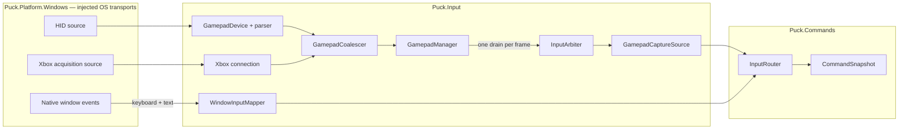

# Device input

Puck.Input turns controller reports and window keyboard or text events into one
provider-neutral input stream. It owns controller protocols, hotplug and player
slots, per-frame coalescing, sub-frame timestamps, motion fusion, haptics, and
the physical-control vocabulary. `Puck.Commands` owns the next step: binding
those physical controls to named commands and producing a fixed-step snapshot.

The project contains no operating-system transport. `Puck.Platform.Windows`
supplies HID and Xbox acquisition through injected interfaces; another
platform package can implement the same interfaces without changing a parser.
Absolute cursor position remains presentation-side browsing state; relative
mouse motion, wheel motion, and mouse buttons are ordinary bindable sources.

Use [Quick start](#quick-start) to inspect devices in the running host. For
an embedding application, start with [How device input reaches a command](#how-device-input-reaches-a-command)
and the [gamepad pipeline](#the-gamepad-pipeline). The [API reference](../api/index.md)
owns member signatures, parameters, return values, and exceptions.

## How device input reaches a command

Two acquisition transports feed one manager. HID devices own an asynchronous
read/write loop; the Windows Xbox backend polls separately and publishes the
same `IGamepadConnection` surface. The manager's `Drain` is destructive, so
`InputArbiter` performs it at most once for each host frame key.



`GamepadSnapshotInputCapture` is the standard host-loop contribution. It asks
the arbiter to drain the current frame, then passes the drained devices to
`GamepadCaptureSource`, which appends timestamped `InputSignal`s to an
`InputRouter`. `Puck.World` composes this path and focus-gates it through
`IInputFocus.IsActiveFor`.

Registered arbiter lanes provide alternate views without draining again:

| Lane mode | Resolution |
|---|---|
| `Multicast` | One representative state with buttons OR-ed across connected pads. |
| `PerPlayer` | The device currently assigned to one player seat. |
| `Owned` | A device explicitly assigned through `SetLaneDevice`; neutral until assigned. |
| `Suppressed` | Always neutral. Any other lane can also be muted temporarily. |

## Device support

| Family | Transport | Input | Motion | Output | Power |
|---|---|---|---|---|---|
| **DualSense** and **DualSense Edge** | HID over USB or Bluetooth | buttons, sticks, analog triggers, two touches; Edge Fn buttons and back paddles | calibrated gyro and accelerometer, fused orientation | rumble, RGB light bar, player LEDs, microphone-mute LED, adaptive triggers | battery and charging; headphone and microphone jacks |
| **Switch Pro** | HID over USB or Bluetooth | buttons including Home and Capture, calibrated sticks, digital triggers | calibrated gyro and accelerometer, fused orientation | HD rumble, player LEDs, Home LED | battery and charging |
| **Steam Controller** | HID over USB or the classic receiver | buttons, analog triggers and their full-pull switches, stick, two trackpads, grip buttons | gyro and accelerometer, fused orientation | trackpad haptic pulses, Steam-button LED | wireless battery |
| **Steam Controller Triton** | HID over USB, Bluetooth LE, the puck receiver or the Nereid dongle | buttons, four paddles, analog triggers and their full-pull switches, two sticks, two pressure-sensing trackpads, stick and grip capacitive sense | gyro and accelerometer, fused orientation | dual-motor rumble, trackpad haptics (pulse, built-in effect, tone, sweep, script) | battery and charging |
| **Xbox** | XInput, with GameInput for the trigger motors | buttons including Guide, sticks, analog triggers | — | body rumble; impulse triggers once bound to GameInput | battery; headset |

Each parser follows the reference drivers for its family: Linux `hid-playstation`,
`hid-nintendo`, `hid-steam` and `xpad`, and SDL's `hidapi` drivers, with the
dekuNukem notes for the Switch. The [limits and hardware
evidence](#limits-and-hardware-evidence) distinguish implementation coverage from
reported device observations.

## Quick start

Build the platform-neutral project, then run the live Windows host:

```sh
dotnet build src/Puck.Input/Puck.Input.csproj -c Release
dotnet run --project src/Puck.World -c Release -- --world worlds/debug --exit-after-seconds 30
```

While the host runs, `world.devices` and `world.players` show the connected set
and seat assignments. `world.devices` also ends each gamepad's entry with its
power then its accessories when it reports them: `battery N%`, `charging N%`,
`not charging N%`, `charged` or `wired`, then `headset`, `headphones` or
`microphone` (for example `gamepad1=p2* battery 94% headset`). Controller diagnostics use `[gamepad]` or `[gameinput]`
lines on stderr. Bindings are data in `Puck.World`; they are not hard-coded in
this project.

## The gamepad pipeline

### Per-device I/O and coalescing

Each HID connection initializes its parser, waits asynchronously for reports,
stamps every successful parse with an arrival tick and sequence number, and
folds the state into `GamepadCoalescer`. The same loop serializes queued output
writes for that handle. Streaming reads use a 16-millisecond bounded wait so
scheduled effects, rumble expiry, and receiver-silence detection keep moving
when input pauses. Each output queue retains at most 64 commands, and the loop
services at most 32 before returning to input; a full queue rejects the request
instead of growing without bound or starving reports.

Between frame drains the coalescer keeps the latest continuous values, ORs all
button press and release edges, records the first press time for each button,
and averages gyro samples. A short tap therefore survives even if it begins and
ends between two rendered frames.

### Connection lifecycle

`GamepadManager` rescans HID interfaces about every 1.5 seconds. A supported
interface is opened, assigned the lowest free player slot, and started. A
faulted connection is removed at the next drain or rescan, and disposal occurs
outside the manager lock. Disposing a live pad first stops its motors and
releases its adaptive triggers, bounded to 100 ms per write.

A controller that streams continuously (DualSense, Switch Pro) faults when its
parsed stream falls silent (2 s and 3 s), which releases its held input when a
Bluetooth link drops without a removal notice; the rescan reopens it if it is
still present. One controller reached over USB and Bluetooth at once counts once:
its parser reads the pad's Bluetooth address (`IPhysicalIdentityParser`), and
the Bluetooth connection gives up its player slot while the USB one streams.

Classic and Triton Steam receivers expose several input collections, most of
which can be empty. Those collections start dormant: they hold no player slot,
are excluded from public connection queries, and do not run the ordinary
five-second first-report watchdog. The first parsed state activates a slot.
Both receivers report pairing events: a connection re-initializes the slot for
the pad that arrived, and a disconnection returns it to dormancy. The device loop
also parks any active receiver whose parsed state stream is silent for one
second, for a pad that powers off without an event. Parking
clears coalesced state, pending output, scheduled effects, rumble, motion-fusion
history, and the player slot before that receiver carries another controller.

### Motion fusion

The motion-capable parsers map their sensor frames to one right-handed frame
(X right, Y up, Z toward the player) before calling `ImuOrientationTracker`, and
`GamepadState.Gyro` and `Accelerometer` carry that frame. DualSense takes `dt`
from its sensor clock; Switch spaces its three samples a third of the measured
report interval apart; Triton derives `dt` from its IMU clock; the classic Steam
Controller uses the connection interval it reports and skips a repeated packet.
The clock-free tracker
integrates angular velocity, estimates stationary gyro bias, and corrects pitch
and roll toward accelerometer gravity. Capture the resulting orientation with
the input snapshot; replay consumes that orientation rather than recomputing
motion fusion from live hardware.

DualSense reads its factory gyro and accelerometer calibration from feature
report `0x05`. Switch reads stick and IMU calibration from SPI flash, preferring
the user block over the factory one, and each stick's own radial deadzone from its
device parameters (`0x6086` left, `0x6098` right), normalized by the stick's
travel; a Pro Controller reads about 0.11. Each falls back to its nominal scale,
and the deadzone to 0.12, when a read is missing or implausible. Both Steam families use
the fixed ±2000 deg/s and ±2 g scales of their sensors.

## Keyboard, mouse commands, text, and pointer browsing

`InputSources` is the single vocabulary for keyboard, mouse, and gamepad control
names. `InputSourceVocabulary` resolves those names case-insensitively, in the
reflection-derived declared tables and in every parametric family alike
(keyboard letters and digits, function and numpad keys, numbered mouse buttons,
`probe.<name>`), because `Puck.Commands`' `BindingProfile` compiles a page's
sources into a case-insensitive table and dispatches through the same one: a
case-sensitive catalog beside a case-insensitive compiler would refuse working
rows as unknown controls. A source id's case is authored-document noise, never
identity, and case-insensitivity widens nothing, since an id no member and no
family declares stays unknown in every casing. `WindowInputMapper` converts
neutral window events from `Puck.Platform` into `InputSignal`s, mirroring the
gamepad capture path. Left and right Control,
Shift, Alt, and Super remain distinct ordinary controls; number-row and numpad
digits remain distinct too, including when programmable mouse buttons emit them.

Absolute cursor position, hover, capture, and visibility remain presentation
state in the window-observer path. Relative motion (`mouse.motion`), two-axis
wheel notches (`mouse.wheel`), and numbered buttons (`mouse.button1` and upward)
also project into the command path. Button numbering has no five-button model
ceiling; a backend preserves every stable ordinal it can report. Windows' generic
mouse messages expose the conventional five, while programmable devices such as
the Naga commonly expose their larger grid as number-row or numpad keyboard
controls; both families are bindable here. Mouse motion and wheel samples are
transient impulses, never persistent analog holds.

`HeldDigitalInputState` retains keyboard and mouse-button first-down order and
emits per-frame digital `Active` samples after the original press frame. That
lets binding reloads and per-player modality changes cancel first, then recover
channels and modifier pages through the current profile without synthesizing an
edge verb.

Bindings, chord pages, toggles, sequences, interactive rebinding, and the
binding document format belong to [Commands and input](commands.md).

## Keyboard focus and passthrough sources

A window captured into a pane, such as an editor, can take the keyboard.
`SourceFocus` decides where each window event goes, before
`WindowInputMapper` sees it:

- `Press` reports a pointer press and the `SourceMapping` it landed on (the
  published source mapping in `Puck.Commands`). Focus moves to that source when
  the mapping takes the `Passthrough` destination, the local user opened it,
  and the press lands on its pixels. A press anywhere else returns focus to the
  game.
- `Route` sends a key or text event to the focused source, or to the game when
  no source has focus. A key's release goes wherever its press went, so neither
  side is left holding a key after focus moves. Pointer events are routed by
  the mapping a hit lands on, never by focus.
- The reserved chord, Control and Alt held with Escape pressed, returns focus to
  the game whenever a source has it, and that Escape reaches neither the game
  nor the source. While the game has focus the chord has nothing to return, so
  its Escape is the game's like any other key.

A world document never creates a passthrough source: the world validator
refuses a screen whose `input` is `Passthrough`. Focus sits inside the input the
engine already holds, so it is separate from `IInputFocus` in `Puck.Hosting`,
which decides whether the terminal routes a device to the engine at all.

`SourcePassthroughRouter` hosts `SourceFocus` for a window. The host publishes
the pane mappings its display shows, and the router reads each raw window event
in order:

- A pointer event over a pane whose mapping takes `Passthrough`, was opened by
  the local user and lands on its source goes to that source's window at
  `SourcePassthrough.ToClient`'s client point. A button press there also
  focuses the source. A press on the captured frame's border or title bar
  focuses it without reaching the client area.
- Keys and text follow `SourceFocus`. A key released after focus moved to
  another source still reaches the window its press did, and a button pressed
  on a source is released there at the point its drag reached.
- Losing the window's own focus releases every key and button a source's
  window holds.
- A source that holds focus, a key or a button but no longer has a
  passthrough pane among the published panes is revoked before the event
  routes (`Revoke`): its window receives the release of each key and button it
  holds, and focus returns to the game. The host revokes a source the same way
  when it closes it.

The router tells the pump which events the game must not see. The window pump
in `Puck.Launcher` offers every raw event to an optional `IWindowInputFilter`
before the `IWindowInputObserver` and the command router. An event the filter
consumes reaches neither of them. A pointer position is never consumed, so the
game keeps the pointer's position over a passthrough pane, but its relative
motion there is consumed, so a drawn cursor that shows only on motion fades out. The filter
reports instead whether it holds the pointer (`IWindowInputFilter.HoldsPointer`,
`SourcePassthroughRouter.HoldsPointer`): the pointer lies on a passthrough
pane's source whose window is still there, or a button pressed on a source is
still held. After each batch of events the pump sets the window's
`INativeWindowCursor.ShowsSystemCursor` from it, so a window that hides the
system cursor over its client area (`NativeWindowOptions.HideMouseCursor`, as
the World's does) shows the system arrow while the pointer is over the captured
window, and hides it again once the pointer leaves, from the published panes
alone when a pane is hidden under a resting pointer. A pane that contains its
image (`views.graphs` `fit: Contain`) leaves bars beside it, and a pointer on a
bar is the game's. The arrow is the system's, not the captured window's own
cursor shape: the shape a window sets follows the input queue of the window under
the pointer, which is the World's. On Win32 the change applies at once to a
pointer resting over the client area, and `WM_SETCURSOR` keeps it as the pointer
moves.

A source's window is an `ISourcePassthroughWindow`. On Windows a window
capture's feed supplies it (`INativeImageCaptureFeed.Window`,
`Win32PassthroughWindow`), and it sends window messages to the captured window
with `SendNotifyMessage`, so the window need not be in the foreground and
receives them in order. A sent message skips the window's `TranslateMessage`,
so a typed key arrives as a keyboard's would: `WM_KEYDOWN`, then `WM_CHAR` from
the text event, then `WM_KEYUP`, with no text heard twice. A pointer message
goes to the deepest visible, enabled child window under the point, in that
child's client coordinates, and while a button is held the child it was pressed
on keeps every pointer message until the last release. A key or text message
goes to the window thread's keyboard focus. Each side of each modifier is
tracked apart, and Alt counts as held across its own press and release, so an
Alt chord's press and release are `WM_SYSKEYDOWN` and `WM_SYSKEYUP`.
Coordinates are read in physical pixels for the captured frame and in the
window's own DPI context for the client point, so a DPI-unaware, system-aware
or per-monitor-aware window each receives its own units. Keys outside `KeyCode`, such as Delete
or Home, never reach the engine, so they never reach a source either.

The World host opens a passthrough source only through `source.passthrough`,
which only its own console may run as typed text (see
[the World guide](../../src/Puck.World/README.md)). A recorded run on real
hardware, in which a click reaches a captured editor window at the mapped point,
is [deferred to the end](../plans/rendering.md#deferred-to-the-end) of the
rendering programme.

## Output and haptics

`IGamepadOutput` accepts typed output commands and a raw-report escape hatch.
The connection advertises capabilities from the interfaces its parser actually
implements. A parser with periodic work of its own (`IServicedGamepadParser`)
is serviced on its device loop after every read.

`GamepadDevice` owns rumble cadence. A parser declares the shortest spacing its
controller accepts between writes and, when the controller drops its motors
without fresh writes, a refresh period: 30 ms spacing on the DualSense and both
Steam families and the Switch's own transport spacing (20 ms on USB, 60 ms over
Bluetooth), and refreshes every 50 ms on the Switch and the classic Steam
Controller and every 40 ms on the Triton (whose firmware stops its motors after
about 50 ms). A
weaker update inside the spacing is held and written when it passes; a stop or a
stronger update is written at once, and a refreshed controller hears a stop
three more times.

Rumble duration is finite by contract. A zero-millisecond `RumbleEffect` stops
the body motors and a zero-millisecond `TriggerRumbleEffect` stops the trigger
motors; each pair expires on its own. Intensities are clamped to `0..1` and
non-finite values map to rest before a parser encodes them.

- **DualSense** keeps one output image for rumble, both adaptive triggers, the
  light bar, the player LEDs and the microphone-mute LED. USB writes report
  `0x02`; Bluetooth writes report `0x31` with its 78-byte framing and trailing
  CRC even when Windows advertises a larger buffer. Firmware 2.24 and later, and
  every Edge, use the improved rumble emulation; older firmware gets the classic
  emulation at half strength, as SDL does. Each press of the mute button toggles
  the microphone mute and its LED, which the firmware leaves to the host.
- **Switch Pro** plays HD rumble (`RumbleHd`): each actuator's low band (41 to
  626 Hz) and high band (82 to 1253 Hz) take their own carrier and amplitude,
  encoded as `round(32 · log2(f / 10))` and the Linux amplitude table. An
  ordinary `Rumble` plays the low intensity on a 160 Hz band and the high one on
  a 320 Hz band on both actuators. Every output report carries the current
  rumble, so a subcommand never interrupts it, and every report, rumble or
  subcommand, waits for the transport's spacing (20 ms on USB, 60 ms over
  Bluetooth), past which a Bluetooth pad drops off the link. The Home LED plays a
  `HomeLedPattern` (`SetHomeLedPattern`): up to 15 steps of brightness, fade and
  hold over a base step of about 8 to 175 ms, repeated or held, as subcommand
  `0x38`. `SetLed` holds a steady brightness from the brightest channel through
  SDL's perceptual curve. Over USB, the pad is sent the HID-only command again
  when its reports stop for 100 ms, since another driver (Steam) can switch it
  back to its proprietary mode. Initialization faults, and the manager reopens
  the pad, when the IMU, the full report mode or vibration is never acknowledged.
- **Steam Controller** drives each trackpad actuator with a pulse train whose
  duty cycle follows intensity; the low band is the left pad. `PlayTrackpadHaptic`
  also plays an explicit pulse train with its gain. `SetLed` sets the
  Steam-button brightness.
- **Triton** drives its two motors with output report `0x80` and plays every
  `TrackpadHapticEffect` form on its trackpad actuators: a pulse train (`0x81`),
  a built-in effect such as a tick or click (`0x82`), a tone with an optional
  low-frequency oscillator (`0x83`), a logarithmic sweep (`0x84`) and a stored
  script (`0x85`), laid out as Valve's `controller_structs.h` declares them.
  Initialization turns off the keyboard-and-mouse emulation together with the
  firmware watchdog (setting 71) that would re-arm it without a Steam client,
  and release restores the default mappings and settings (Linux
  `steam_set_lizard_mode`).
- `IGamepadOutput.TrackpadHaptics` names the forms a device plays; a haptic of
  another form is refused.
- **Xbox** writes each rumble through one path: the four GameInput motors once
  the XInput slot is bound to its GameInput device, the two XInput body motors
  until then. A slot binds without a held button only when it is the only pad
  and the slot and device topology has been still for 1.5 s; otherwise it binds
  while a button is held that tells the pads apart.

## Dynamic lighting

The bind legend is presentation-only. `Puck.Abstractions` defines the neutral
LampArray contract, `Puck.Platform.Windows` implements the Windows HID LampArray
transport, and this project composes colors from the host's current binding
state:

```text
lamp geometry + palette + live bindings
    -> LightLegendComposer
    -> per-lamp colors
```

No host drives a lamp array yet: nothing delivers the composed colors to a
device on a tick. The transport and composer have been exercised on a Logitech G915 LampArray
(115 lamps, 33-millisecond minimum update), a G502 mouse, and a POWERPLAY pad.

## Limits and hardware evidence

The hardware observations below were recorded without a dated build identifier.
They describe reported results, while the transport-fake suite checks current
code. A release qualification needs its own recorded hardware run.

Every protocol path is pinned by golden-byte tests against the reference
drivers' layouts (`ControllerProtocolTests`). Hardware observation is separate:

- **Observed on hardware, DualSense over USB:** every button including Mute,
  both sticks to full deflection, analog triggers, both touches, calibrated
  motion, battery, rumble, the light bar, adaptive triggers and the
  microphone-mute LED, at about 255 Hz. The current Bluetooth path and the
  DualSense Edge await a hardware run. Bluetooth input reports whose CRC fails
  are dropped.
- **Observed on hardware, Switch Pro over USB:** every button including Capture
  and Home, calibrated sticks and IMU, its stick deadzone from flash, battery,
  HD rumble at the default carriers and a steady Home LED, at about 75 Hz.
  Bluetooth, HD rumble at other carriers and Home LED patterns await a hardware
  run.
- **Observed on hardware, Triton through its puck receiver:** every button
  including the four paddles, both trackpad clicks, the trigger switches and
  stick and grip capacitive sense, trackpad position and pressure, motion,
  battery (`0x43`) and rumble, at about 265 Hz. The receiver also sends an
  undocumented report `0x7B` about twice a second, which the parser drops.
  Reports `0x45`/`0x47`, the other transports, pairing events, the trackpad
  haptics and the watchdog setting await a hardware run; the side codes of
  reports `0x82` to `0x85` (left 1, right 2, both 3, from Valve's
  `MsgTriggerHaptic`) are unconfirmed, while the pulse report's (left 1, right
  0) follow Linux. A built-in click on the right pad settles it: under these codes
  only the right pad clicks, under the pulse report's numbering both do.
- **Observed on hardware, Xbox Series X|S:** every button including Guide, sticks,
  triggers, its family from the ordinal-108 identity, battery and body rumble.
- **Motion agrees across families on hardware:** on the DualSense, the Switch
  Pro and the Triton alike, a quarter turn to the left reads +90° about Y and
  lifting the far edge reads a positive rotation about X, in both the integrated
  gyro and the fused orientation.
- **The classic Steam Controller is protocol-derived** and has not been run on
  physical hardware.
- **Xbox reaches the Share button and Elite paddles through neither XInput nor
  the inbox GameInput v0 runtime**; they need the GameInput redistributable,
  which the engine does not ship. Impulse-trigger rumble needs a GameInput
  runtime that `GameInputCreate` accepts; without the GameInput service it fails
  with `0xD0000034` (logged as `[gameinput]`), and rumble falls back to the two
  XInput body motors. A headset is read from XInput's voice-device capability
  flag, since the headset battery query echoes the pad's own battery.
- **Not surfaced:** the DualSense's audio-driven haptics and speaker (an
  audio-endpoint feature, not HID) and the classic Steam Controller's Bluetooth
  LE transport.
- **Only the Windows HID transport exists.** The parsers are platform-neutral,
  but no Linux `hidraw` implementation has exercised them.
- **Steam lizard mode and LampArray host control restore only during clean
  disposal.** An abnormal process exit can leave the device in the last mode
  until another driver or a replug resets it.

For receiver diagnostics, match Steam VID `0x28DE` and the supported PID on
vendor input usage `0xFF00/0x01`. Classic control messages use their classic
feature framing. Triton feature messages use report id 1 and
`[type][length][payload]`; report id 0 is rejected with Win32 error 87.

`GamepadManager.TryGetPower` returns a device's last `GamepadPower`: where it
draws power from and its charge, at the resolution its family reports, with a
charger fault as `NotCharging` and an unvalidated or reserved value as
`Unknown`. `TryGetAccessories` returns the headphones and microphone plugged
into it. A report that carries no fresh motion (a subcommand reply, a battery
report, a repeated packet) sets `GamepadState.IsMotionSample` false and is not
averaged into the frame's gyro.

## Core types

| Type | Role |
|---|---|
| `GamepadManager` | Enumerates, hotplugs, slots, queries, drains, and owns connection lifetimes. |
| `InputArbiter` | Performs the single destructive drain and resolves registered lanes. |
| `GamepadSnapshotInputCapture` | Connects the arbiter's frame drain to the snapshot input pump. |
| `GamepadCaptureSource` | Converts drained normalized states into timestamped `InputSignal`s. |
| `GamepadDevice` | Hosts one HID parser and owns that handle's asynchronous I/O loop. |
| `IGamepadParser` / `IServicedGamepadParser` | Define initialization, report parsing and periodic device work for a controller family. |
| `GamepadCoalescer` / `GamepadDrain` | Bridge high-rate acquisition to a loss-aware per-frame view. |
| `GamepadState` / `GamepadButtons` / `GamepadPower` | Define the normalized controller state, button vocabulary and power report. |
| `ImuOrientationTracker` | Holds complementary-filter orientation and gyro-bias state. |
| `InputSources` / `WindowInputMapper` | Own physical source names and neutral keyboard/mouse/text mapping. |
| `HeldDigitalInputState` | Retains edge-reported held controls in press order and produces safe per-frame reassertions. |
| `SourceFocus` | Routes keys and text between the game and a focused passthrough source, and holds the reserved focus chord. |
| `SourcePassthroughRouter` / `IWindowInputFilter` | Host `SourceFocus` for a window: deliver a passthrough source's pointer and keys to its window and withhold them from the game. |
| `IGamepadOutput` / `TriggerEffectSpec` | Expose capability-gated controller output. |
| `LightLegendComposer` | Composes presentation-side LampArray legends. |

The concrete controller parsers are `NintendoSwitchController`,
`DualSenseController`, `SteamController`, and `SteamControllerTriton`.
Windows implementations of `IHidDeviceSource`, `IHidDevice`, and the Xbox
acquisition source live in `src/Puck.Platform.Windows`.

## Verification

The [Input test suite](../../tests/Puck.Input.Tests/README.md) owns the test
coverage and run instructions. Live hardware checks use the [Quick start](#quick-start)
inspection path, stderr diagnostics, and physical output observation.

A hardware run drives a `GamepadManager` from `WindowsInputTransports` in a
small program, or a parser over `Win32HidDeviceSource` directly, and logs each
drained state. Only one process can hold a pad's HID handle at a time, so run no
second probe or `Puck.World` beside it. What each check expects:

- **Inputs:** every button reaches its `GamepadButtons` flag, sticks reach ±1,
  triggers sweep 0 to 1, touch position (and Triton pressure) tracks, and
  `TryGetPower` and `TryGetAccessories` agree with the pad.
- **Motion:** integrate the drained gyro between two presses. A quarter turn to
  the left, flat on a table, reads about +90° about Y; lifting the far edge reads
  a positive rotation about X; the fused orientation agrees.
- **Outputs:** low and high rumble on every pad, the DualSense light bar,
  adaptive triggers and mute LED, the Switch Home LED (steady and a
  `HomeLedPattern`), Switch `RumbleHd` sweeps across each band's range (the
  pitch should rise), and each Triton `TrackpadHapticEffect` form on each side.
  `Builtin(Right, Click)` settles the side codes of reports `0x82` to `0x85`:
  only the right pad clicking confirms them, both pads clicking means they take
  the pulse report's numbering.
- **Lizard mode:** some seconds after a Triton initializes, a finger on its
  right trackpad must not move the cursor. A probe stopped without disposing
  leaves the pad out of lizard mode until it is power-cycled.

## Further reading

- [Commands and input](commands.md) — bindings, dispatch, and fixed-step snapshots.
- [Reference](README.md) — the manual’s library and schema index.
