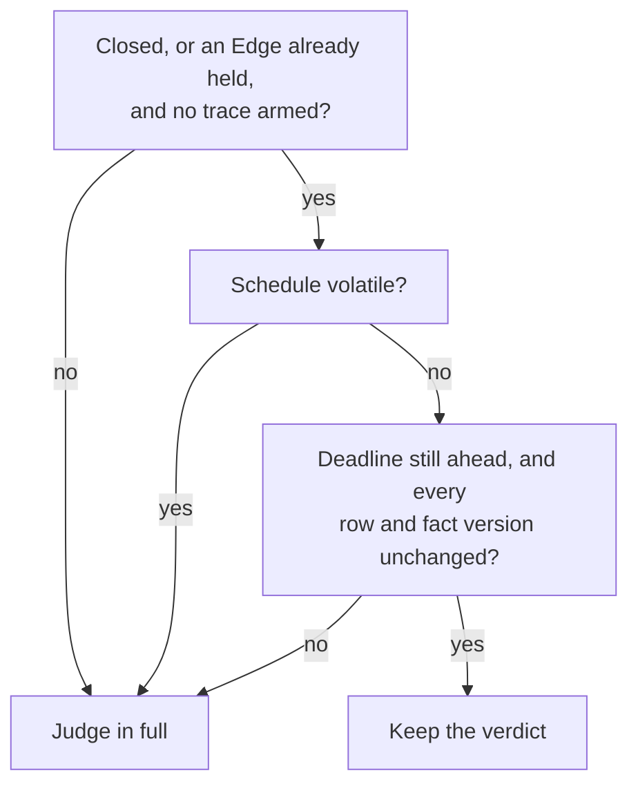

# Rule analysis, scheduling, and work budgets

Every compiled rule can say which cells it reads, which it writes, and how much
work one evaluation can cost. Several analyses read those answers: one finds
pairs of rules whose document order silently decides a result, one lets the
evaluator judge a rule's bindings only when something they read changed, and
one prices the work a tick's rules do by that same reading and refuses a
document that exceeds the ceiling. This article explains each analysis, what
its numbers mean, and where each stops.
It's for authors reading `world.rule.hazards` and `world.budget.rules`, and for
host developers whose own facts feed these analyses.

## The example

The fragment below is a complete world that compiles and validates. It has an
Int slot `coins`, a `cards` slot, and a `phase` slot, and three rules.

```puck
schema: "puck.world.definition.v1"
documentId: "shop-analysis"

state {
  world {
    slot coins = 0 bounds(0..99)
    slot cards = 0 bounds(0..52)
    slot phase = 0 bounds(0..2)
  }
}

rule "buy-card" {
  when coins >= 3
  coins = coins - 3
  cards += 1
}

rule "income" {
  when phase == 1
  coins += 1
}

rule "bankrupt" {
  when phase == 2
  coins = 0
}
```

The sections below use these three rules to show what each analysis reports.

## Read and write sets

`RuleDataflow` walks a compiled rule and lists every cell it touches as a
`CellAccess`: a row ordinal, an interned cell key, and, for a write, whether it
replaces the cell (`IsSet`) or accumulates into it. A key the compiler can't
name at compile time (a key read from another cell, a reduction, a push, a
transform) is recorded as the invalid key, meaning "any cell of this row".

For the example:

| Rule | Reads | Writes |
|---|---|---|
| `buy-card` | `coins` | `coins` (set), `cards` (add) |
| `income` | `phase` | `coins` (add) |
| `bankrupt` | `phase` | `coins` (set) |

A rule's reads include its gate, its locals, its effect sources, and every
cell a key indirection reads through. A host's own facts add theirs through
`CollectReads` and `CollectWrites` (see [Host and extend the state engine](hosting.md)).

## Find order-sensitive pairs

Rules in one tick run as a sequence in document order, and a committed firing
is visible to the next rule. That order can decide a result without anyone
noticing. `RuleHazards.Analyze` lists the pairs where it does:

- A **write-after-read** hazard: an earlier rule reads a cell a later rule
  writes, so the reader sees the previous tick's value.
- A **write-after-write** hazard: two rules write one cell in the same tick and
  at least one of them sets it. Two sets mean the later one wins. A set after an
  add discards the add, and an add after a set lands on the new value. Two adds
  commute, so they aren't a hazard.

For the example, `world.rule.hazards` lists `buy-card` against `income`
(`buy-card` reads `coins` before `income` adds to it, and `income`'s add lands
on the value `buy-card` set) and `buy-card` against `bankrupt` (both set
`coins`, so `bankrupt` wins).

It doesn't list `income` against `bankrupt`. Their gates pin the literal cell
`phase` to disjoint ranges (1 and 2), so they can never both fire in one tick
and their order decides nothing. A **pin** comes from a gate that is one
comparison, or a top-level conjunction of comparisons, of a literal-keyed cell
against a constant. Ranges on one cell intersect, and `!=` pins nothing.

A hazard isn't an error. It tells you that moving one of the two rules could
change an answer. If you want the other answer, reorder the rules yourself; the
engine always keeps document order.

## Price a tick's rules

The **work sheet** prices the work the document's rules do in one tick, in
heuristic work units. `RuleWorkBudget` builds it from each fact's own `Cost`
and from how the host evaluates each line: a rule the evaluator judges by
change is priced for a tick at rest plus one change
([Price by change](#price-by-change)), and every other line for every binding
it can hold. The sheet also reports the **worst tick**, every line with every
binding judged and firing at once, which it never refuses.

### What one line costs

`CompiledRule.CostBreakdown` returns a `RuleCost` with three parts:

- **Setup**: what one sweep costs before its first evaluation, one unit per key
  a `forEach` snapshots.
- **Check**: what one evaluation costs whether or not its gate holds: the gate,
  any row selection, and the locals either reads (directly or through another
  local).
- **Effects**: what one firing costs: the locals only the effects read, which
  the evaluator computes only once the gate has opened on an evaluation that
  fires (`CompiledRule.Deferred`), and the effects themselves.

So a binding whose gate stays closed costs its gate, never the work its effects
alone need: a sweep over many candidates of which few can fire, such as a judge
over a step's input events, pays a full judgement only for the bindings that
fire.

`RuleWorkBudget.Contributor` turns that into a **contributor line**. The
line's **multiplier** is how many bindings one sweep can hold: 1 for a rule
evaluated once, the iterated row's capacity for a `forEach` rule, the zone
table's entry count for a rule over zones, the pool's capacity for a pool
sweep, in Puck.World the carrier or pair count for an interaction, for a
`forEach: region(placement)` sweep the occupants the region is priced at
(`WorldRuleWorkBudget.RegionSweepCapacity`: the region's authored `capacity`,
or the most bodies that fit it), and for a
`forEach: $inputEvents:<owner>` sweep the events one step can admit: the
document's `inputHistory.maximumEventsPerStep` plus the terminal cancellations
one switch writes (`WorldInputIteration.StepCapacity`), since the sweep binds
only the current step's events and admission refuses a batch past the bound.

How many of those bindings the line is charged for depends on how the host
evaluates it. A line judged **in place** is charged for all of them: its
check units are `Setup + Multiplier × Check`, and its firing units are
`Firings × Effects`, where its **firings** are the multiplier, or the rule's
`maxFirings` when that is smaller, since the evaluator ends a sweep once that
many bindings have fired
([Bound how many bindings fire](rules.md#bound-how-many-bindings-fire)). A
search judge's rules, a group's rules, an interaction, a decision, a sweep
bounded by `maxFirings`, and a sweep over a set no version names (a pool, a
zone table) are judged in place.

A sweep of **this tick's events** (`RuleIteration.BindsEvents`: in Puck.World
`forEach: contacts(<surface>)` and `forEach: inputEvents(<owner>)`) binds
nothing on a tick with no event and one binding per event. Its multiplier is
still the events one tick can carry, which is its worst case, but the line is
charged one binding's check and firing and one snapshot unit of setup: the one
event the sheet's "one change" is. A `maxFirings` bound or a host that judges
the line in place keeps the capacity price.

### Price by change

Every other rule is walked through a due list
([Visit only the rules that are due](#visit-only-the-rules-that-are-due)),
which judges a binding only when something it reads moved. The sheet reads the
same judgement the due list's schedule is built from and charges the line
(`RuleResponse.Of`) for **a tick at rest plus one change**:

- **A tick at rest** is one in which time passes and bodies move, but no state
  cell and no event-like host fact changes. A binding is judged at rest only
  when its judgement reads something that moves with time: `$tick` outside a
  deadline, a row carrying a value-over-time trait, or a host fact that does
  not rest (`RuleCompileContext.FactRests`). In Puck.World a pose, a distance,
  a pointer and a channel move; a region's occupants, a body's fact bits and
  producer stand-down, an input event, a beat, and the population and
  quiescence counts rest (`WorldFactsCompileContext.Rests`). A line that reads
  only rows and facts at rest is not visited, and is charged nothing at rest.
- **What fires at rest** depends on what stops a binding that fired from firing
  again. A Level gate that holds fires every tick, so a Level line is charged
  every binding's check and firing. An Edge fires on the crossing, so an Edge
  line over inputs at rest fires nothing at rest; over a moving input it can
  cross again, and is charged every binding. A Level rule whose firing closes
  its own gate fires nothing at rest, whatever moves, and so does one whose
  firing settles (`RuleResponse.Settles`): every effect is a plain set and
  nothing its values, keys or branches are computed from is a row it writes,
  so a second firing writes what the first wrote and the evaluator takes the
  binding as settled. Such a line is charged two firings for a change, the
  second being the one that proves it settled.
- **A firing closes its own gate** (`RuleResponse.ClosesItself`) when the gate
  is a comparison, or a conjunction with a comparison among its terms, of a
  cell the binding itself names (a literal key, or `row[$each]`); the rule's
  one write to that row is an unconditional set of that cell; and the value
  written fails the comparison; a set inside a `transaction` with no refusal
  branch counts as unconditional. `when state[$each] == 0` with
  `state[$each] = 1` is one, and so is
  `when at[$each] != goal[group[$each]]` with `at[$each] = goal[group[$each]]`.
  Such a binding fires once and stays closed until another line writes. The
  mirrored form, `cell != source` with `cell = source`, holds when both sides
  are the same read of nothing the firing writes: one plain cell, or one local
  of the rule (`local target = …`, `when cell != target`, `cell = target`).
  A closure over a mirrored value that itself moves with time is priced as
  firing again.
- **The tested cell may be a host fact** an effect sets exactly
  (`IFactSettingEffect`). In Puck.World that is a body's counter register read
  and written for the body bound to `$each`
  (`when bodyState(each, form) != target` with
  `setBodyState(key: $each, state: "form", expression: target)`). The
  read-back is exact only when the register keeps what was written, so a
  register that declares an envelope needs every value the source can answer
  to lie inside it, which the sheet proves from
  [the source's bounds](#bound-what-a-program-can-answer). A source the proof
  cannot bound is priced as firing every tick.
- **One change** is one move of one thing at rest the line reads. When
  everything at rest is read under the binding's own key (`row[$each]`, a fact
  of the body bound to `$each`), one move reaches one binding: one check and
  one firing. When something is shared (a literal cell, a region's occupancy,
  a deadline), one move reaches every binding: every check, and every firing.
  A row read through a per-binding index, `goal[group[$each]]`, is shared too,
  but one of its cells is read only by the bindings that index it, so the line
  is charged every check and an even share of the firings: the multiplier
  divided by the row's capacity, rounded up.

The line's check units are the setup of the bindings judged plus
`Judged × Check`, and its firing units are `Firings × Effects`.
`world.budget.rules` prints `judged=` and `firings=` when they are fewer than
the multiplier, and `worst=` when the line's worst case is more than its price;
`world.budget.rules --why <rule>` prints which of the cases above the line
fell under.

One change per line per tick is the sheet's stated expectation, not a bound.
A tick in which many things move at once (a boot, a schedule that turns every
group over on one tick) costs more, up to the worst tick the sheet reports
beside its total. Each binding's work stays bounded by its check and its
effects, and `world.budget.rules --spent` reads what a run actually spent.

A host whose commit of one firing spends more than the effects themselves
prices that into the firing's effects: `Contributor` takes the commit's units.
In Puck.World a firing's validation and commit otherwise scale with the rows
it wrote, so the extra is only what a commit derives from a written register:
a `setBodyState` of an input-selection register adds one routing owner's
revalidation and resynchronization (two passes over the input families and the
kit selection), one of a scale, kit or look register adds the written body's
own resync (its size, and a walk of each selector's cases and row table;
`WorldPopulation.SyncBodyCells` resyncs only the bodies whose registers were
touched), and a line that writes a drive-gate row adds one read of each gate
row under the written key and one owner's resync
(`WorldGrants.SyncDriveGate`).

A region interaction's carrier count is bounded by disc packing. Membership is
by a body's centre, so at most `floor(((R + r)/r)^2)` carriers fit inside a
region of radius `R` (a box's half-diagonal on the ground), clamped to the
population capacity. The footprint radius
`r` is the smallest over every kit, because a property tag carries no static
link to a kit and any body could be the one standing in the region. When the
region is absent or no solid-only kit footprint resolves, the bound falls back
to the population capacity (`WorldRuleWorkBudget.RegionCapacityBound`).

A `forEach: region(placement)` sweep is priced at the same bound unless the
region authors a `capacity` (`WorldPlacementRegion.Capacity`), the occupants
its author expects it to hold at once. The capacity prices the sweep and
nothing else: a sweep binds every body inside the region, and
`world.tick.region-sweep-overflow` in `world.counters world.tick` counts the
bodies it bound past the priced number, so a capacity authored too small
shows.

### Bound what a program can answer

`RuleBounds.Of` answers the values a compiled program, or a value source, can
answer: a `ValueBounds`, which is every value exactly (a finite set), a closed
range, or unbounded. It is the bounds lowering of the one expression program,
and any analysis that needs to know where a written value can land reads it
rather than inspecting a rule's shape.

The inputs are declarations. `RuleCompileContext.ReadBounds` answers what one
read can answer: a Bool cell is 0 or 1, a cell of a row declaring both `min`
and `max` lies in that range (every whole number of it for a short Int range),
and a derived context answers for its host's facts. In Puck.World a body's
counter register answers its envelope's set or range, its initial value, and
the zero a reference to no live body reads
(`WorldBodyStateReads.TryCounterBounds`).

There are two forms, tried in this order:

- **Exact.** When every read's declared values are a finite set and their
  product is at most `RuleBounds.MaxAssignments`, the program is evaluated once
  per assignment by the one interpreter, with each read replaced by its value.
  Two reads of the same thing (the same cell under the same key, the same
  register of the same body) are one variable, and a local's program is
  evaluated under the same assignment, so correlated terms stay correlated:
  `craft * (4 + space) + (1 - craft) * (suit + 2 * noclip)` over four 0-or-1
  registers answers exactly 0 to 5, where a range would answer 0 to 8.
- **Range.** Otherwise one walk carries a closed interval through the program
  over `FixedInterval` (`Puck.Maths`), whose outward-rounded arithmetic holds
  every fixed-point result of the same steps. Addition, subtraction,
  multiplication, fixed-point division, minimum, maximum, clamp, negation,
  magnitude, a conditional choice and `??` have a rule; a comparison or a truth
  answers 0 to 1.

A bound describes the values a program answers when it answers. A program
that faults or answers an absence for some assignment, one that folds a row,
reads through a computed address, or holds an operation the range form has no
rule for, is unbounded, and a proof that needs its bound does not hold.

### Prices read declarations

Every price reads a row's room through one door,
`RuleCompileContext.RowCapacity`, and the answer depends on declarations alone:

| Row | Priced room |
|---|---|
| Slot | One cell. |
| Lattice | Its topology's cell count. |
| Ring | Its declared length. |
| Keyed or ordered, with a `capacity` | That capacity. |
| Keyed or ordered, without one | `StateCapacity.MaxCellsPerRow`, the ceiling the arena may grow it to. |
| Keyed over a token domain | The smaller of its own room and the domain row's. |

A row's cells, and the room the arena has reserved for it, never enter a price.
The arena still reserves only what an uncapped row holds and grows it on
demand ([the state arena](arena.md#from-declarations-to-storage)), but the sheet
is fixed once a document compiles: an install that changes no declaration, a
recipient's write to any row, and a growth all leave it where it was. That is
what lets a refusal that quotes the sheet or a search's allowance reach a
recipient without telling it how many cells a hidden row holds, and what makes
a world's cost a property of what its author wrote.

So a rule that iterates or folds a row with no capacity, or a search that keys
on one, is priced as if the row held the engine's ceiling. When that refuses a
world, the refusal names each row priced there for want of a capacity
(`WorldRuleWorkBudget.RowsAtCeiling`); author its capacity, or key it over a
capped domain, which bounds it with nothing more written. The decision and the
options weighed are in [costing](../../decisions/state-and-language.md#costing).

### Prices worth knowing

- An expression costs the sum of its operations and live operand reads. A fold
  runs its body once per cell its row can hold, so it is priced at the row's
  room whatever cells the row holds, and it reads that one row for scheduling.
  A shared subprogram is priced once per numeric kind and reused at every call
  site.
- A transform is priced by the operands it addresses (`TransformWork`): a
  fixed door, then the scratch its kernel leases, the cells it visits, and the
  journal entries its writes record. Rows it never touches don't change its
  price. A reordering transform includes a stable insertion sort over its
  capacity (`InsertionSortWork`), and a runtime sort is priced by
  `IntrosortWork`.
- Transforms, pool effects, and a `rewindGroup` share one unit, the element
  operation: one per journal entry, per vector component, per cell visited,
  and per scratch element leased. A text value is journaled by reference, so
  its length is memory the journal's byte ceiling bounds, never work.
- A `rewindGroup` is priced by the work of restoring its group's widest turn
  (`StateArena.EstimateRewindWork`), which its group's compilation binds; a
  rewind compiled without its groups is unmodeled. In Puck.World,
  `WorldRuleWorkBudget.Measure` and `Contributors` compile the whole document,
  groups included, so they return the sheet admission held.
- A `transaction` costs one unit more than its steps and its `onFailure`
  branch, each once: a savepoint fires each step once, commits them where they
  stand, and on a refusal fires the failure branch once.
- `TransformWorkLawTests` holds each transform's price between the work one
  firing over its costliest operand does, as the arena counts it, and the fixed
  door plus sixteen times that work. The arena counts journal entries, vector
  components, draw samples, and two of the `ArenaWork` counters it reports as
  the source `state.arena`: the scratch
  elements it leases (`state.arena.scratch-leased-elements`) and the lanes it
  visits (`state.arena.visits`).
- A `RuleEvaluator` counts its own work, as the source `state.rules`, under the
  `RuleWorkKinds` kinds: one
  evaluation per rule and binding it judges (`state.rules.evaluations`), one
  skip per closed verdict the schedule keeps without running the gate
  (`state.rules.skips`), and one firing per committed firing that moved the
  arena (`state.rules.firings`). Puck.World reads them through
  `WorldRuleHost.RuleWork`.
- In Puck.World an input-history read costs the retained history its
  newest-first scan walks; a read of the event a sweep bound (`each`) or of a
  hold costs the one record it names, and a pattern read its matching program.
- A pattern over a board costs its ray visits plus one step per cell. When the
  rule asks for the position or length of an occurrence, it adds the square of
  the longest ray in the read's direction, or of the cell count for `any`. A
  pattern over a keyed row or zone costs the source row's capacity times one
  match step plus the per-token expression, and again times the capacity for an
  occurrence search. Its read set includes the source row, the attribute row,
  the key indirection, and the token expression's reads.
- An operation the operator table doesn't price is **unmodeled**, and a sum
  no `long` holds is an **overflow**. Both carry through every sum and product
  they take part in, so a total that includes one is never mistaken for a
  number.

### Let exclusive rules share an allowance

Summing every line would over-count rules that can't fire together. The tally
builds an **exclusion trie** from each line's pinned cells: a line's firing
cost sits at the node its pins spell. A node's worst case is its own lines plus,
for each further cell its children pin, the costliest values of that cell.
Children that pin different cells aren't exclusive and sum. Checks and setup
always sum, because a closed gate still costs its check.

The discount has to account for writes during the tick. `CountWriters` counts,
per cell, how many firings per tick can write it (each rule's write set times
its firings) and where in the tick's pass each runs; a write whose key isn't
literal counts against every cell of its row, pinned cells included. A cell
that changes mid-tick can let a second exclusive rule fire later in the same
tick, but only a write that lands between two lines changes what they read: one
at or after the earlier line's place and before the later one's. So for each
cell, the tally takes one more of the costliest values per writer firing placed
from the first through before the last of the lines that pin it
(`RuleCellWriters.Between`), and per writer firing everywhere when one of those
lines may run anywhere.

Each line carries its place (`RuleWorkContributor.Order`). In Puck.World a tick
runs the rules no group claims in one pass in document order, then every
group's passes, then the interactions in theirs
(`WorldRuleHost.EvaluateWorldRules`), so an ungrouped rule's place is its
position among the ungrouped rules, an interaction's comes after every rule,
and a grouped rule's line may run anywhere while its writes land after every
ungrouped rule and before every interaction. The host's pass and the sheet both
read one `RuleEvaluationOrder`, so they cannot place a rule differently. A search judge run is one pass over its rules in
order, so each judge rule's place is its index.

In the example, `income` and `bankrupt` pin `phase` to 1 and 2, and nothing
writes `phase`, so the sheet charges the costlier of their two firings once.
`buy-card`'s firing is charged in full, and all three checks are charged. Had a
rule placed between `income` and `bankrupt` written `phase`, both firings would
be charged; placed before `income` or after `bankrupt`, it changes nothing the
two can read in one tick.

### The ceiling

`RuleCapacity.MaxWorkUnitsPerTick` is 4,200,000. A world whose sheet is
unmodeled, overflowed, or above the ceiling is refused, and the refusal names
the three costliest lines. The value was sized against a 30 Hz tick: it
reserves a fifth of a 33.3 ms tick for the rule sweep, at about
1.6 ns a unit.

The search jobs run in the same tick, right after the rules, and draw on the
same ceiling: a job's allowance is what the ceiling leaves after the sheet and
the jobs' input stamps ([Search](search.md#work-is-priced-in-units)). One
judge run is priced by the same sheet over the job's judge rules, so an
over-priced rule costs the search twice, once in the sheet and once in every
candidate.

A `forEach` line's multiplier is its row's capacity, so the first fix for a
refused sheet is to author the capacity the row really needs. The second is to
let the line be priced by change: `world.budget.rules --why <rule>` says what
keeps a line judged every tick (a read of `$tick`, a trait row, a pose) and
what keeps it firing (a Level gate nothing closes). A rule about a place
sweeps the place's occupants (`forEach: region(placement)`) instead of testing
every body's position; a rule that moves a state machine sets the cell its
gate tests, so its firing closes its gate. A rule that fires
only a few of its bindings at a time, such as a batch window over an ordinal or
a match against one held piece, states it with `maxFirings`, and its firings are
priced at that number. `world.budget.rules` lists every line, costliest first,
with its multiplier, the bindings it is charged a check for when they are fewer
(`judged=`), its firings when they are fewer (`firings=`),
setup, check, fire, and total, its worst case when that is more (`worst=`), and
the pinned ranges it's priced under.
`world.budget.rules --why <rule>` prints one line's derivation: where the
multiplier comes from, each effect's own cost and how the line was priced, then
the rule's [schedule](#what-a-schedule-names).

`world.budget.rules --spent [top]`
is what the rules actually spent. Per rule and interaction it lists the visits,
the ticks a due list left it alone (`elided=`), the evaluations, the skips and
the firings the evaluator counted since the latches began, and the work those
cost at the sheet's own prices: setup per sweep that snapshotted its keys,
check per evaluation that ran, fire per firing. Every count is deterministic, so two runs of one document and
input print the same sheet. `settled=` counts the skips that stood for a Level
firing proven to change nothing, and `armed=` the firings that queued an arm
that leaves the arena (each makes the host derive its fact versions again). The
costliest line comes first, with its schedule and, for a Level rule, the
schedule a firing stands on, so a rule that spends because its firing changes a
row every tick, or because it reads a fact with no version, says which.

Puck.World also reports contradictory gates, where a gate pins a cell to an
empty range and can never hold (`WorldRuleWorkBudget.ContradictoryGates`).

## What a work unit means

A work unit is a heuristic weight that the compiler assigns to each operation.
The units are exact, deterministic, and machine-independent, and a sheet
describes a static worst case. Units aren't calibrated against CPU time, so a
sheet under the ceiling doesn't guarantee how long a tick takes. The engine
also doesn't count the units a tick actually spends.

A separate model prices operations in reference cycles. `CostModel` is a
portable abstract service policy whose coefficients come from one evidence
manifest, `src/Puck.State/ReferenceSchedule.json`. The manifest pins the
evidence targets, the per-target instruction service, the reference kernels,
and a memory-service profile.

- `ReferenceSchedule.OperationCostBound(op, kind)` answers a reference-cycle
  price only for an operation the manifest prices, and returns
  `CostBound.Unmodeled` with its reason for everything else. An operation
  priced by a reference kernel takes that kernel's representative service, so
  a kernel the capture leaves unresolved leaves every operation it prices
  unmodeled, with the kernel's reason.
- `ReferenceSchedule.Coverage` lists, per registered vocabulary, how many
  operations are priced and which are still unmodeled.
- The memory coefficients are unmodeled throughout, so
  `CostModel.MemoryCycles` returns a known price only for an empty operation.
- `RuleCost.ToBound()` is always unmodeled. Heuristic units have no calibrated
  conversion to reference cycles, and the two never add.

Admission runs on heuristic units. The trailing line of `world.budget.rules`
shows the reference model, its evidence digest, the cycle bound, and whether
that bound is certified. To replay or recapture the instruction evidence, use
[`puck bench state-evidence`](../cli.md#puck-bench-state-evidence). The evidence
still needed before admission can move to reference cycles is described in
[the costing decision](../../decisions/state-and-language.md#costing).

## Skip rules whose inputs haven't changed

A verdict that fires nothing, judged against inputs that haven't changed, is
the verdict judging would give again. The evaluator uses that twice without
changing any answer: it keeps such a verdict instead of judging, and it doesn't
visit a rule nothing it reads has moved for.

### What a schedule names

A rule's **schedule** (`RuleSchedule`, built once per compiled rule from
`RuleDataflow.CollectJudgement`) names every dependency one judgement can have.
A judgement is the rule's locals, its live-row selection and its gate; its
effects run only once the verdict is in, so they aren't part of it. The
schedule names:

- the arena rows the judgement reads, by **row version**: a per-row change
  counter that moves when a commit leaves the row's bytes different (see
  [The state arena](arena.md#row-versions-and-generations));
- the host facts it reads, which the host versions
  (`IStateReader.TryScheduleFact`): the world names `bodyState(...)` as the
  arena row its slot is stored in, and a body's pose (what
  `bodyPosition(...)`, `board(cellOf, ...)` and `upright(...)` read), its
  `fact(...)` bits and the live-body roster as per-body versions it derives by
  comparing what each body answers now with what it answered last
  (`WorldRuleHost.RefreshFacts`), for a literal body or the body bound to
  `$each`; a pose read through a placement reference (`placement:$each`) names
  the pose of whichever body inhabits the placement, paired with the
  population's placement table version; an input-history read of a literal
  owner (an event, its time, value or tick, a hold, or the music clock at an
  event) as that owner's input version, which moves on an admission, an
  expiry, a switch or a restore; the music clock's current beat, bar,
  beat in bar or phase error as a version that moves when the value does, so a
  beat read moves on the beat's edge; and a fact that names no binding and
  answers from host state alone (a literal seat's `$channel:`, `$pointer:` or
  `board(engaged|pointer|side, ...)`, the `physics(quiescent)` census and the
  population count) as a version that moves when the value it answers does:
  the host reads each one again wherever its state may have moved, which is
  before a walk, after a firing that delivered an arm, and after a commit that
  resynchronised gates, input owners or body cells;
- for a sweep, the set it sweeps: the keyed row it iterates, or the live-body
  roster;
- a **deadline**: a gate conjunct `$tick >= X`, `$tick > X` or `$tick == X` (or
  the same with the tick on the right) whose falsehood alone closes the gate,
  and where X reads no tick (`RuleDeadline`). Its tick read is not a
  dependency: a closed verdict carries the first tick the comparison holds, and
  is judged again then. An equality is how a rule names the tick an event
  landed (`inputTick(seat, channel, Press, 0) == $tick`): closed, it wakes at
  X if X is ahead and never once X has passed; held open by an `Edge`, it wakes
  the next tick, when the equality stops holding.

A judgement's dependencies are its gate's and the gate's locals' reads; a local
only the effects read is computed when the rule fires, after the verdict, and
names no dependency.

A schedule is **volatile** when it can't name a dependency, and a volatile rule
is judged every tick. It is volatile when the judgement:

- reads `$tick` anywhere but a deadline, or `$search:ply` on a host whose ply
  moves (`IStateReader.SearchPlyIsFixed`);
- reads a host fact the host advertises no version for, or a host-owned row;
- reads an ordinal the arena's layout doesn't carry;
- reads a row whose row or cells declare a value-over-time trait (advance,
  cycle, dynamics, or a cell behavior), since the live value moves every tick
  from the same stored bits.

A `$local:` read follows the source local's dependencies transitively, and a
pattern's token expression and a history read's age are walked too, so a chain
can't hide a volatile source. `world.budget.rules --why <rule>` prints a rule's
schedule, and the reason it's volatile when it is.

### Keep a verdict



Each time a binding's verdict fires nothing while its reads hold (a closed
gate, or an Edge gate that is held once it crosses), the latch records the
version of every dependency the schedule names and the binding's wake tick.
On the next evaluation, if the tick is before the wake and every version
matches (`RuleEvaluator.VersionsMatch`, the one door every kept verdict
passes), the binding keeps its verdict without running its locals or gate. A
local's value is memoized the same way. A traced evaluation always runs.

A row answers the door with the number that names its content
(`StateArena.RowContent`), which is its version unless a commit put its numbers
back as they recently stood. A row that one rule clears and the next rebuilds
every tick therefore answers the same number at each point of the tick from one
tick to the next, and the readers between and after the two keep their
verdicts.

### Keep a Level firing that changed nothing

A Level gate that held fires again every tick. Most such firings recompute a
value that has not moved, so the evaluator keeps one as it keeps a closed
verdict, on a wider schedule: the **firing schedule**
(`RuleDataflow.CollectFiring`) names the judgement's dependencies, the locals
deferred to the firing, every row the effects read, every row they write, and
every host fact they observe. `world.budget.rules --why <rule>` prints it after
the judgement's schedule.

A firing is **settled** when the firing itself proves it changed nothing
(`RuleEvaluator.FireProposal`):

- its scope was the outermost one, and no row version moved across its commit
  (`StateArena.MoveSequence` moves exactly when one does);
- every row it wrote, changed or not, is a row the firing schedule names, read
  from the journal's own entries, so no effect's declared write set is trusted
  for the rows it did write;
- it queued no arm, reported no refusal, and wrote no latch bit;
- the host's commit did nothing but close the arena's scope
  (`IEffectHost.CommitStateTransaction` answers so; the world host answers no
  when a gate, an input owner or a body cell resynchronised, or a private draw
  word was read).

The binding then records the firing schedule's versions and the step's engine
ticks. While every one of them stands and the deadline is ahead, the firing is
not run: fired again it would read the same values and write what is already
there. The skip answers `RuleOutcome.Fired`, which is what the firing answered,
so a `maxFirings` budget and a staged group's step count it as before. A firing
schedule is volatile for the same reasons a judgement's is, and also when an
effect kind reads the tick (`EffectNeeds.ReadsTick`) or the rule holds a read of
`$tick` beyond its deadline's; an arm a firing queues is left out of the
schedule, because a firing that queued one is never settled. Every other
facet-bearing fact the compiler created for the rule is in it wherever the fact
sits (`RuleNeeds.FacetFacts`), so a fact an effect walk does not reach makes the
schedule volatile rather than leaving it out. An Edge rule and a group rewind
have no firing schedule.

`puck test --reproduce` replays a recording with every schedule off
(`RuleEvaluator.SchedulingEnabled`): the replay judges every binding of every
rule in place, every tick, and fires every Level gate that holds. Each replayed
tick's hash therefore compares what the schedules ran, the kept verdicts, the
firings not run again and the bindings a due list never visited, with the
evaluation they stand for.

### Visit only the rules that are due

The rules a family evaluates directly walk a **due list**
(`RuleEvaluator.EvaluateDue`, `RuleDueList`) in document order instead of the
rule array. A rule is due when its schedule is volatile, when its last verdict
asks for it (a Level firing that did not settle, a refusal, a fault), when its
deadline comes, or when a row or host fact it names moves; a settled Level rule
is also due when a row or fact its firing schedule names moves. Interactions have their own
due list after the groups. A distance interaction follows its carriers' positions,
and a region interaction follows the event feed's occupancy for its placement.
Both follow carrier membership and pool instance lifetimes. When due, each visits
pairs in its original order. Decisions, rules with live rows or a `maxFirings`,
and sweeps over a set no version names are due every tick. A
`forEach: region(placement)` sweep is due in full when the region's occupants
change, and a `forEach: $players` sweep for the body that joined or left the
players; otherwise either is due for the occupant or player whose own fact or
cell moved, as a body sweep is (`RuleIteration.BindsBodies`). A channel read
for the body bound to `$each` has no version, so a rule that reads one is
volatile and judged every tick over its set.

A keyed sweep is due **per binding**. A schedule records how the judgement
reaches each row it reads (`RowReach`): the cell under the key bound to
`$each`, a literal cell, or a cell no compile-time key names. A move of the
cell `row[k]` then marks only binding `k` of a rule that reads the row as
`row[$each]`, a move of another literal cell marks nothing, and only a move
of a cell every binding may read, or a change to the row's members or order,
marks the rule in full. A family member selected by the binding's own key
(`pile[$each]`, `count(pile[$each])`, a transfer between `deck[$each]` and
`hand[$each]`) is reached as that member alone (`RowReach.Member`): any move of
member `k`, a cell or the row whole, marks only the binding whose key spells
`k`, so one rule sweeping a set of stations whose piles are families judges one
station's binding when one station's pile moves, and the sheet prices it at one
binding. A rule's `zones` table may list families instead of rows
(`zones [ pile0 pile1 … ]` over `pile pile0[n]`, `pile pile1[n]`): `$zones[i]`
then selects family `i`'s member at the binding's own index, so a sweep picks
one of its own station's piles by a computed index and is still reached and
priced per binding, where a table of rows is judged in place every tick. A
literal index is live in such a table (`$zones[2]` differs per binding), so a
rule written once per column names its piles by number. In `.puck` a table
may be any value known at compile time, such as a `let` or a function over the
piles (`zones: kdZonesOf(kdColumns)`, worlds/games/klondike.puck), so a world
writes its piles once and each rule names only the piles it can choose.

A rule may sweep a row family itself (`forEach: pile` over `pile pile[n]`):
it binds every key of every member, members in family order and each member's
keys in cell order, with the key bound to `$each` and the member's family index
to `$member`, so a set of stations each holding a pile of cards is one rule over
station and card (worlds/games/patience-station.puck). There the binding's own
member is the one `$member` names: `pile[$member]` and `$zones[i]` select the
binding's station, a read `pile[$member][$each]` is a cell of it, and a cell
`table[$member]` of a row keyed by station is reached as `RowReach.MemberKey`.
The due list keeps one snapshot of (member, key) positions per family
(`RuleDueList.FamilySnapshot`): a move of member `m`'s row, or of the cell keyed
`m` that a rule reads under `$member`, marks member `m`'s bindings; a move of a
cell read under `$each` marks that key in every member; and a change to any
member's structure runs the next visit in full. The sheet multiplies the rule by
every member's capacity and prices one change at one member's bindings. Two such
lines whose gates pin one row's cell under `$member` to disjoint ranges
(`patienceSyncScan[$member] == turn`) share one allowance, as literal pins do,
when neither fires at rest and every read at rest reaches its binding through
the member (`RuleResponse.PinsByMember`). A host fact read for the body bound to `$each` marks
that body's binding the same way, and in a sweep whose keys are bodies it marks
nothing for a body outside the set the sweep last bound: that body has no
binding until the set itself moves, which reaches the sweep through the set's
own schedule. A rule over a thousand keys of which one
changed judges one binding. A row sweep judges its due keys in cell order over
the keys the row held at its last full sweep, which stand while the row's
structure does (`StateArena.RowStructureVersion`), so the order and the set
are the ones an in-place sweep would bind.

Moves are pushed, not polled. Every committed change to a row's cells is
described through one door in the arena, which names the cell whose value
moved or, for any other change, the row whole
(`StateArena.TryReadCellMoves`); every row version move passes it. Every
reader follows the moves from its own place and is handed each one since; the
host records each
fact that moved
(`IStateReader.DrainFactMoves`) when it derives its versions again: the
evaluator tells it host state may have moved before a walk and after any firing
that delivered an arm (`IStateReader.RefreshFacts`), and the host derives once,
before the next version read or drain. After every
visit, and after every firing inside a keyed sweep, the walk drains both feeds
and marks each mover's readers due. A mark on
a rule or binding later in the order is seen this tick; one the walk has
passed is seen next tick, exactly where an in-place version check would first
see the move.

`state.rules.due` and `state.rules.elided` in `world.counters state` count the
rules the walk visited and the ones it left alone, beside `evaluations`,
`skips`, `settled`, `firings` and `armed`. `world.budget.rules --spent` lists the same counts per
rule (see [Price a tick's rules](#price-a-ticks-rules)).

`RuleEvaluator.SchedulingEnabled` is `true` by default. Off, every rule judges
every binding in place every tick. Tests turn it off to prove the skip and the
due list change no observable result (`LatchAndTriggerLawTests`), and so does
every `puck test --reproduce` replay.

> [!IMPORTANT]
> Scheduling caches are acceleration. They live in `RuleLatch`, per rule and
> iteration binding, and in the due list, and never enter `AppendStateHash`,
> `Flatten`, or `Restore`. Each cache belongs to the exact `RuleSchedule`
> instance that captured it, and a schedule belongs to one compiled rule
> instance and host fact epoch (`IStateReader.FactScheduleEpoch`), so
> recompiling a rule under the same name can't match an old cache. When a host
> replaces its arena, it calls `RuleLatch.InvalidateScheduler`, which keeps the
> edge-held bindings and forgets the versions the old arena counted; the due
> list also notices a replaced arena or a forgotten cache itself
> (`RuleLatch.SchedulerEpoch`) and marks every rule due.

A caller that evaluates many unrelated positions, such as a search judge, resets
the latch before each one so no memo carries one position's value into the next.
See [Keep the latch with the state it describes](rules.md#keep-the-latch-with-the-state-it-describes).

## When merged content collides with a capacity

Every ceiling in the state engine bounds one whole document: the work sheet's
`RuleCapacity.MaxWorkUnitsPerTick`, the arena's byte ceiling, and declaration
counts such as `StateCapacity.MaxRows` (1,024). A world that imports several
districts or games merges them into one document, so content that fits
comfortably on its own can cross a ceiling once it's merged. When the work
sheet is the ceiling hit, first read the costliest lines' derivations
(`world.budget.rules --why`): a line priced for work that cannot run, or for
firings that cannot land in one tick together, is a pricing defect, fixed in
the analysis. When the sheet prices what can run, raise the ceiling that was
hit by changing the constant and whatever it sizes, and keep the content as it
is. [Limits and capacities](limits.md) lists every
ceiling and how they behave.

## Limitations

- Hazard analysis works per cell and per literal pin. It can prove two gates
  exclusive only through disjoint ranges on one literal cell, so it can list
  pairs that never fire together in practice.
- The work sheet prices a tick at rest plus one change per line, and says
  nothing about how long a tick takes on a particular machine. A tick in which
  many things change at once costs more than the sheet's total, up to the
  worst tick it reports.
- The sheet proves a firing closes its own gate only in the shapes
  `RuleResponse.ClosesItself` reads: a literal the written literal fails, or a
  mirrored read. A Level rule that closes its gate another way is priced as
  firing every tick; write it as one of those shapes, or as an Edge where a
  crossing is what it means.
- A bound is read from declarations, so it holds for values written through
  them. A body register an operator writes raw, past its envelope, can hold a
  value the bound does not list; the rule still runs correctly, and only its
  price assumed otherwise.
- In Puck.World every firing is its own grant-checked state transaction, and its
  validation and commit revisit the document's rows and the input runtime's
  owners whatever the firing wrote. The sheet prices a firing's effects, not
  that per-firing overhead, so a tick of many firings costs more than its
  price.
- An analysis is only as complete as the facts' own `CollectReads`,
  `CollectWrites`, and `Cost`. An omitted access isn't detected.
- The reference-cycle model is uncalibrated for memory, and many operations are
  still unmodeled, so admission can't use it yet.

## Key types

| Type | Project | Purpose |
|---|---|---|
| `CellAccess` | `Puck.State` | One cell a fact reads or writes, by ordinal and key. |
| `RuleWork` | `Puck.State` | A heuristic bound: known, unmodeled, or overflowed. |
| `RuleCapacity` | `Puck.State` | Hard bounds on rule programs, including the per-tick work ceiling. |
| `CostModel`, `ReferenceSchedule` | `Puck.State` | The reference-cycle pricing model and its evidence manifest. |
| `RuleDataflow` | `Puck.State.Rules` | Collects read and write sets and scheduling facts. |
| `RuleHazards`, `RuleHazard` | `Puck.State.Rules` | Order-sensitive rule pairs. |
| `RuleCost`, `RuleWorkBudget`, `RuleWorkContributor`, `RulePinnedCell` | `Puck.State.Rules` | Line costs, the exclusion trie, writer counts, and the tally. |
| `RuleSchedule`, `RuleDeadline`, `RowReach` | `Puck.State.Rules` | A judgement's rows, how it reaches their cells, host facts, sweep set and deadline, and why it's volatile. |
| `RuleDueList` | `Puck.State.Rules` | The rules, and the bindings of a keyed sweep, due this tick, and the index that pushes readers onto it. |
| `RuleResponse` | `Puck.State.Rules` | How many bindings a line is charged for: a tick at rest plus one change. |
| `RuleBounds`, `ValueBounds` | `Puck.State.Rules` | The values a program or a read can answer: an exact set, a range, or unbounded. |
| `ArenaCellMove` | `Puck.State` | One committed change to a row's cells, as the arena hands it to a reader. |
| `FactRead` | `Puck.State` | One versioned host fact a schedule names. |
| `RuleLatch` | `Puck.State.Rules` | Edge memory plus the scheduler's caches. |
| `WorldRuleWorkBudget` | `Puck.World.Schema` | The world's sheet, including interactions and admission's refusal. |

## Next steps

- [Rules and firing](rules.md): the evaluation these analyses describe.
- [Host and extend the state engine](hosting.md): how your own facts report
  their reads, writes, and cost.
- [Search](search.md): how a judge run is priced against a job's own step lane.

## See also

- [Limits and capacities](limits.md)
- [The costing decision](../../decisions/state-and-language.md#costing)
